# Common Errors in Diagram Generation

Errors are divided into two categories:
- **Syntax error**: the diagram violates the formal grammar of the notation and cannot be parsed or rendered.
- **Semantic error**: the diagram is syntactically correct but models the described situation incorrectly, incompletely, or inconsistently.

---

## BPMN 2.0 (XML Syntax)

### BPMN: Missing or incorrect namespace

**Category:** Syntax error  
**Description:** The `xmlns` attribute is missing or contains the wrong URL. Without the correct namespace the document is not valid BPMN 2.0.

```xml
<!-- Wrong: no namespace -->
<definitions targetNamespace="http://example.org">
  <process id="p1"/>
</definitions>

<!-- Wrong: incorrect namespace URL -->
<definitions xmlns="http://www.omg.org/spec/BPMN/2.0"
             targetNamespace="http://example.org">
  <process id="p1"/>
</definitions>
```

```xml
<!-- Correct -->
<definitions xmlns="http://www.omg.org/spec/BPMN/20100524/MODEL"
             targetNamespace="http://example.org">
  <process id="p1"/>
</definitions>
```

---

### BPMN: Missing or duplicate IDs

**Category:** Syntax error  
**Description:** Two or more elements share the same `id`, or an element has no `id` at all. Because sequence flows reference elements by ID, this leads to invalid references.

```xml
<!-- Wrong: duplicate ID -->
<task id="task_1" name="Task A"/>
<task id="task_1" name="Task B"/>

<!-- Wrong: missing ID -->
<task name="Task A"/>
```

```xml
<!-- Correct: every element has a unique ID -->
<task id="task_a" name="Task A"/>
<task id="task_b" name="Task B"/>
```

---

### BPMN: Invalid reference in sequence flow

**Category:** Syntax error  
**Description:** The `sourceRef` or `targetRef` attribute of a `<sequenceFlow>` points to an ID that does not exist in the document.

```xml
<!-- Wrong: task_end does not exist -->
<task id="task_review" name="Review"/>
<sequenceFlow id="sf1" sourceRef="task_review" targetRef="task_end"/>
```

```xml
<!-- Correct: targetRef points to an existing ID -->
<task id="task_review" name="Review"/>
<endEvent id="end_1"/>
<sequenceFlow id="sf1" sourceRef="task_review" targetRef="end_1"/>
```

---

### BPMN: Missing start event

**Category:** Syntax error  
**Description:** A process has no `<startEvent>`. Without a start event it is unclear where the process begins.

```xml
<!-- Wrong: process starts directly with a task -->
<process id="p1">
  <task id="task_1" name="Check order"/>
  <endEvent id="end_1"/>
  <sequenceFlow id="sf1" sourceRef="task_1" targetRef="end_1"/>
</process>
```

```xml
<!-- Correct -->
<process id="p1">
  <startEvent id="start_1"/>
  <task id="task_1" name="Check order"/>
  <endEvent id="end_1"/>
  <sequenceFlow id="sf1" sourceRef="start_1" targetRef="task_1"/>
  <sequenceFlow id="sf2" sourceRef="task_1"  targetRef="end_1"/>
</process>
```

---

### BPMN: Open process path without end event

**Category:** Semantic error  
**Description:** A process path (e.g. after a gateway branch) ends at a task without a following `<endEvent>`. The process has no defined completion.

```xml
<!-- Wrong: the "No" branch has no end event -->
<exclusiveGateway id="gw"/>
<sequenceFlow id="sf1" name="Yes" sourceRef="gw" targetRef="task_ok"/>
<sequenceFlow id="sf2" name="No"  sourceRef="gw" targetRef="task_reject"/>
<task id="task_ok"     name="Approve"/>
<task id="task_reject" name="Reject"/>
<endEvent id="end_1"/>
<sequenceFlow id="sf3" sourceRef="task_ok" targetRef="end_1"/>
<!-- No sequence flow from task_reject to an end event -->
```

```xml
<!-- Correct: both branches end with an end event -->
<endEvent id="end_ok"      name="Approved"/>
<endEvent id="end_rejected" name="Rejected"/>
<sequenceFlow id="sf3" sourceRef="task_ok"     targetRef="end_ok"/>
<sequenceFlow id="sf4" sourceRef="task_reject" targetRef="end_rejected"/>
```

---

### BPMN: Message flow within a single pool

**Category:** Semantic error  
**Description:** A `<messageFlow>` connects two elements inside the same pool. Message flows may only run between pools; within a pool `<sequenceFlow>` must always be used.

```xml
<!-- Wrong: messageFlow between tasks in the same process -->
<collaboration id="collab">
  <participant id="pool_a" name="Company" processRef="proc_a"/>
  <messageFlow id="mf_internal"
               sourceRef="task_create"
               targetRef="task_check"/>
</collaboration>
<process id="proc_a">
  <task id="task_create" name="Create invoice"/>
  <task id="task_check"  name="Check invoice"/>
</process>
```

```xml
<!-- Correct: sequenceFlow within the process -->
<process id="proc_a">
  <task id="task_create" name="Create invoice"/>
  <task id="task_check"  name="Check invoice"/>
  <sequenceFlow id="sf1" sourceRef="task_create" targetRef="task_check"/>
</process>
```

---

### BPMN: Sequence flow crossing pool boundary

**Category:** Semantic error  
**Description:** A `<sequenceFlow>` connects elements from different pools. Across pool boundaries only `<messageFlow>` may be used.

```xml
<!-- Wrong: sequenceFlow across pool boundary -->
<process id="proc_customer">
  <task id="task_order" name="Place order"/>
</process>
<process id="proc_vendor">
  <task id="task_receive" name="Receive order"/>
</process>
<sequenceFlow id="sf_wrong" sourceRef="task_order" targetRef="task_receive"/>
```

```xml
<!-- Correct: messageFlow in the collaboration -->
<collaboration id="collab">
  <participant id="pool_c" processRef="proc_customer"/>
  <participant id="pool_v" processRef="proc_vendor"/>
  <messageFlow id="mf1" sourceRef="task_order" targetRef="task_receive"/>
</collaboration>
```

---

### BPMN: Parallel gateway without a join

**Category:** Semantic error  
**Description:** A parallel split gateway divides the flow but the branches are never synchronized by a join gateway. Parallel paths must always be re-merged.

```xml
<!-- Wrong: no join after the split -->
<parallelGateway id="gw_split"/>
<sequenceFlow id="sf1" sourceRef="gw_split" targetRef="task_a"/>
<sequenceFlow id="sf2" sourceRef="gw_split" targetRef="task_b"/>
<task id="task_a" name="Path A"/>
<task id="task_b" name="Path B"/>
<endEvent id="end_a"/>
<endEvent id="end_b"/>
<sequenceFlow id="sf3" sourceRef="task_a" targetRef="end_a"/>
<sequenceFlow id="sf4" sourceRef="task_b" targetRef="end_b"/>
```

```xml
<!-- Correct: join synchronizes both branches -->
<parallelGateway id="gw_split"/>
<parallelGateway id="gw_join"/>
<task id="task_a" name="Path A"/>
<task id="task_b" name="Path B"/>
<endEvent id="end_1"/>
<sequenceFlow id="sf1" sourceRef="gw_split" targetRef="task_a"/>
<sequenceFlow id="sf2" sourceRef="gw_split" targetRef="task_b"/>
<sequenceFlow id="sf3" sourceRef="task_a"   targetRef="gw_join"/>
<sequenceFlow id="sf4" sourceRef="task_b"   targetRef="gw_join"/>
<sequenceFlow id="sf5" sourceRef="gw_join"  targetRef="end_1"/>
```

---

### BPMN: Gateway outgoing flows without conditions

**Category:** Semantic error  
**Description:** An exclusive or inclusive gateway has outgoing sequence flows with no `name` attribute or condition expression. It is therefore unclear which path is taken under which condition.

```xml
<!-- Wrong: no conditions on the outgoing flows -->
<exclusiveGateway id="gw_xor"/>
<sequenceFlow id="sf1" sourceRef="gw_xor" targetRef="task_a"/>
<sequenceFlow id="sf2" sourceRef="gw_xor" targetRef="task_b"/>
```

```xml
<!-- Correct: conditions as name attribute -->
<exclusiveGateway id="gw_xor" name="Approved?"/>
<sequenceFlow id="sf1" name="Yes" sourceRef="gw_xor" targetRef="task_a"/>
<sequenceFlow id="sf2" name="No"  sourceRef="gw_xor" targetRef="task_b"/>
```

---

### BPMN: catchEvent and throwEvent confused

**Category:** Semantic error  
**Description:** An `intermediateThrowEvent` is used for receiving, or an `intermediateCatchEvent` is used for sending. Catching events wait for an external signal; throwing events emit one.

```xml
<!-- Wrong: throwEvent used for receiving a message -->
<intermediateThrowEvent id="evt_wrong" name="Message received">
  <messageEventDefinition/>
</intermediateThrowEvent>
```

```xml
<!-- Correct: catchEvent for receiving -->
<intermediateCatchEvent id="evt_receive" name="Message received">
  <messageEventDefinition/>
</intermediateCatchEvent>

<!-- Correct: throwEvent for sending -->
<intermediateThrowEvent id="evt_send" name="Send message">
  <messageEventDefinition/>
</intermediateThrowEvent>
```

---

### BPMN: Sub-process without internal start or end event

**Category:** Semantic error  
**Description:** A `<subProcess>` contains tasks and sequence flows but no internal `<startEvent>` or `<endEvent>`. Every sub-process needs an internal entry and exit point.

```xml
<!-- Wrong: sub-process without start and end -->
<subProcess id="sub_1" name="Processing">
  <task id="sub_task" name="Check document"/>
</subProcess>
```

```xml
<!-- Correct -->
<subProcess id="sub_1" name="Processing">
  <startEvent id="sub_start"/>
  <task id="sub_task" name="Check document"/>
  <endEvent id="sub_end"/>
  <sequenceFlow id="sub_sf1" sourceRef="sub_start" targetRef="sub_task"/>
  <sequenceFlow id="sub_sf2" sourceRef="sub_task"  targetRef="sub_end"/>
</subProcess>
```

---

### BPMN: Lane without flowNodeRef entries

**Category:** Semantic error  
**Description:** A lane contains no `<flowNodeRef>` entries. The assignment of elements to lanes is therefore not modeled, even though that is the purpose of lanes.

```xml
<!-- Wrong: lanes with no assignments -->
<laneSet id="ls_1">
  <lane id="lane_a" name="Department A"/>
  <lane id="lane_b" name="Department B"/>
</laneSet>
<task id="task_1" name="Task 1"/>
```

```xml
<!-- Correct -->
<laneSet id="ls_1">
  <lane id="lane_a" name="Department A">
    <flowNodeRef>task_1</flowNodeRef>
  </lane>
  <lane id="lane_b" name="Department B">
    <flowNodeRef>task_2</flowNodeRef>
  </lane>
</laneSet>
```

---

## UML (PlantUML Syntax)

### UML: Missing @enduml or @startuml

**Category:** Syntax error  
**Description:** The diagram ends without `@enduml` or does not start with @startuml. PlantUML cannot render it.

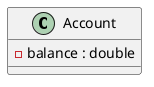


---

### UML: Inheritance arrow pointing the wrong way

**Category:** Semantic error  
**Description:** The inheritance arrow (`--|>`) points from the superclass to the subclass instead of the other way around. In UML the arrow always points to the superclass.

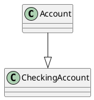

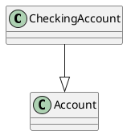

---

### UML: Realization arrow used instead of inheritance for interfaces

**Category:** Semantic error  
**Description:** A class inherits from an interface using `--|>` instead of `..|>`. For interface implementation the dashed realization relationship must be used.


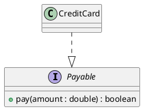

---

### UML: Composition and aggregation confused

**Category:** Semantic error  
**Description:** Composition (`*--`) and aggregation (`o--`) are swapped. Composition means the part only exists as part of the whole (strong dependency). Aggregation means the part can exist independently.

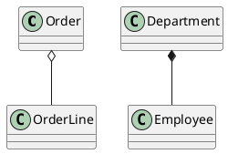

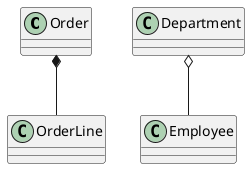

---

### UML: Missing multiplicities on associations

**Category:** Semantic error  
**Description:** An association has no multiplicity annotations. It is therefore unclear how many instances are involved on each side.

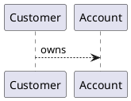

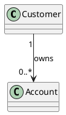

---

### UML: Abstract class declared without the abstract keyword

**Category:** Semantic error  
**Description:** A class with abstract methods or one that should not be instantiated directly is declared as `class` instead of `abstract class`. Abstract methods in a non-abstract class are semantically inconsistent.

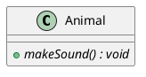

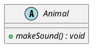

---

### UML: include and extend confused in use case diagrams

**Category:** Semantic error  
**Description:** `<<include>>` and `<<extend>>` are swapped. `<<include>>` means the included UC is always executed. `<<extend>>` means the extension only occurs under certain conditions.

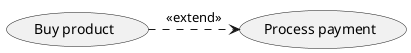

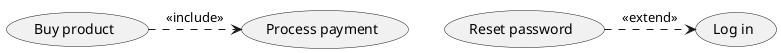

---

### UML: Missing start/stop in activity diagram

**Category:** Syntax error  
**Description:** The activity diagram has no `start` node or no `stop` node. Without these markers the flow is incomplete.

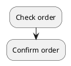

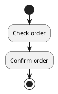

---

### UML: if without endif in activity diagram

**Category:** Syntax error  
**Description:** An `if` branch in an activity diagram is not closed with `endif`. The diagram cannot be parsed correctly.

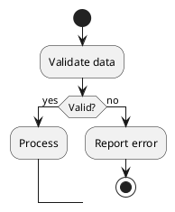

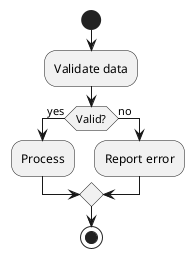

---

### UML: fork without end fork in activity diagram

**Category:** Syntax error  
**Description:** A `fork` block for parallel execution is not closed with `end fork`.

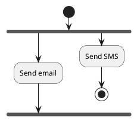

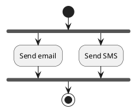

---

### UML: Missing initial state in state diagram

**Category:** Semantic error  
**Description:** The state diagram has no `[*]` starting point. Without an initial state it is unclear which state is active when the system starts.

```plantuml
@startuml
' Wrong: no [*] at the beginning
Locked --> Unlocked : PIN correct
Unlocked --> Locked : Card removed
@enduml
```

```plantuml
@startuml
[*] --> Locked
Locked   --> Unlocked : PIN correct
Unlocked --> [*]      : Card removed
@enduml
```

---

### UML: Dependency used instead of association

**Category:** Semantic error  
**Description:** A permanent structural relationship between classes (e.g. an attribute reference) is shown as a dashed dependency (`..>`) instead of an association (`-->`). Dependencies (`..>`) express a temporary or implicit usage, not a structural relationship.

```plantuml
@startuml
' Wrong: Customer permanently holds accounts → this is an association, not a dependency
Customer ..> Account
@enduml
```

```plantuml
@startuml
' Correct: structural relationship as association
Customer "1" --> "0..*" Account : owns

' Correct: dependency for temporary usage (e.g. method parameter)
OrderController ..> CustomerService : uses
@enduml
```

---

## Petri Nets (PNML Syntax)

### PNML: Missing namespace

**Category:** Syntax error  
**Description:** The `xmlns` attribute is missing from the `<pnml>` root element. Without the namespace the document is not valid PNML.

```xml
<!-- Wrong: no xmlns -->
<pnml>
  <net id="n1" type="http://www.pnml.org/version-2009/grammar/ptnet">
    <page id="p1"/>
  </net>
</pnml>
```

```xml
<!-- Correct -->
<pnml xmlns="http://www.pnml.org/version-2009/grammar/pnml">
  <net id="n1" type="http://www.pnml.org/version-2009/grammar/ptnet">
    <page id="p1"/>
  </net>
</pnml>
```

---

### PNML: Arc between two places

**Category:** Syntax error  
**Description:** An arc directly connects two places. Petri nets are bipartite graphs — arcs may only run between a place and a transition.

```xml
<!-- Wrong: place → place -->
<place id="s_a"/> <place id="s_b"/>
<arc id="a1" source="s_a" target="s_b"/>
```

```xml
<!-- Correct: place → transition → place -->
<place id="s_a"/>
<transition id="t_between"/>
<place id="s_b"/>
<arc id="a1" source="s_a"       target="t_between"/>
<arc id="a2" source="t_between" target="s_b"/>
```

---

### PNML: Arc between two transitions

**Category:** Syntax error  
**Description:** An arc directly connects two transitions. This also violates the bipartite structure of Petri nets.

```xml
<!-- Wrong: transition → transition -->
<transition id="t_a"/> <transition id="t_b"/>
<arc id="a1" source="t_a" target="t_b"/>
```

```xml
<!-- Correct: transition → place → transition -->
<transition id="t_a"/>
<place id="s_between"/>
<transition id="t_b"/>
<arc id="a1" source="t_a"        target="s_between"/>
<arc id="a2" source="s_between"  target="t_b"/>
```

---

### PNML: Missing initialMarking

**Category:** Semantic error  
**Description:** Places have no `<initialMarking>`. The initial state of the net is therefore unspecified. Places without tokens cannot enable any transitions.

```xml
<!-- Wrong: no initialMarking, initial state unclear -->
<place id="s_ready">
  <name><text>Ready</text></name>
</place>
```

```xml
<!-- Correct: initialMarking explicitly set -->
<place id="s_ready">
  <name><text>Ready</text></name>
  <initialMarking><text>1</text></initialMarking>
</place>
```

---

### PNML: Invalid arc reference

**Category:** Syntax error  
**Description:** The `source` or `target` attribute of an arc points to an ID that does not exist in the document.

```xml
<!-- Wrong: s_input does not exist -->
<transition id="t_process"/>
<arc id="a1" source="s_input" target="t_process"/>
```

```xml
<!-- Correct: define the place first, then reference it -->
<place id="s_input">
  <initialMarking><text>1</text></initialMarking>
</place>
<transition id="t_process"/>
<arc id="a1" source="s_input" target="t_process"/>
```

---

### PNML: Missing join after fork (incomplete concurrency)

**Category:** Semantic error  
**Description:** Parallel paths after a fork are never synchronized by a join. The synchronization point is missing, so the process either never fully completes or produces incorrect states.

```xml
<!-- Wrong: fork without join, both paths end separately -->
<transition id="t_fork"/>
<place id="s_a"/> <place id="s_b"/>
<transition id="t_a"/> <transition id="t_b"/>
<place id="s_end_a"/> <place id="s_end_b"/>

<arc id="a1" source="t_fork" target="s_a"/>
<arc id="a2" source="t_fork" target="s_b"/>
<arc id="a3" source="s_a"    target="t_a"/>
<arc id="a4" source="s_b"    target="t_b"/>
<arc id="a5" source="t_a"    target="s_end_a"/>
<arc id="a6" source="t_b"    target="s_end_b"/>
<!-- No join: s_end_a and s_end_b are never merged -->
```

```xml
<!-- Correct: join synchronizes both paths -->
<place id="s_done_a"/> <place id="s_done_b"/>
<transition id="t_join"/>
<place id="s_end"/>

<arc id="a5" source="t_a"      target="s_done_a"/>
<arc id="a6" source="t_b"      target="s_done_b"/>
<arc id="a7" source="s_done_a" target="t_join"/>
<arc id="a8" source="s_done_b" target="t_join"/>
<arc id="a9" source="t_join"   target="s_end"/>
```

---

### PNML: Deadlock in the initial marking

**Category:** Semantic error  
**Description:** No transition is enabled in the initial marking because no place in the preset of any transition holds a token. The net is blocked from the very beginning.

```xml
<!-- Wrong: all places have 0 tokens → no transition can fire -->
<place id="s_a"> <initialMarking><text>0</text></initialMarking> </place>
<place id="s_b"> <initialMarking><text>0</text></initialMarking> </place>
<transition id="t_1"/>
<arc id="a1" source="s_a" target="t_1"/>
<arc id="a2" source="t_1" target="s_b"/>
```

```xml
<!-- Correct: at least one starting place holds a token -->
<place id="s_a"> <initialMarking><text>1</text></initialMarking> </place>
<place id="s_b"> <initialMarking><text>0</text></initialMarking> </place>
<transition id="t_1"/>
<arc id="a1" source="s_a" target="t_1"/>
<arc id="a2" source="t_1" target="s_b"/>
```

---

### PNML: Missing arc weight in Petri net

**Category:** Semantic error  
**Description:** In an petri net where a transition is intended to consume or produce multiple tokens, the `<inscription>` on the arc is missing. Without a weight the value defaults to 1, leading to incorrect firing conditions.

```xml
<!-- Wrong: arc should transfer 3 tokens, inscription missing -->
<arc id="a1" source="t_store" target="s_warehouse"/>
```

```xml
<!-- Correct: weight explicitly specified -->
<arc id="a1" source="t_store" target="s_warehouse">
  <inscription><text>3</text></inscription>
</arc>
```

---

### PNML: Isolated place or dead transition

**Category:** Semantic error  
**Description:** A place or transition is not connected to the rest of the net. Unreachable places are never marked; dead transitions can never fire. Both indicate a modeling error.

```xml
<!-- Wrong: s_isolated has no arcs -->
<place id="s_main">     <initialMarking><text>1</text></initialMarking> </place>
<place id="s_isolated"> <initialMarking><text>0</text></initialMarking> </place>
<transition id="t_1"/>
<arc id="a1" source="s_main" target="t_1"/>
<!-- s_isolated is not connected to any transition -->
```

```xml
<!-- Correct: every place is connected to at least one transition -->
<place id="s_main">   <initialMarking><text>1</text></initialMarking> </place>
<place id="s_result"> <initialMarking><text>0</text></initialMarking> </place>
<transition id="t_1"/>
<arc id="a1" source="s_main"   target="t_1"/>
<arc id="a2" source="t_1"      target="s_result"/>
```

---

### PNML Missing names on places and transitions

**Category:** Semantic error  
**Description:** Places and transitions have no `<name>` elements. Without names the net is uninterpretable without additional context — it is unclear which states and events are being modeled.

```xml
<!-- Wrong: no names -->
<place id="s1"> <initialMarking><text>1</text></initialMarking> </place>
<transition id="t1"/>
<arc id="a1" source="s1" target="t1"/>
```

```xml
<!-- Correct: meaningful names -->
<place id="s_ready">
  <name><text>Ready</text></name>
  <initialMarking><text>1</text></initialMarking>
</place>
<transition id="t_produce">
  <name><text>Produce</text></name>
</transition>
<arc id="a1" source="s_ready" target="t_produce"/>
```
