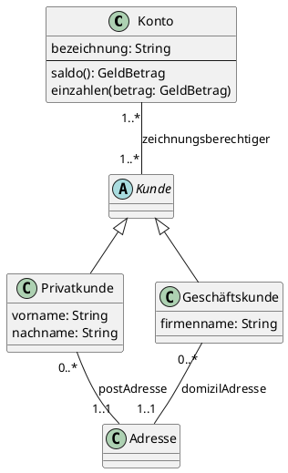
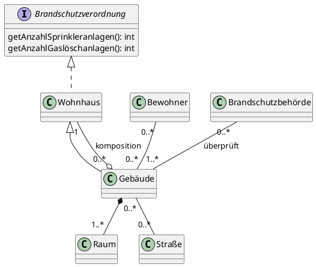
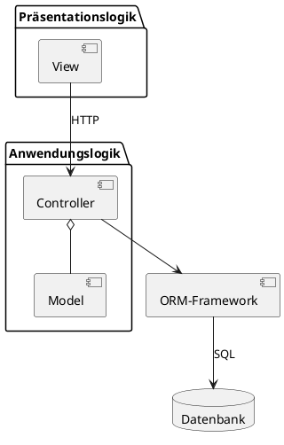
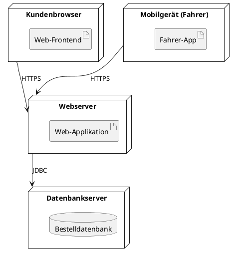
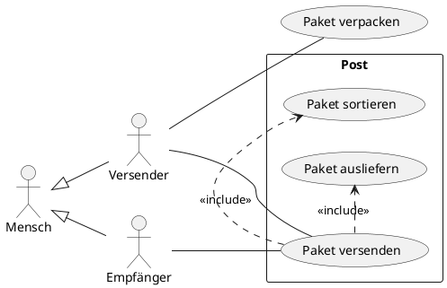
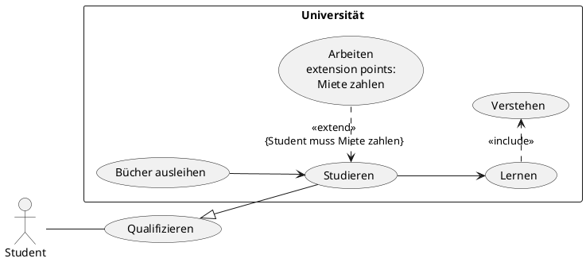
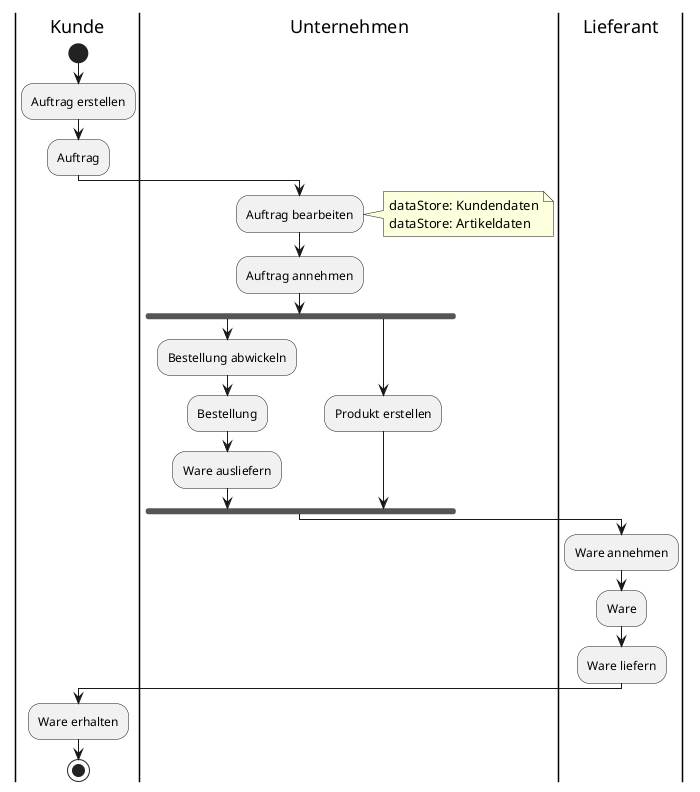
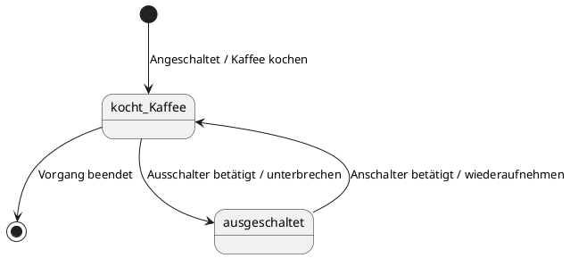
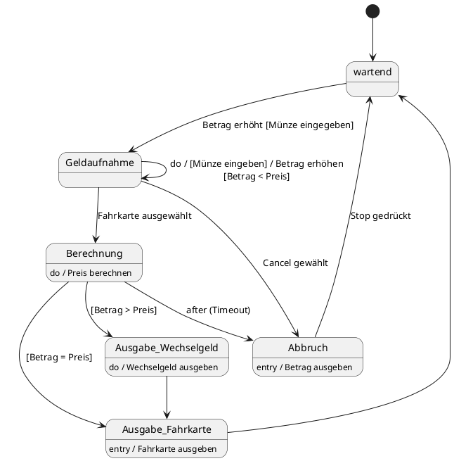

# Diagram Examples

---

## BPMN 2.0 Examples

---

### BPMN-EX-01: Lecture Process (Process Diagram)

A minimal linear process diagram showing the sequence of a student's actions during a lecture: turning on a laptop, interacting with Facebook, and turning it off again. Demonstrates start event, end event, a generic task, a service task, and sequential sequence flows — the simplest possible complete BPMN process.

```xml
<?xml version="1.0" encoding="UTF-8"?>
<definitions xmlns="http://www.omg.org/spec/BPMN/20100524/MODEL"
             xmlns:xsi="http://www.w3.org/2001/XMLSchema-instance"
             targetNamespace="http://example.org/prozessdiagramm">
  <process id="prozess_vorlesung" name="Vorlesung" isExecutable="false">

    <startEvent id="start" name="Vorlesung beginnt"/>
    <sequenceFlow id="sf1" sourceRef="start" targetRef="task_laptop_ein"/>

    <task id="task_laptop_ein" name="Laptop einschalten"/>
    <sequenceFlow id="sf2" sourceRef="task_laptop_ein" targetRef="task_facebook"/>

    <serviceTask id="task_facebook" name="Mit Facebook interagieren"/>
    <sequenceFlow id="sf3" sourceRef="task_facebook" targetRef="task_laptop_aus"/>

    <task id="task_laptop_aus" name="Laptop ausschalten"/>
    <sequenceFlow id="sf4" sourceRef="task_laptop_aus" targetRef="end"/>

    <endEvent id="end" name="Vorlesung endet"/>

  </process>
</definitions>
```

---

### BPMN-EX-02: Thesis Topic Negotiation (Collaboration Diagram)

A collaboration diagram with two pools — Student and Employee (Mitarbeiter) — modeling the exchange of messages during thesis topic negotiation. Demonstrates two independent process pools, three message flows between them, and how each pool has its own start and end event. Shows that message flows run between pools, not within them.

```xml
<?xml version="1.0" encoding="UTF-8"?>
<definitions xmlns="http://www.omg.org/spec/BPMN/20100524/MODEL"
             targetNamespace="http://example.org/kollaboration">
  <collaboration id="collab_bachelorarbeit">

    <participant id="pool_student"     name="Student"     processRef="proc_student"/>
    <participant id="pool_mitarbeiter" name="Mitarbeiter" processRef="proc_mitarbeiter"/>

    <messageFlow id="mf1" name="Anfrage"
                 sourceRef="task_thema_versenden" targetRef="task_thema_erhalten"/>
    <messageFlow id="mf2" name="Konkretisiere das bitte in Hinblick auf Y"
                 sourceRef="task_aenderung_machen" targetRef="task_aenderung_erhalten"/>
    <messageFlow id="mf3" name="Ich habe die Vorschläge im Exposé eingearbeitet"
                 sourceRef="task_expose_schicken" targetRef="task_expose_erhalten"/>

  </collaboration>

  <process id="proc_student" name="Student">
    <startEvent id="start_s"/>
    <sequenceFlow id="sf_s1" sourceRef="start_s"               targetRef="task_thema_versenden"/>
    <task id="task_thema_versenden"  name="Thema für Abschlussarbeit versenden"/>
    <sequenceFlow id="sf_s2" sourceRef="task_thema_versenden"  targetRef="task_aenderung_erhalten"/>
    <task id="task_aenderung_erhalten" name="Änderungsvorschläge erhalten"/>
    <sequenceFlow id="sf_s3" sourceRef="task_aenderung_erhalten" targetRef="task_expose_schicken"/>
    <task id="task_expose_schicken"  name="Exposé schicken"/>
    <sequenceFlow id="sf_s4" sourceRef="task_expose_schicken"  targetRef="end_s"/>
    <endEvent id="end_s"/>
  </process>

  <process id="proc_mitarbeiter" name="Mitarbeiter">
    <startEvent id="start_m"/>
    <sequenceFlow id="sf_m1" sourceRef="start_m"               targetRef="task_thema_erhalten"/>
    <task id="task_thema_erhalten"   name="Thema für Abschlussarbeit erhalten"/>
    <sequenceFlow id="sf_m2" sourceRef="task_thema_erhalten"   targetRef="task_aenderung_machen"/>
    <task id="task_aenderung_machen" name="Änderungsvorschläge machen"/>
    <sequenceFlow id="sf_m3" sourceRef="task_aenderung_machen" targetRef="task_expose_erhalten"/>
    <task id="task_expose_erhalten"  name="Exposé erhalten"/>
    <sequenceFlow id="sf_m4" sourceRef="task_expose_erhalten"  targetRef="end_m"/>
    <endEvent id="end_m"/>
  </process>
</definitions>
```

---

### BPMN-EX-03: Thesis Review (Conversation Diagram)

A conversation diagram showing the grouped message exchange between Student and Employee during a thesis review process. Demonstrates the conversation diagram type, which abstracts individual message flows into named communication groups (conversations) between participants.

```xml
<?xml version="1.0" encoding="UTF-8"?>
<definitions xmlns="http://www.omg.org/spec/BPMN/20100524/MODEL"
             targetNamespace="http://example.org/konversation">
  <collaboration id="konv_review">

    <participant id="part_student"     name="Student"/>
    <participant id="part_mitarbeiter" name="Mitarbeiter"/>

    <conversation id="conv1" name="Review anbahnen und abschließen">
      <participantRef>part_student</participantRef>
      <participantRef>part_mitarbeiter</participantRef>
    </conversation>

  </collaboration>
</definitions>
```

---

### BPMN-EX-04: Thesis Final Review (Choreography Diagram)

A choreography diagram showing three interaction steps between Student, Employee, and Professor during the finalization of a thesis. Demonstrates the choreography diagram type, where each choreography task shows which participant initiates the interaction and what messages are exchanged. Participants appear as bands inside the task box rather than in separate pools.

```xml
<?xml version="1.0" encoding="UTF-8"?>
<definitions xmlns="http://www.omg.org/spec/BPMN/20100524/MODEL"
             targetNamespace="http://example.org/choreographie">
  <choreography id="choreo_abschlussarbeit" name="Abschlussarbeit Bewertung">

    <startEvent id="choreo_start"/>
    <sequenceFlow id="csf1" sourceRef="choreo_start" targetRef="ctask1"/>

    <choreographyTask id="ctask1"
                      name="Letztes Korrekturlesen der Abschlussarbeit durch den Betreuer"
                      initiatingParticipantRef="cpart_student">
      <participantRef>cpart_student</participantRef>
      <participantRef>cpart_mitarbeiter</participantRef>
      <messageFlowRef>cmf_abschlussarbeit</messageFlowRef>
      <messageFlowRef>cmf_anmerkungen</messageFlowRef>
    </choreographyTask>

    <sequenceFlow id="csf2" sourceRef="ctask1" targetRef="ctask2"/>

    <choreographyTask id="ctask2"
                      name="Aufforderung zum Einarbeiten der Anmerkungen"
                      initiatingParticipantRef="cpart_mitarbeiter">
      <participantRef>cpart_student</participantRef>
      <participantRef>cpart_mitarbeiter</participantRef>
    </choreographyTask>

    <sequenceFlow id="csf3" sourceRef="ctask2" targetRef="ctask3"/>

    <choreographyTask id="ctask3"
                      name="Bewertung der finalisierten Abschlussarbeit durch den Professor"
                      initiatingParticipantRef="cpart_student">
      <participantRef>cpart_student</participantRef>
      <participantRef>cpart_professor</participantRef>
      <messageFlowRef>cmf_finale_abschlussarbeit</messageFlowRef>
      <messageFlowRef>cmf_note</messageFlowRef>
    </choreographyTask>

    <sequenceFlow id="csf4" sourceRef="ctask3" targetRef="choreo_end"/>
    <endEvent id="choreo_end"/>

    <participant id="cpart_student"     name="Student"/>
    <participant id="cpart_mitarbeiter" name="Mitarbeiter"/>
    <participant id="cpart_professor"   name="Professor"/>

    <messageFlow id="cmf_abschlussarbeit"      name="Abschlussarbeit"
                 sourceRef="cpart_student"     targetRef="ctask1"/>
    <messageFlow id="cmf_anmerkungen"          name="Anmerkungen"
                 sourceRef="cpart_mitarbeiter" targetRef="ctask1"/>
    <messageFlow id="cmf_finale_abschlussarbeit" name="finale Abschlussarbeit"
                 sourceRef="cpart_student"     targetRef="ctask3"/>
    <messageFlow id="cmf_note"                 name="Note"
                 sourceRef="cpart_professor"   targetRef="ctask3"/>

  </choreography>
</definitions>
```

---

### BPMN-EX-05: Thesis Supervision Request (Collaboration with Swimlanes, Data Objects)

A collaboration diagram with two pools (Student and Professor), each subdivided into swimlane lanes, modeling the full exchange required for a student to request thesis supervision. Demonstrates lanes within pools, message events (send/receive), data objects with data associations, and an exclusive gateway for the professor's decision on the submitted exposé.

```xml
<?xml version="1.0" encoding="UTF-8"?>
<definitions xmlns="http://www.omg.org/spec/BPMN/20100524/MODEL"
             targetNamespace="http://example.org/bachelorarbeit-anfrage">
  <collaboration id="collab_ba">
    <participant id="pool_student"   name="Student"   processRef="proc_student"/>
    <participant id="pool_professor" name="Professor" processRef="proc_professor"/>

    <messageFlow id="mf1" name="Anfrage"
                 sourceRef="throw_anfrage"     targetRef="catch_anfrage"/>
    <messageFlow id="mf2" name="Anforderung Exposé"
                 sourceRef="throw_bitte_expose" targetRef="catch_bitte_expose"/>
    <messageFlow id="mf3" name="Exposé"
                 sourceRef="throw_expose"      targetRef="catch_expose"/>
  </collaboration>

  <process id="proc_student" name="Student">
    <laneSet id="ls_s">
      <lane id="lane_s" name="Student">
        <flowNodeRef>start_s</flowNodeRef>
        <flowNodeRef>task_anfrage</flowNodeRef>
        <flowNodeRef>throw_anfrage</flowNodeRef>
        <flowNodeRef>catch_bitte_expose</flowNodeRef>
        <flowNodeRef>task_expose_formulieren</flowNodeRef>
        <flowNodeRef>throw_expose</flowNodeRef>
      </lane>
    </laneSet>

    <startEvent id="start_s"/>
    <sequenceFlow id="sfs1" sourceRef="start_s"             targetRef="task_anfrage"/>
    <task id="task_anfrage" name="Anfrage für Betreuung der Bachelorarbeit formulieren"/>
    <sequenceFlow id="sfs2" sourceRef="task_anfrage"        targetRef="throw_anfrage"/>
    <intermediateThrowEvent id="throw_anfrage" name="Anfrage versendet">
      <messageEventDefinition/>
    </intermediateThrowEvent>
    <sequenceFlow id="sfs3" sourceRef="throw_anfrage"       targetRef="catch_bitte_expose"/>
    <intermediateCatchEvent id="catch_bitte_expose" name="Bitte um Exposé erhalten">
      <messageEventDefinition/>
    </intermediateCatchEvent>
    <sequenceFlow id="sfs4" sourceRef="catch_bitte_expose"  targetRef="task_expose_formulieren"/>
    <task id="task_expose_formulieren" name="Exposé formulieren"/>
    <sequenceFlow id="sfs5" sourceRef="task_expose_formulieren" targetRef="throw_expose"/>
    <intermediateThrowEvent id="throw_expose" name="Exposé verschicken">
      <messageEventDefinition/>
    </intermediateThrowEvent>
    <dataObjectReference id="dor_expose" name="Exposé"/>
    <dataOutputAssociation id="doa1" sourceRef="task_expose_formulieren" targetRef="dor_expose"/>
    <dataInputAssociation  id="dia1" sourceRef="dor_expose"              targetRef="throw_expose"/>
  </process>

  <process id="proc_professor" name="Professor">
    <laneSet id="ls_p">
      <lane id="lane_p" name="Professor">
        <flowNodeRef>catch_anfrage</flowNodeRef>
        <flowNodeRef>task_bitte_formulieren</flowNodeRef>
        <flowNodeRef>throw_bitte_expose</flowNodeRef>
        <flowNodeRef>catch_expose</flowNodeRef>
        <flowNodeRef>task_expose_pruefen</flowNodeRef>
        <flowNodeRef>gw_expose</flowNodeRef>
        <flowNodeRef>task_anmeldung</flowNodeRef>
        <flowNodeRef>task_kommentarlos</flowNodeRef>
        <flowNodeRef>end_p</flowNodeRef>
      </lane>
    </laneSet>

    <intermediateCatchEvent id="catch_anfrage" name="Anfrage erhalten">
      <messageEventDefinition/>
    </intermediateCatchEvent>
    <sequenceFlow id="sfp1" sourceRef="catch_anfrage"        targetRef="task_bitte_formulieren"/>
    <task id="task_bitte_formulieren" name="Bitte um Exposé formulieren"/>
    <sequenceFlow id="sfp2" sourceRef="task_bitte_formulieren" targetRef="throw_bitte_expose"/>
    <intermediateThrowEvent id="throw_bitte_expose" name="Bitte um Exposé verschickt">
      <messageEventDefinition/>
    </intermediateThrowEvent>
    <sequenceFlow id="sfp3" sourceRef="throw_bitte_expose"   targetRef="catch_expose"/>
    <intermediateCatchEvent id="catch_expose" name="Exposé erhalten">
      <messageEventDefinition/>
    </intermediateCatchEvent>
    <sequenceFlow id="sfp4" sourceRef="catch_expose"         targetRef="task_expose_pruefen"/>
    <task id="task_expose_pruefen" name="Exposé prüfen"/>
    <sequenceFlow id="sfp5" sourceRef="task_expose_pruefen"  targetRef="gw_expose"/>
    <exclusiveGateway id="gw_expose" name="Exposé akzeptiert?"/>
    <sequenceFlow id="sfp6" name="Ja"   sourceRef="gw_expose" targetRef="task_anmeldung"/>
    <sequenceFlow id="sfp7" name="Nein" sourceRef="gw_expose" targetRef="task_kommentarlos"/>
    <task id="task_anmeldung"    name="Anmeldung unterschreiben"/>
    <task id="task_kommentarlos" name="Kommentarlos ignorieren"/>
    <sequenceFlow id="sfp8" sourceRef="task_anmeldung"    targetRef="end_p"/>
    <sequenceFlow id="sfp9" sourceRef="task_kommentarlos" targetRef="end_p"/>
    <endEvent id="end_p"/>
  </process>
</definitions>
```

---

### BPMN-EX-06: Bachelor Thesis Evaluation (Complex Process)

A single-pool process modeling a professor's workflow for evaluating a bachelor thesis from registration to final grade announcement. Demonstrates a wide range of BPMN elements in combination: message start event, event-based gateways, timer and conditional intermediate catch events, exclusive gateways, multi-instance loop tasks, signal throw event, data objects with input/output associations, and both message and terminate end events.

```xml
<?xml version="1.0" encoding="UTF-8"?>
<definitions xmlns="http://www.omg.org/spec/BPMN/20100524/MODEL"
             targetNamespace="http://example.org/bachelorarbeit-bewertung">
  <process id="proc_bewertung" name="Bewertung einer Bachelorarbeit" isExecutable="false">

    <startEvent id="start">
      <messageEventDefinition/>
    </startEvent>
    <dataObjectReference id="dor_ba_angemeldet" name="BA ist angemeldet"/>
    <sequenceFlow id="sf1" sourceRef="start" targetRef="gw_xor_start"/>

    <exclusiveGateway id="gw_xor_start"/>
    <sequenceFlow id="sf2" sourceRef="gw_xor_start" targetRef="task_frist_eintragen"/>

    <task id="task_frist_eintragen" name="Abgabefrist im Kalender eintragen"/>
    <sequenceFlow id="sf3" sourceRef="task_frist_eintragen" targetRef="gw_event_wait"/>

    <!-- Event-based gateway: waits for either the thesis or deadline expiry -->
    <eventBasedGateway id="gw_event_wait"/>
    <sequenceFlow id="sf4" sourceRef="gw_event_wait" targetRef="catch_ba_erhalten"/>
    <sequenceFlow id="sf5" sourceRef="gw_event_wait" targetRef="catch_frist_ablauf"/>

    <!-- Path 1: Thesis received -->
    <intermediateCatchEvent id="catch_ba_erhalten" name="BA erhalten">
      <messageEventDefinition/>
    </intermediateCatchEvent>
    <dataObjectReference id="dor_ba" name="BA"/>
    <dataInputAssociation id="dia_ba" sourceRef="dor_ba" targetRef="catch_ba_erhalten"/>
    <sequenceFlow id="sf6" sourceRef="catch_ba_erhalten" targetRef="task_lesen"/>

    <task id="task_lesen" name="Bachelorarbeit lesen">
      <multiInstanceLoopCharacteristics isSequential="true"/>
    </task>
    <sequenceFlow id="sf7" sourceRef="task_lesen" targetRef="gw_plagiat"/>

    <exclusiveGateway id="gw_plagiat" name="Plagiat?"/>
    <sequenceFlow id="sf8" name="Plagiat entdeckt" sourceRef="gw_plagiat" targetRef="task_plagiat_melden"/>
    <sequenceFlow id="sf9" name="Kein Plagiat"     sourceRef="gw_plagiat" targetRef="task_gutachten"/>

    <task id="task_plagiat_melden" name="Plagiat ans Prüfungsamt melden"/>
    <sequenceFlow id="sf10" sourceRef="task_plagiat_melden" targetRef="end_plagiat"/>
    <endEvent id="end_plagiat">
      <messageEventDefinition/>
    </endEvent>

    <task id="task_gutachten" name="Gutachten schreiben">
      <multiInstanceLoopCharacteristics isSequential="true"/>
    </task>
    <sequenceFlow id="sf11" sourceRef="task_gutachten" targetRef="gw_traurig"/>

    <!-- Event-based gateway: sad or not sad after writing the report -->
    <eventBasedGateway id="gw_traurig" name="Traurig?"/>
    <sequenceFlow id="sf12" name="traurig" sourceRef="gw_traurig" targetRef="task_musik_an"/>
    <sequenceFlow id="sf13"               sourceRef="gw_traurig" targetRef="task_termin_mitteilen"/>

    <task id="task_musik_an" name="Musik anschalten"/>
    <sequenceFlow id="sf14" sourceRef="task_musik_an" targetRef="gw_event_musik"/>

    <!-- Event-based gateway: music off after 10 min or when no longer sad -->
    <eventBasedGateway id="gw_event_musik"/>
    <sequenceFlow id="sf15" sourceRef="gw_event_musik" targetRef="catch_10min"/>
    <sequenceFlow id="sf16" sourceRef="gw_event_musik" targetRef="catch_nicht_traurig"/>

    <intermediateCatchEvent id="catch_10min" name="10 Minuten vergangen">
      <timerEventDefinition/>
    </intermediateCatchEvent>
    <intermediateCatchEvent id="catch_nicht_traurig" name="nicht mehr traurig">
      <conditionalEventDefinition/>
    </intermediateCatchEvent>
    <sequenceFlow id="sf17" sourceRef="catch_10min"          targetRef="gw_xor_musik_join"/>
    <sequenceFlow id="sf18" sourceRef="catch_nicht_traurig"  targetRef="gw_xor_musik_join"/>

    <exclusiveGateway id="gw_xor_musik_join"/>
    <sequenceFlow id="sf19" sourceRef="gw_xor_musik_join" targetRef="task_musik_aus"/>

    <task id="task_musik_aus" name="Musik ausschalten"/>
    <sequenceFlow id="sf20" sourceRef="task_musik_aus" targetRef="task_termin_mitteilen"/>

    <task id="task_termin_mitteilen" name="Student Termin der Verteidigung mitteilen"/>
    <sequenceFlow id="sf21" sourceRef="task_termin_mitteilen" targetRef="catch_terminbestaetigung"/>

    <intermediateCatchEvent id="catch_terminbestaetigung" name="Terminbestätigung">
      <messageEventDefinition/>
    </intermediateCatchEvent>
    <sequenceFlow id="sf22" sourceRef="catch_terminbestaetigung" targetRef="task_termin_ankuendigen"/>

    <task id="task_termin_ankuendigen" name="Termin ankündigen"/>
    <dataObjectReference id="dor_ankuendigung" name="Ankündigung"/>
    <dataOutputAssociation id="doa_ankuendigung"
                           sourceRef="task_termin_ankuendigen" targetRef="dor_ankuendigung"/>
    <sequenceFlow id="sf23" sourceRef="task_termin_ankuendigen" targetRef="catch_verteidigung"/>

    <intermediateCatchEvent id="catch_verteidigung" name="Verteidigungstermin erreicht">
      <timerEventDefinition/>
    </intermediateCatchEvent>
    <dataObjectReference id="dor_termin" name="Termin"/>
    <dataInputAssociation id="dia_termin" sourceRef="dor_termin" targetRef="catch_verteidigung"/>
    <sequenceFlow id="sf24" sourceRef="catch_verteidigung" targetRef="task_vortrag"/>

    <task id="task_vortrag" name="Vortrag hören"/>
    <sequenceFlow id="sf25" sourceRef="task_vortrag" targetRef="task_note"/>

    <task id="task_note" name="Note verkünden"/>
    <sequenceFlow id="sf26" sourceRef="task_note" targetRef="end_normal"/>
    <endEvent id="end_normal">
      <messageEventDefinition/>
    </endEvent>

    <!-- Path 2: Deadline expired -->
    <intermediateCatchEvent id="catch_frist_ablauf" name="Frist abgelaufen">
      <timerEventDefinition/>
    </intermediateCatchEvent>
    <sequenceFlow id="sf27" sourceRef="catch_frist_ablauf" targetRef="task_erkundigung"/>

    <task id="task_erkundigung" name="Erkundigung beim Prüfungsamt einholen"/>
    <sequenceFlow id="sf28" sourceRef="task_erkundigung" targetRef="gw_verlaengerung"/>

    <eventBasedGateway id="gw_verlaengerung" name="Verlängerung?"/>
    <sequenceFlow id="sf29" name="keine Verlängerung gewährt"
                  sourceRef="gw_verlaengerung" targetRef="end_keine_verlaengerung"/>
    <sequenceFlow id="sf30" name="Verlängerung gewährt"
                  sourceRef="gw_verlaengerung" targetRef="catch_verlaengerung"/>

    <endEvent id="end_keine_verlaengerung">
      <terminateEventDefinition/>
    </endEvent>

    <intermediateCatchEvent id="catch_verlaengerung" name="Verlängerung gewährt">
      <messageEventDefinition/>
    </intermediateCatchEvent>
    <sequenceFlow id="sf31" sourceRef="catch_verlaengerung" targetRef="task_neue_frist"/>

    <task id="task_neue_frist" name="Neue Frist im Kalender eintragen"/>
    <sequenceFlow id="sf32" sourceRef="task_neue_frist" targetRef="gw_event_wait"/>

  </process>
</definitions>
```

---

## Petri Net Examples

---

### PN-EX-01: Library Use (B/E Net — Sequence and Conflict)

A Condition/Event net modeling library book borrowing. Shows two transitions (Ausleihe and Rückgabe) sharing the place "Nutzer an Theke", creating a conflict — only one can fire at a time. Demonstrates how places model conditions (book available, user at desk) and transitions model events (loan, return). Initial marking: book available.

```xml
<?xml version="1.0" encoding="UTF-8"?>
<pnml xmlns="http://www.pnml.org/version-2009/grammar/pnml">
  <net id="bibliothek" type="http://www.pnml.org/version-2009/grammar/ptnet">
    <name><text>Bibliotheksbenutzung</text></name>
    <page id="p0">

      <place id="s_nutzer_an_theke">
        <name><text>Nutzer an Theke</text></name>
        <initialMarking><text>0</text></initialMarking>
      </place>
      <place id="s_buch_ausleihbar">
        <name><text>Buch ausleihbar</text></name>
        <initialMarking><text>1</text></initialMarking>
      </place>

      <transition id="t_nutzer_trifft_ein">
        <name><text>Nutzer trifft ein</text></name>
      </transition>
      <transition id="t_ausleihe">
        <name><text>Ausleihe</text></name>
      </transition>
      <transition id="t_rueckgabe">
        <name><text>Rückgabe</text></name>
      </transition>

      <arc id="a1" source="t_nutzer_trifft_ein" target="s_nutzer_an_theke">
        <inscription><text>1</text></inscription>
      </arc>
      <arc id="a2" source="s_nutzer_an_theke"  target="t_ausleihe">
        <inscription><text>1</text></inscription>
      </arc>
      <arc id="a3" source="s_nutzer_an_theke"  target="t_rueckgabe">
        <inscription><text>1</text></inscription>
      </arc>
      <arc id="a4" source="s_buch_ausleihbar"  target="t_ausleihe">
        <inscription><text>1</text></inscription>
      </arc>
      <arc id="a5" source="t_rueckgabe"        target="s_buch_ausleihbar">
        <inscription><text>1</text></inscription>
      </arc>

    </page>
  </net>
</pnml>
```

---

### PN-EX-02: Seasons (B/E Net — Cycle with Auxiliary Conditions)

A cyclic B/E net modeling the four seasons as a permanently repeating sequence. Uses auxiliary condition places ("Nicht Herbst", "Winter oder Frühling") to encode enabling constraints that prevent seasons from occurring out of order. Demonstrates how B/E nets model cyclic processes and how auxiliary places express conditions that cannot be derived from the main cycle alone. Initial marking: Winter = 1, Nicht Herbst = 1, Winter oder Frühling = 1.

```xml
<?xml version="1.0" encoding="UTF-8"?>
<pnml xmlns="http://www.pnml.org/version-2009/grammar/pnml">
  <net id="jahreszeiten" type="http://www.pnml.org/version-2009/grammar/ptnet">
    <name><text>Jahreszeiten</text></name>
    <page id="p0">

      <place id="s_fruehling">
        <name><text>Frühling</text></name>
        <initialMarking><text>0</text></initialMarking>
      </place>
      <place id="s_sommer">
        <name><text>Sommer</text></name>
        <initialMarking><text>0</text></initialMarking>
      </place>
      <place id="s_herbst">
        <name><text>Herbst</text></name>
        <initialMarking><text>0</text></initialMarking>
      </place>
      <place id="s_winter">
        <name><text>Winter</text></name>
        <initialMarking><text>1</text></initialMarking>
      </place>
      <place id="s_nicht_herbst">
        <name><text>Nicht Herbst</text></name>
        <initialMarking><text>1</text></initialMarking>
      </place>
      <place id="s_winter_fruehling">
        <name><text>Winter oder Frühling</text></name>
        <initialMarking><text>1</text></initialMarking>
      </place>

      <transition id="t_fruehlingsanfang">
        <name><text>Frühlingsanfang</text></name>
      </transition>
      <transition id="t_sommeranfang">
        <name><text>Sommeranfang</text></name>
      </transition>
      <transition id="t_herbstanfang">
        <name><text>Herbstanfang</text></name>
      </transition>
      <transition id="t_winteranfang">
        <name><text>Winteranfang</text></name>
      </transition>

      <arc id="a1"  source="s_winter"           target="t_fruehlingsanfang"/>
      <arc id="a2"  source="t_fruehlingsanfang"  target="s_fruehling"/>
      <arc id="a3"  source="s_nicht_herbst"      target="t_sommeranfang"/>
      <arc id="a4"  source="t_fruehlingsanfang"  target="s_nicht_herbst"/>
      <arc id="a5"  source="s_fruehling"         target="t_sommeranfang"/>
      <arc id="a6"  source="t_sommeranfang"      target="s_sommer"/>
      <arc id="a7"  source="s_winter_fruehling"  target="t_herbstanfang"/>
      <arc id="a8"  source="s_sommer"            target="t_herbstanfang"/>
      <arc id="a9"  source="t_herbstanfang"      target="s_herbst"/>
      <arc id="a10" source="s_herbst"            target="t_winteranfang"/>
      <arc id="a11" source="t_winteranfang"      target="s_winter"/>
      <arc id="a12" source="t_winteranfang"      target="s_nicht_herbst"/>
      <arc id="a13" source="t_winteranfang"      target="s_winter_fruehling"/>

    </page>
  </net>
</pnml>
```

---

### PN-EX-03: Hairdresser (B/E Net — Concurrency with Fork and Join)

A B/E net modeling a hairdresser salon visit where hair cutting and manicure happen concurrently after the customer arrives. Demonstrates the fork/join pattern: one transition (Aufteilen) produces tokens into two places simultaneously, enabling two independent transitions (Haare schneiden, Maniküre) to fire in any order or concurrently. The join transition (Kunde fertig) requires tokens from both parallel branches before firing. Initial marking: Kunde wartet = 0 (customer has not yet arrived).

```xml
<?xml version="1.0" encoding="UTF-8"?>
<pnml xmlns="http://www.pnml.org/version-2009/grammar/pnml">
  <net id="friseursalon" type="http://www.pnml.org/version-2009/grammar/ptnet">
    <name><text>Friseursalon</text></name>
    <page id="p0">

      <place id="s_kunde_wartet">
        <name><text>Kunde wartet</text></name>
        <initialMarking><text>0</text></initialMarking>
      </place>
      <place id="s_haare_bereit">
        <name><text>Haare bereit</text></name>
        <initialMarking><text>0</text></initialMarking>
      </place>
      <place id="s_manikuere_bereit">
        <name><text>Maniküre bereit</text></name>
        <initialMarking><text>0</text></initialMarking>
      </place>
      <place id="s_haare_fertig">
        <name><text>Haare fertig</text></name>
        <initialMarking><text>0</text></initialMarking>
      </place>
      <place id="s_manikuere_fertig">
        <name><text>Maniküre fertig</text></name>
        <initialMarking><text>0</text></initialMarking>
      </place>

      <transition id="t_kunde_trifft_ein">
        <name><text>Kunde trifft ein</text></name>
      </transition>
      <transition id="t_fork">
        <name><text>Aufteilen</text></name>
      </transition>
      <transition id="t_haare_schneiden">
        <name><text>Haare schneiden</text></name>
      </transition>
      <transition id="t_manikuere">
        <name><text>Maniküre</text></name>
      </transition>
      <transition id="t_fertig">
        <name><text>Kunde fertig</text></name>
      </transition>

      <arc id="a1"  source="t_kunde_trifft_ein"  target="s_kunde_wartet"/>
      <arc id="a2"  source="s_kunde_wartet"      target="t_fork"/>
      <arc id="a3"  source="t_fork"              target="s_haare_bereit"/>
      <arc id="a4"  source="t_fork"              target="s_manikuere_bereit"/>
      <arc id="a5"  source="s_haare_bereit"      target="t_haare_schneiden"/>
      <arc id="a6"  source="s_manikuere_bereit"  target="t_manikuere"/>
      <arc id="a7"  source="t_haare_schneiden"   target="s_haare_fertig"/>
      <arc id="a8"  source="t_manikuere"         target="s_manikuere_fertig"/>
      <arc id="a9"  source="s_haare_fertig"      target="t_fertig"/>
      <arc id="a10" source="s_manikuere_fertig"  target="t_fertig"/>

    </page>
  </net>
</pnml>
```

---

### PN-EX-04: Producer-Consumer System (S/T Net — Arc Weights and Capacity)

An S/T net with two cyclic processes coupled through a shared buffer. The producer deposits 2 tokens per cycle; the consumer withdraws 3. The buffer has a capacity of 6; the consumer's local buffer has capacity 2. Demonstrates arc weights greater than 1, capacity constraints on places, and how these enforce resource limits that are not expressible in a plain B/E net. Both transitions are concurrently enabled once the buffer holds enough tokens.

```xml
<?xml version="1.0" encoding="UTF-8"?>
<pnml xmlns="http://www.pnml.org/version-2009/grammar/pnml">
  <net id="erzeuger_verbraucher" type="http://www.pnml.org/version-2009/grammar/ptnet">
    <name><text>Erzeuger-Verbraucher-System</text></name>
    <page id="p0">

      <place id="s_e_bereit">
        <name><text>Erzeuger bereit</text></name>
        <initialMarking><text>1</text></initialMarking>
      </place>
      <place id="s_e_produziert">
        <name><text>Erzeuger produziert</text></name>
        <initialMarking><text>0</text></initialMarking>
      </place>
      <place id="s_speicher">
        <name><text>Speicher</text></name>
        <capacity><text>6</text></capacity>
        <initialMarking><text>0</text></initialMarking>
      </place>
      <place id="s_v_bereit">
        <name><text>Verbraucher bereit</text></name>
        <initialMarking><text>1</text></initialMarking>
      </place>
      <place id="s_v_puffer">
        <name><text>Verbraucher Puffer</text></name>
        <capacity><text>2</text></capacity>
        <initialMarking><text>0</text></initialMarking>
      </place>

      <transition id="t_produzieren"> <name><text>Produzieren</text></name> </transition>
      <transition id="t_einlagern">   <name><text>Einlagern</text></name>   </transition>
      <transition id="t_entnehmen">   <name><text>Entnehmen</text></name>   </transition>
      <transition id="t_verbrauchen"> <name><text>Verbrauchen</text></name> </transition>

      <arc id="a1" source="s_e_bereit"     target="t_produzieren"/>
      <arc id="a2" source="t_produzieren"  target="s_e_produziert"/>
      <arc id="a3" source="s_e_produziert" target="t_einlagern"/>
      <arc id="a4" source="t_einlagern"    target="s_e_bereit"/>
      <arc id="a5" source="t_einlagern"    target="s_speicher">
        <inscription><text>2</text></inscription>
      </arc>
      <arc id="a6" source="s_speicher"     target="t_entnehmen">
        <inscription><text>3</text></inscription>
      </arc>
      <arc id="a7" source="s_v_bereit"     target="t_entnehmen"/>
      <arc id="a8" source="t_entnehmen"    target="s_v_puffer">
        <inscription><text>2</text></inscription>
      </arc>
      <arc id="a9" source="s_v_puffer"     target="t_verbrauchen">
        <inscription><text>2</text></inscription>
      </arc>
      <arc id="a10" source="t_verbrauchen" target="s_v_bereit">
        <inscription><text>2</text></inscription>
      </arc>

    </page>
  </net>
</pnml>
```

---

### PN-EX-05: Formula 1 Race (S/T Net — Multiple Arc Weights and Laps)

An S/T net modeling a Formula 1 race. The car completes laps consuming fuel (3 units per lap), can make a pit stop to refuel (adds 9 units), and finishes when 4 laps are completed. Demonstrates complex S/T net modeling with multiple arc weights, capacity-bounded places (tank k=10, rounds k=4), and a conflict between continuing the race and pitting. A more advanced example of S/T net modeling from the course.

```xml
<?xml version="1.0" encoding="UTF-8"?>
<pnml xmlns="http://www.pnml.org/version-2009/grammar/pnml">
  <net id="formel1" type="http://www.pnml.org/version-2009/grammar/ptnet">
    <name><text>Formel 1 Rennen</text></name>
    <page id="p0">

      <place id="s_auto">
        <name><text>Auto</text></name>
        <initialMarking><text>1</text></initialMarking>
      </place>
      <place id="s_tank">
        <name><text>Tank</text></name>
        <capacity><text>10</text></capacity>
        <initialMarking><text>4</text></initialMarking>
      </place>
      <place id="s_rundenanzahl">
        <name><text>Rundenanzahl</text></name>
        <capacity><text>4</text></capacity>
        <initialMarking><text>1</text></initialMarking>
      </place>
      <place id="s_runden_zu_fahren">
        <name><text>Runden zu fahren</text></name>
        <capacity><text>4</text></capacity>
        <initialMarking><text>4</text></initialMarking>
      </place>
      <place id="s_auto_unterwegs">
        <name><text>Auto unterwegs</text></name>
        <initialMarking><text>0</text></initialMarking>
      </place>
      <place id="s_auto_box">
        <name><text>Auto in der Box</text></name>
        <initialMarking><text>0</text></initialMarking>
      </place>
      <place id="s_ziel">
        <name><text>Ziel erreicht</text></name>
        <initialMarking><text>0</text></initialMarking>
      </place>

      <transition id="t_runde_beginnen">    <name><text>Runde beginnen</text></name>    </transition>
      <transition id="t_runde_komplettieren"><name><text>Runde komplettieren</text></name></transition>
      <transition id="t_rennen_beenden">    <name><text>Rennen beenden</text></name>    </transition>
      <transition id="t_tanken">            <name><text>Tanken</text></name>            </transition>
      <transition id="t_zurueck">           <name><text>Zurück zur Strecke</text></name></transition>

      <arc id="a1" source="s_auto"           target="t_runde_beginnen"/>
      <arc id="a2" source="s_tank"           target="t_runde_beginnen">
        <inscription><text>3</text></inscription>
      </arc>
      <arc id="a3" source="t_runde_beginnen" target="s_auto_unterwegs"/>
      <arc id="a4" source="s_auto_unterwegs" target="t_runde_komplettieren"/>
      <arc id="a5" source="t_runde_komplettieren" target="s_rundenanzahl"/>
      <arc id="a6" source="s_runden_zu_fahren" target="t_rennen_beenden">
        <inscription><text>4</text></inscription>
      </arc>
      <arc id="a7" source="s_rundenanzahl"   target="t_rennen_beenden">
        <inscription><text>4</text></inscription>
      </arc>
      <arc id="a8" source="t_rennen_beenden" target="s_ziel"/>
      <arc id="a9" source="s_auto_unterwegs" target="t_tanken"/>
      <arc id="a10" source="t_tanken"        target="s_auto_box"/>
      <arc id="a11" source="t_tanken"        target="s_tank">
        <inscription><text>9</text></inscription>
      </arc>
      <arc id="a12" source="s_auto_box"      target="t_zurueck"/>
      <arc id="a13" source="t_zurueck"       target="s_auto"/>

    </page>
  </net>
</pnml>
```

---

### PN-EX-06: Vending Machine (S/T Net — State Machine Structure)

An S/T net modeling a coin-operated vending machine. The machine is ready when no coin is inside; a coin can be inserted, after which the customer can either cancel (returning the coin) or select an item. When an item is dispensed, the machine returns to ready. An additional refill transition restores stock (5 items) when the machine is empty. Demonstrates the State Machine Petri net subtype, capacity constraints, and a refill loop.

```xml
<?xml version="1.0" encoding="UTF-8"?>
<pnml xmlns="http://www.pnml.org/version-2009/grammar/pnml">
  <net id="muenzautomat" type="http://www.pnml.org/version-2009/grammar/ptnet">
    <name><text>Münzautomat</text></name>
    <page id="p0">

      <place id="s_bereit">
        <name><text>Bereit</text></name>
        <initialMarking><text>1</text></initialMarking>
      </place>
      <place id="s_muenze_drin">
        <name><text>Münze im Automaten</text></name>
        <initialMarking><text>0</text></initialMarking>
      </place>
      <place id="s_artikel_gewaehlt">
        <name><text>Artikel gewählt</text></name>
        <initialMarking><text>0</text></initialMarking>
      </place>
      <place id="s_artikel_vorrat">
        <name><text>Artikelvorrat</text></name>
        <capacity><text>5</text></capacity>
        <initialMarking><text>5</text></initialMarking>
      </place>

      <transition id="t_einwerfen">  <name><text>Münze einwerfen</text></name>          </transition>
      <transition id="t_abbrechen">  <name><text>Abbrechen (Münze zurück)</text></name> </transition>
      <transition id="t_auswaehlen"> <name><text>Artikel auswählen</text></name>         </transition>
      <transition id="t_ausgeben">   <name><text>Artikel ausgeben</text></name>          </transition>
      <transition id="t_auffuellen"> <name><text>Auffüllen</text></name>                 </transition>

      <arc id="a1"  source="s_bereit"          target="t_einwerfen"/>
      <arc id="a2"  source="t_einwerfen"        target="s_muenze_drin"/>
      <arc id="a3"  source="s_muenze_drin"      target="t_abbrechen"/>
      <arc id="a4"  source="t_abbrechen"        target="s_bereit"/>
      <arc id="a5"  source="s_muenze_drin"      target="t_auswaehlen"/>
      <arc id="a6"  source="t_auswaehlen"       target="s_artikel_gewaehlt"/>
      <arc id="a7"  source="s_artikel_gewaehlt" target="t_ausgeben"/>
      <arc id="a8"  source="s_artikel_vorrat"   target="t_ausgeben"/>
      <arc id="a9"  source="t_ausgeben"         target="s_bereit"/>
      <arc id="a10" source="t_auffuellen"       target="s_artikel_vorrat">
        <inscription><text>5</text></inscription>
      </arc>

    </page>
  </net>
</pnml>
```

---

### PN-EX-07: Hairdresser as Marked Graph (Petri Net Subtype)

The hairdresser scenario modeled as a Marked Graph, a Petri net subtype where every place has exactly one incoming and one outgoing arc. This structural constraint means conflicts are impossible — only concurrency can be modeled. Demonstrates the Marked Graph subtype and how it can be equivalently represented as an activity diagram (places become arrows). Initial marking: Kunde trifft ein = 1.

```xml
<?xml version="1.0" encoding="UTF-8"?>
<pnml xmlns="http://www.pnml.org/version-2009/grammar/pnml">
  <net id="marked_graph_friseur" type="http://www.pnml.org/version-2009/grammar/ptnet">
    <name><text>Marked Graph – Friseursalon</text></name>
    <page id="p0">

      <place id="s_kunde_ein">
        <name><text>Kunde trifft ein</text></name>
        <initialMarking><text>1</text></initialMarking>
      </place>
      <place id="s_haare_bereit">
        <name><text>Haare bereit</text></name>
        <initialMarking><text>0</text></initialMarking>
      </place>
      <place id="s_manikuere_bereit">
        <name><text>Maniküre bereit</text></name>
        <initialMarking><text>0</text></initialMarking>
      </place>
      <place id="s_haare_fertig">
        <name><text>Haare fertig</text></name>
        <initialMarking><text>0</text></initialMarking>
      </place>
      <place id="s_manikuere_fertig">
        <name><text>Maniküre fertig</text></name>
        <initialMarking><text>0</text></initialMarking>
      </place>
      <place id="s_kunde_fertig">
        <name><text>Kunde fertig</text></name>
        <initialMarking><text>0</text></initialMarking>
      </place>

      <transition id="t_fork">     <name><text>Fork</text></name>           </transition>
      <transition id="t_haare">    <name><text>Haare schneiden</text></name></transition>
      <transition id="t_manikuere"><name><text>Maniküre</text></name>       </transition>
      <transition id="t_join">     <name><text>Join</text></name>           </transition>

      <!-- Every place has exactly 1 incoming and 1 outgoing arc: Marked Graph property -->
      <arc id="a1"  source="s_kunde_ein"      target="t_fork"/>
      <arc id="a2"  source="t_fork"           target="s_haare_bereit"/>
      <arc id="a3"  source="t_fork"           target="s_manikuere_bereit"/>
      <arc id="a4"  source="s_haare_bereit"   target="t_haare"/>
      <arc id="a5"  source="t_haare"          target="s_haare_fertig"/>
      <arc id="a6"  source="s_manikuere_bereit" target="t_manikuere"/>
      <arc id="a7"  source="t_manikuere"      target="s_manikuere_fertig"/>
      <arc id="a8"  source="s_haare_fertig"   target="t_join"/>
      <arc id="a9"  source="s_manikuere_fertig" target="t_join"/>
      <arc id="a10" source="t_join"           target="s_kunde_fertig"/>

    </page>
  </net>
</pnml>
```

---

## UML Examples

---

### UML-EX-01: Bank Accounts (Class Diagram — Association, Inheritance, Composition)

A class diagram modeling a bank account system. Shows a concrete class (Konto), an abstract class (Kunde) with two subclasses (Privatkunde, Geschäftskunde), and an Adresse class. Demonstrates: bidirectional association with multiplicity between Konto and Kunde, inheritance (Privatkunde and Geschäftskunde inherit from Kunde), and directed associations from customer subclasses to Adresse.



---

### UML-EX-02: Building Environment (Class Diagram — Interface Realization, Aggregation, Composition)

A comprehensive class diagram describing the environment around buildings. Demonstrates interface realization (Wohnhaus realizes Brandschutzverordnung), inheritance (Gebäude generalizes Wohnhaus), composition (Gebäude is composed of Räume), aggregation, and multiple associations with different multiplicities and roles.



---

### UML-EX-03: 3-Tier Web Application (Component Diagram)

A component diagram showing the 3-tier architecture of a web application: presentation layer (View), application layer (Controller, Model), ORM framework, and database. Demonstrates component notation, packages as logical groupings, dependencies between components with labeled communication protocols (HTTP, SQL).



---

### UML-EX-04: Delivery Service Deployment (Deployment Diagram)

A deployment diagram describing the physical distribution of a delivery service: customer browser, web server, database server, and driver mobile device. Demonstrates nodes as hardware/execution environments, artifacts as deployed software, and communication paths with protocol labels (HTTPS, JDBC).



---

### UML-EX-05: Postal Service (Use Case Diagram — include)

A use case diagram for a postal service showing actors (Versender, Empfänger, both specializations of Mensch) and three use cases inside the Post system boundary. Demonstrates actor generalization, actor-to-use-case associations, and two `<<include>>` relationships showing that sorting and delivery are always part of sending a parcel.



---

### UML-EX-06: University Qualification (Use Case Diagram — include, extend, generalization)

A use case diagram for a university qualification process. Demonstrates use case generalization (Studieren specializes Qualifizieren), directed associations, `<<include>>` (Verstehen is always part of Lernen), and `<<extend>>` with an extension point condition (Arbeiten extends Studieren only when the student must pay rent).



---

### UML-EX-07: Order Processing (Activity Diagram — Swimlanes, Fork, Data Objects)

An activity diagram modeling order processing across three swimlane partitions: Customer, Company, and Supplier. Demonstrates swimlanes for assigning responsibility, a parallel fork/join for simultaneously handling order processing and product creation, and data objects flowing between activities.



---

### UML-EX-08: Entering a House (Sequence Diagram — alt fragment)

A sequence diagram showing a resident attempting to enter their house. Demonstrates lifeline notation, synchronous calls with return messages, and an `alt` combined fragment to model two alternative scenarios: the lock works (resident unlocks the door themselves) or is broken (locksmith is called).

```plantuml
@startuml
participant ":Bewohner"     as B
participant ":Wohnhaus"     as W
participant ":Schlüsseldienst" as S

B -> W : Türschlosszustand abfragen()
W --> B : :Türschlosszustand

alt Zustand Türschloss
  [Türschloss in Ordnung]
  B -> W : Tür aufschließen()
  W --> B : :Offen
else [Türschloss defekt]
  B -> S : Schlüsseldienst rufen()
  S --> B : :Ankunftszeit
end
@enduml
```

---

### UML-EX-09: Coffee Machine (State Diagram — Behavior State Machine)

A behavioral state machine for a coffee machine with three states: brewing coffee, switched off, and a terminal state. Demonstrates transitions with event/action labels, entry from the initial pseudo-state, transitions to the final pseudo-state, and the use of guard-free transitions where the trigger alone determines the transition.



---

### UML-EX-10: Ticket Machine (State Diagram — Guards, do-Activities, Composite Behavior)

A detailed behavioral state machine for a ticket vending machine. Demonstrates: entry actions (Ausgabe_Fahrkarte: entry / Fahrkarte ausgeben), do-activities (Berechnung: do / Preis berechnen; Ausgabe_Wechselgeld: do / Wechselgeld ausgeben), guard conditions on transitions ([Betrag = Preis], [Betrag > Preis]), a time event (after Timeout), and a cancellation path (Abbruch state with entry action).


