# Diagram Generation Hints

---

## BPMN 2.0 (XML Syntax)

### Document Frame

Every BPMN document starts with this wrapper. The namespace URL and the `targetNamespace` attribute are mandatory.

```xml
<?xml version="1.0" encoding="UTF-8"?>
<definitions xmlns="http://www.omg.org/spec/BPMN/20100524/MODEL"
             xmlns:xsi="http://www.w3.org/2001/XMLSchema-instance"
             targetNamespace="http://example.org/process">
  <!-- Processes and collaborations here -->
</definitions>
```

---

### Start Event

A process always begins with exactly one `<startEvent>`. It has no incoming sequence flows.

```xml
<!-- Blank start (no trigger) -->
<startEvent id="start_1" name="Process starts"/>

<!-- Message start (triggered by an incoming message) -->
<startEvent id="start_message">
  <messageEventDefinition/>
</startEvent>

<!-- Timer start (triggered at a specific time) -->
<startEvent id="start_timer">
  <timerEventDefinition/>
</startEvent>
```

---

### End Event

Every process path ends with an `<endEvent>`. It has no outgoing sequence flows. Multiple end events are allowed when there are multiple completion paths.

```xml
<!-- Blank end -->
<endEvent id="end_1" name="Process finished"/>

<!-- Message end (sends a message on completion) -->
<endEvent id="end_message" name="Send confirmation">
  <messageEventDefinition/>
</endEvent>

<!-- Error end (throws an error) -->
<endEvent id="end_error" name="Error occurred">
  <errorEventDefinition/>
</endEvent>

<!-- Terminate end (immediately ends all parallel branches) -->
<endEvent id="end_terminate">
  <terminateEventDefinition/>
</endEvent>
```

---

### Tasks

Tasks are the basic units of work in a process.

```xml
<!-- Generic task -->
<task id="task_1" name="Capture data"/>

<!-- User task: performed by a human with IT support -->
<userTask id="task_user" name="Fill in form"/>

<!-- Service task: executed automatically, e.g. API call -->
<serviceTask id="task_service" name="Call payment service"/>

<!-- Send task: sends a message -->
<sendTask id="task_send" name="Send invoice"/>

<!-- Receive task: waits for a message -->
<receiveTask id="task_receive" name="Wait for response"/>

<!-- Manual task: performed without IT support -->
<manualTask id="task_manual" name="Pack parcel"/>

<!-- Script task: executes a script -->
<scriptTask id="task_script" name="Generate report"/>

<!-- Business rule task: evaluates a business rule -->
<businessRuleTask id="task_rule" name="Calculate discount"/>
```

---

### Sequence Flow

`<sequenceFlow>` connects two elements within the same process. `sourceRef` and `targetRef` must point to IDs of existing elements in the same process.

```xml
<sequenceFlow id="sf_1" sourceRef="start_1" targetRef="task_1"/>
<sequenceFlow id="sf_2" sourceRef="task_1"  targetRef="end_1"/>

<!-- Sequence flow with condition label (for conditional branches) -->
<sequenceFlow id="sf_yes"  name="Approved" sourceRef="gw_xor" targetRef="task_approved"/>
<sequenceFlow id="sf_no"   name="Rejected" sourceRef="gw_xor" targetRef="task_rejected"/>
```

---

### Intermediate Events

Intermediate events occur during the process. Catching events wait for a signal; throwing events send one.

```xml
<!-- Catching: waits for an incoming message -->
<intermediateCatchEvent id="catch_message" name="Response received">
  <messageEventDefinition/>
</intermediateCatchEvent>

<!-- Catching: waits for a specific duration -->
<intermediateCatchEvent id="catch_timer" name="Wait 3 days">
  <timerEventDefinition/>
</intermediateCatchEvent>

<!-- Throwing: sends a message -->
<intermediateThrowEvent id="throw_message" name="Send request">
  <messageEventDefinition/>
</intermediateThrowEvent>

<!-- Throwing: broadcasts a signal -->
<intermediateThrowEvent id="throw_signal" name="Trigger alarm">
  <signalEventDefinition/>
</intermediateThrowEvent>
```

---

### Gateways

Gateways control how the sequence flow is split or joined.

```xml
<!-- Exclusive gateway (XOR): exactly one outgoing path is activated -->
<exclusiveGateway id="gw_xor" name="Decision"/>

<!-- Parallel gateway (AND): all outgoing paths are activated simultaneously -->
<parallelGateway id="gw_and_split" name="Start parallel"/>
<parallelGateway id="gw_and_join"  name="Synchronize"/>

<!-- Inclusive gateway (OR): one or more outgoing paths are activated -->
<inclusiveGateway id="gw_or" name="Select"/>

<!-- Event-based gateway: the path whose event occurs first is taken -->
<eventBasedGateway id="gw_event" name="Waiting for..."/>
```

**Symmetry rule:** A parallel split gateway always requires a matching parallel join gateway. Exclusive and inclusive gateways can be used asymmetrically.

**Complete example: XOR gateway**

```xml
<startEvent id="start"/>
<sequenceFlow id="sf1" sourceRef="start" targetRef="task_review"/>

<task id="task_review" name="Review application"/>
<sequenceFlow id="sf2" sourceRef="task_review" targetRef="gw_xor"/>

<exclusiveGateway id="gw_xor" name="Approved?"/>
<sequenceFlow id="sf3" name="Yes" sourceRef="gw_xor" targetRef="task_approve"/>
<sequenceFlow id="sf4" name="No"  sourceRef="gw_xor" targetRef="task_reject"/>

<task id="task_approve" name="Issue approval"/>
<task id="task_reject"  name="Send rejection"/>

<sequenceFlow id="sf5" sourceRef="task_approve" targetRef="end_ok"/>
<sequenceFlow id="sf6" sourceRef="task_reject"  targetRef="end_rejected"/>

<endEvent id="end_ok"       name="Approved"/>
<endEvent id="end_rejected" name="Rejected"/>
```

**Complete example: Parallel gateway**

```xml
<startEvent id="start"/>
<sequenceFlow id="sf1" sourceRef="start" targetRef="gw_split"/>

<parallelGateway id="gw_split"/>
<sequenceFlow id="sf2" sourceRef="gw_split" targetRef="task_a"/>
<sequenceFlow id="sf3" sourceRef="gw_split" targetRef="task_b"/>

<task id="task_a" name="Create invoice"/>
<task id="task_b" name="Ship goods"/>

<sequenceFlow id="sf4" sourceRef="task_a" targetRef="gw_join"/>
<sequenceFlow id="sf5" sourceRef="task_b" targetRef="gw_join"/>

<parallelGateway id="gw_join"/>
<sequenceFlow id="sf6" sourceRef="gw_join" targetRef="end"/>

<endEvent id="end" name="Completed"/>
```

---

### Sub-Process

A `<subProcess>` encapsulates its own process flow. It contains its own start event and its own end event.

```xml
<subProcess id="sub_processing" name="Process order">
  <startEvent id="sub_start"/>
  <sequenceFlow id="sub_sf1" sourceRef="sub_start" targetRef="sub_task"/>
  <task id="sub_task" name="Check line items"/>
  <sequenceFlow id="sub_sf2" sourceRef="sub_task" targetRef="sub_end"/>
  <endEvent id="sub_end"/>
</subProcess>
```

---

### Swimlanes: Pools and Lanes

A pool represents a process participant. Lanes subdivide a pool by role or department.

```xml
<!-- Pool with two lanes -->
<process id="proc_1">
  <laneSet id="ls_1">
    <lane id="lane_sales" name="Sales">
      <flowNodeRef>start_1</flowNodeRef>
      <flowNodeRef>task_offer</flowNodeRef>
    </lane>
    <lane id="lane_warehouse" name="Warehouse">
      <flowNodeRef>task_pick</flowNodeRef>
      <flowNodeRef>end_1</flowNodeRef>
    </lane>
  </laneSet>

  <startEvent id="start_1"/>
  <task id="task_offer" name="Create offer"/>
  <task id="task_pick"  name="Pick goods"/>
  <endEvent id="end_1"/>

  <sequenceFlow id="sf1" sourceRef="start_1"    targetRef="task_offer"/>
  <sequenceFlow id="sf2" sourceRef="task_offer" targetRef="task_pick"/>
  <sequenceFlow id="sf3" sourceRef="task_pick"  targetRef="end_1"/>
</process>
```

---

### Collaboration with Message Flows

A collaboration connects two or more pools via message flows (`<messageFlow>`). Message flows always run **between pools**, never within a pool.

```xml
<collaboration id="collab_1">
  <participant id="pool_customer" name="Customer" processRef="proc_customer"/>
  <participant id="pool_vendor"   name="Vendor"   processRef="proc_vendor"/>

  <messageFlow id="mf_order"        name="Order"
               sourceRef="task_order"    targetRef="task_receive"/>
  <messageFlow id="mf_confirmation" name="Confirmation"
               sourceRef="task_confirm"  targetRef="catch_confirmation"/>
</collaboration>

<process id="proc_customer">
  <startEvent id="start_c"/>
  <task id="task_order" name="Place order"/>
  <intermediateCatchEvent id="catch_confirmation" name="Receive confirmation">
    <messageEventDefinition/>
  </intermediateCatchEvent>
  <endEvent id="end_c"/>
  <sequenceFlow id="sf_c1" sourceRef="start_c"           targetRef="task_order"/>
  <sequenceFlow id="sf_c2" sourceRef="task_order"        targetRef="catch_confirmation"/>
  <sequenceFlow id="sf_c3" sourceRef="catch_confirmation" targetRef="end_c"/>
</process>

<process id="proc_vendor">
  <intermediateCatchEvent id="task_receive" name="Receive order">
    <messageEventDefinition/>
  </intermediateCatchEvent>
  <task id="task_confirm" name="Confirm order"/>
  <endEvent id="end_v"/>
  <sequenceFlow id="sf_v1" sourceRef="task_receive" targetRef="task_confirm"/>
  <sequenceFlow id="sf_v2" sourceRef="task_confirm" targetRef="end_v"/>
</process>
```

---

### Data Objects and Data Stores

```xml
<!-- Data object: temporary data read or written by an activity -->
<dataObjectReference id="dor_invoice" name="Invoice" dataObjectRef="do_invoice"/>
<dataObject id="do_invoice"/>

<!-- Data store: persistent storage accessible across processes -->
<dataStoreReference id="dsr_customers" name="Customer Database"/>

<!-- Read association -->
<task id="task_read" name="Check invoice">
  <dataInputAssociation id="dia_1">
    <sourceRef>dor_invoice</sourceRef>
    <targetRef>task_read</targetRef>
  </dataInputAssociation>
</task>

<!-- Write association -->
<task id="task_write" name="Create invoice">
  <dataOutputAssociation id="doa_1">
    <sourceRef>task_write</sourceRef>
    <targetRef>dor_invoice</targetRef>
  </dataOutputAssociation>
</task>
```

---

## UML (PlantUML Syntax)

### Document Frame

Every PlantUML diagram starts with `@startuml` and ends with `@enduml`. The diagram type is inferred automatically from the keywords used inside. A single file may only contain one diagram type — do not mix class diagram syntax with activity diagram syntax in the same block.

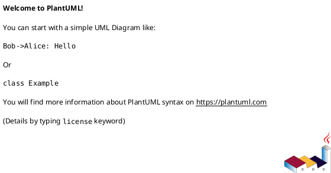

Comments start with a single quote `'` and are ignored by the renderer. Use them to document choices in the diagram.

---

### Class Diagram: Classes and Interfaces

A class diagram models the static structure of a system: what types exist, what data they hold, and how they relate to each other. It does not show runtime behavior.

**Classifier types:**
- `class` — a concrete, instantiable type.
- `abstract class` — a type that cannot be instantiated directly; it may declare abstract methods that subclasses must implement.
- `interface` — a contract of methods without implementation; classes realize it with `..|>`.
- `enum` — a fixed set of named constants.

**Visibility modifiers** prefix each member:
- `+` public — accessible from anywhere.
- `-` private — accessible only within the class.
- `#` protected — accessible within the class and its subclasses.
- `~` package — accessible within the same package.

**Member modifiers** appear in curly braces after the visibility:
- `{abstract}` — the method has no body; must be overridden in a subclass.
- `{static}` — belongs to the class, not to individual instances.

Every attribute should include its type (`: Type`). Every method should include its parameter types and return type.

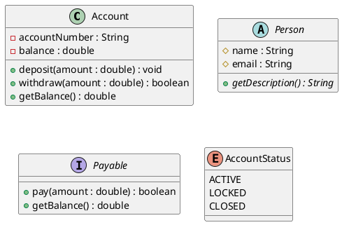

---

### Class Diagram: Relationships

Relationships describe how classifiers are connected. Choosing the right relationship type is as important as naming the classes correctly.

**Inheritance (`--|>`):** Models an "is-a" relationship. The subclass inherits all attributes and methods of the superclass and can override or extend them. The arrow always points toward the superclass (the more general type). Use inheritance when one type is a specialization of another.

**Realization (`..|>`):** A class commits to fulfilling the contract defined by an interface. The arrow points toward the interface. Use realization whenever a class implements an interface — never use `--|>` for interfaces.

**Association (`-->` or `--`):** Models a structural "has-a" or "knows-about" relationship — one class holds a reference to another as an attribute. A directed association (`-->`) shows that only one side holds the reference. A bidirectional association (`--`) means both sides know each other. Always annotate associations with multiplicity on both ends.

**Multiplicity** expresses how many instances participate on each end:
- `1` — exactly one.
- `0..1` — zero or one (optional).
- `0..*` or `*` — zero or more.
- `1..*` — one or more.
- `n..m` — between n and m.

**Aggregation (`o--`):** A weak whole-part relationship. The part can exist independently of the whole (e.g. an employee can exist without a department). The diamond is drawn on the whole side.

**Composition (`*--`):** A strong whole-part relationship. The part's lifecycle is tied to the whole — it is created with the whole and destroyed when the whole is destroyed (e.g. an order line cannot exist without its order). The filled diamond is drawn on the whole side.

**Dependency (`..>`):** A weaker, often temporary relationship — class A uses class B only within a method (e.g. as a parameter or local variable), but does not hold a permanent reference. Use dependency sparingly; if A always holds a reference to B, use association instead.

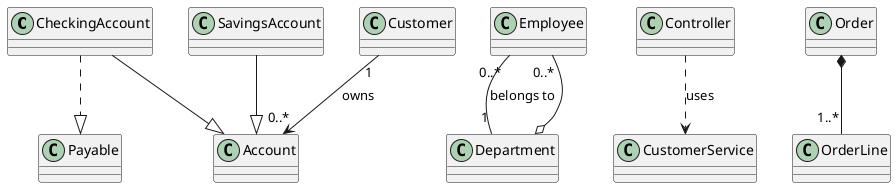

**Complete class diagram example:**

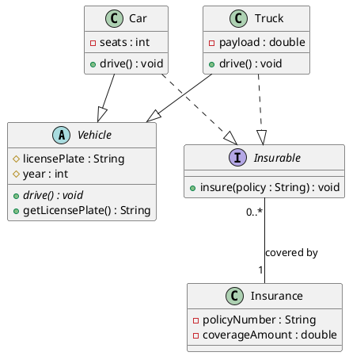

---

### Component Diagram

A component diagram models the high-level architecture of a system: which components exist and how they communicate through interfaces. It abstracts away internal class-level details and focuses on boundaries and contracts between deployable units.

**Key elements:**
- `component` — a self-contained module with a defined boundary (e.g. a service, a library, a subsystem).
- `interface` — a named contract that a component either provides or requires.
- Provided interface (lollipop, `component - interface`): the component implements this interface and offers it to others.
- Required interface (socket, `component --( interface`): the component depends on this interface being provided by someone else.
- Direct dependency (`-->`): used when the architectural interaction does not go through a named interface, e.g. a component directly accessing a database.

A component should only interact with others through its declared interfaces, not through internal implementation details.

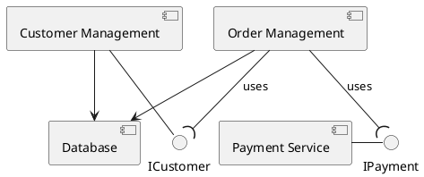

---

### Use Case Diagram

A use case diagram shows what a system does from the perspective of its users, without describing how it does it. It captures functional requirements at a high level of abstraction.

**Key elements:**
- `actor` — an external entity (human user, external system, timer) that interacts with the system. Actors are outside the system boundary.
- `usecase` — a goal an actor wants to achieve using the system. Named with a verb phrase (e.g. "Submit order", "View report").
- `rectangle` — the system boundary; everything inside is part of the system being modeled.
- Association (`-->`): an actor participates in a use case.
- `<<include>>`: the base use case always invokes the included use case as a mandatory sub-step. The arrow points from the base UC to the included UC.
- `<<extend>>`: the extending use case adds optional or conditional behavior to the base use case. The arrow points from the extending UC to the base UC. An extension point describes when the extension applies.
- Generalization (`--|>`): one actor or use case is a specialization of another.

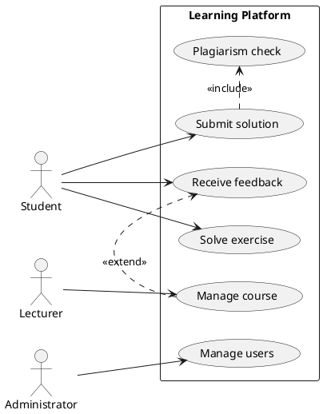

**Deciding between include and extend:**
Use `<<include>>` when the sub-behavior is mandatory and always happens (the base UC cannot complete without it). Use `<<extend>>` when the behavior is optional, conditional, or adds a variation to the base UC.

---

### Activity Diagram

An activity diagram models the flow of control and data through a process or algorithm. It is suited for showing sequential steps, decisions, parallel execution, and the responsibilities of different participants (swimlanes).

**Key syntax elements:**
- `start` — the initial node; every activity diagram needs exactly one.
- `stop` or `end` — terminal node; use `stop` to end a single flow, `end` to terminate all flows.
- `:Action name;` — an action node. The colon and semicolon are mandatory.
- `if (condition?) then (label) ... else (label) ... endif` — a decision node with two branches. The labels in parentheses appear on the outgoing edges.
- `fork ... fork again ... end fork` — parallel split and join. All branches between `fork` and `end fork` execute simultaneously and are all synchronized at `end fork` before the flow continues.
- `|Lane name|` — starts a swimlane. All subsequent nodes belong to this lane until a new lane is declared. Swimlanes represent the roles or systems responsible for the actions they contain.

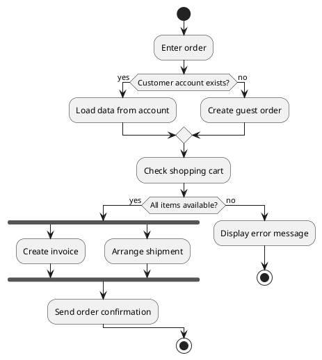

**With swimlanes — each lane groups actions by responsible actor:**

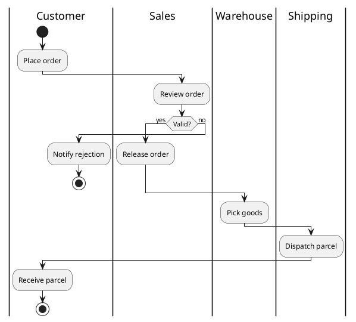

---

### Sequence Diagram

A sequence diagram shows how objects or components interact over time to fulfill a specific scenario. The horizontal axis represents participants; the vertical axis represents time flowing downward. It is well-suited for modeling individual use case realizations or API call flows.

**Key syntax elements:**
- `actor`, `participant`, `database`, `boundary`, `control`, `entity` — stereotyped lifelines. The keyword determines the visual icon; `participant` is the default.
- `A -> B : message` — synchronous call from A to B. A waits for B to return.
- `A --> B : message` — reply or asynchronous response (dashed arrow).
- `A ->> B : message` — asynchronous call (A does not wait).
- `activate X` / `deactivate X` — draws an activation bar on lifeline X, indicating the period during which X is processing. Always pair every `activate` with a `deactivate`.
- `alt condition ... else condition ... end` — models alternative flows (equivalent to if/else). Each branch is a mutually exclusive scenario.
- `opt condition ... end` — optional block; executes only when the condition is true.
- `loop condition ... end` — a repeated interaction.
- `par ... else ... end` — parallel execution of multiple interaction fragments.

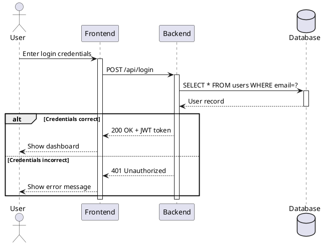

Additional combined fragments:

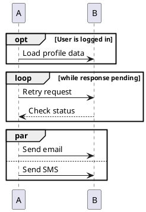

---

### State Diagram

A state diagram (statechart) models the lifecycle of a single object or system by showing the states it can be in and the transitions that cause it to move between states. It is useful when an object's behavior depends heavily on its current state.

**Key syntax elements:**
- `[*] --> StateName` — the initial pseudo-state; every state diagram must have exactly one.
- `StateName --> [*]` — the final pseudo-state; the object's lifecycle ends here.
- `StateA --> StateB : trigger [guard] / action` — a transition. The trigger is the event that causes it; the optional guard in square brackets is a Boolean condition that must be true; the optional action after `/` is executed when the transition fires.
- `state StateName { ... }` — a composite state containing its own nested states and transitions. The composite state has its own `[*]` initial pseudo-state.
- Nested states allow modeling of hierarchical behavior: if the object is in a composite state, it is also in exactly one of its substates at any time.

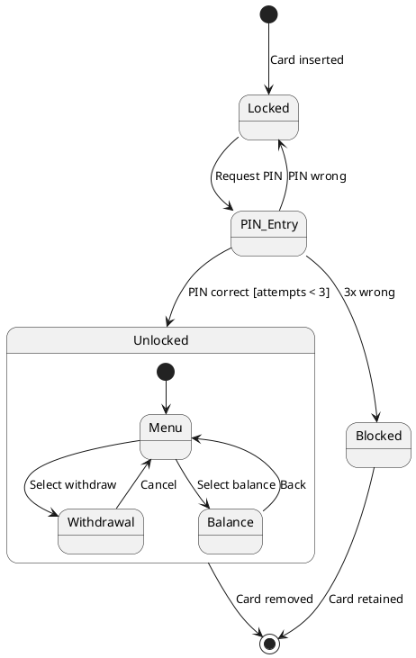

---

## Petri Nets (PNML Syntax)

### Core Concepts

A Petri net is a directed bipartite graph used to model concurrent, distributed, or event-driven systems. It has three element types:

- **Places** (circles) represent conditions, states, or resources. At any point in time a place holds zero or more **tokens**. The distribution of tokens across all places is called the **marking** and represents the current system state.
- **Transitions** (rectangles) represent events or activities. A transition does not hold tokens; it consumes them from input places and produces them into output places when it fires.
- **Arcs** connect places to transitions (input arcs) or transitions to places (output arcs). Arcs between two places or two transitions are forbidden — the graph is strictly bipartite.

**Preset and postset:** The preset of a transition `t` (written `•t`) is the set of places with an arc into `t`. The postset (written `t•`) is the set of places with an arc out of `t`. The same notation applies to places.

**Firing rule:** A transition `t` is **enabled** under marking `m` if every place in `•t` holds at least as many tokens as the weight of the corresponding input arc, and every place in `t•` has enough free capacity to accept the tokens that will be produced. When an enabled transition fires, tokens are consumed from `•t` (according to arc weights) and produced into `t•` (according to arc weights), yielding a new marking `m'`.

**Condition/Event nets (B/E nets):** All arc weights and capacities are 1. A place is either marked (holds a token = condition true) or unmarked (no token = condition false). A transition fires only if all preset places are marked and all postset places are unmarked.

**Place/Transition nets (S/T nets, Petri nets proper):** Arc weights can be greater than 1, and places can hold multiple tokens and have explicit capacity limits. This allows modeling of resources, counts, and buffers.

---

### Document Frame

The PNML document wraps the net in a strict hierarchy: `<pnml>` → `<net>` → `<page>` → elements. The `type` attribute of `<net>` declares the net class. All elements are placed inside the `<page>`.

```xml
<?xml version="1.0" encoding="UTF-8"?>
<pnml xmlns="http://www.pnml.org/version-2009/grammar/pnml">
  <net id="net_1" type="http://www.pnml.org/version-2009/grammar/ptnet">
    <name><text>My Petri Net</text></name>
    <page id="page_1">
      <!-- Places, transitions, and arcs here -->
    </page>
  </net>
</pnml>
```

---

### Places

A place represents a state or condition. The `<initialMarking>` child element sets the number of tokens at the start of the simulation. Always declare it explicitly — leaving it out means zero tokens, which may prevent any transition from firing. In S/T nets, the optional `<capacity>` element sets the maximum number of tokens the place can hold at any time; transitions will not fire if doing so would exceed the capacity of an output place.

Naming convention: place names should describe a condition or state (noun phrase), e.g. "Ready", "Order received", "Buffer full".

```xml
<!-- Place with no tokens (inactive condition) -->
<place id="s_waiting">
  <name><text>Waiting</text></name>
  <initialMarking><text>0</text></initialMarking>
</place>

<!-- Place with 1 token (the condition is true at the start) -->
<place id="s_ready">
  <name><text>Ready</text></name>
  <initialMarking><text>1</text></initialMarking>
</place>

<!-- Place with multiple initial tokens (e.g. 3 items in stock) -->
<place id="s_stock">
  <name><text>Stock</text></name>
  <initialMarking><text>3</text></initialMarking>
</place>

<!-- Place with capacity limit (S/T net): never holds more than 5 tokens -->
<place id="s_buffer">
  <name><text>Buffer</text></name>
  <capacity><text>5</text></capacity>
  <initialMarking><text>0</text></initialMarking>
</place>
```

---

### Transitions

A transition represents an event or activity. It never holds tokens; it only changes the distribution of tokens between places when it fires. A transition is enabled as long as its firing rule is satisfied (see Core Concepts). If multiple transitions are enabled simultaneously, any of them may fire — the order is non-deterministic unless constrained by the net structure.

Naming convention: transition names should describe an event or action (verb phrase), e.g. "Produce", "Send message", "Grant access".

```xml
<transition id="t_produce">
  <name><text>Produce</text></name>
</transition>

<transition id="t_consume">
  <name><text>Consume</text></name>
</transition>
```

---

### Arcs

An arc always connects a **place to a transition** (input arc, consuming tokens from that place when the transition fires) or a **transition to a place** (output arc, depositing tokens into that place when the transition fires). Arcs between two places or two transitions violate the bipartite property and are not allowed.

The `<inscription>` child element specifies the arc weight — how many tokens are consumed or produced per firing. If omitted, the weight defaults to 1. Always include `<inscription>` explicitly in S/T nets to make the model unambiguous.

```xml
<!-- Place → Transition: input arc (consumes tokens from the preset) -->
<arc id="a_in" source="s_ready" target="t_produce">
  <inscription><text>1</text></inscription>
</arc>

<!-- Transition → Place: output arc (deposits tokens into the postset) -->
<arc id="a_out" source="t_produce" target="s_produced">
  <inscription><text>1</text></inscription>
</arc>

<!-- Arc weight > 1: transition consumes 2 tokens from s_input per firing -->
<arc id="a_heavy_in" source="s_input" target="t_process">
  <inscription><text>2</text></inscription>
</arc>

<!-- Arc weight > 1: transition produces 3 tokens into s_warehouse per firing -->
<arc id="a_heavy_out" source="t_store" target="s_warehouse">
  <inscription><text>3</text></inscription>
</arc>
```

---

### Pattern: Sequence

Models strict causality: transition t₂ can only fire after t₁ has fired, because t₁ produces the token that t₂ needs. The intermediate place acts as a "hand-off" between the two steps.

```xml
<place id="s_a"> <name><text>State A</text></name> <initialMarking><text>1</text></initialMarking> </place>
<place id="s_b"> <name><text>State B</text></name> <initialMarking><text>0</text></initialMarking> </place>
<place id="s_c"> <name><text>State C</text></name> <initialMarking><text>0</text></initialMarking> </place>

<transition id="t1"> <name><text>Step 1</text></name> </transition>
<transition id="t2"> <name><text>Step 2</text></name> </transition>

<arc id="a1" source="s_a" target="t1"/>
<arc id="a2" source="t1"  target="s_b"/>
<arc id="a3" source="s_b" target="t2"/>
<arc id="a4" source="t2"  target="s_c"/>
```

---

### Pattern: Concurrency (Fork and Join)

Models parallel execution: after the fork transition fires, tokens exist in multiple places simultaneously, allowing independent transitions to fire in any order or truly concurrently. The join transition re-synchronizes the parallel branches by requiring a token in every one of its input places before it can fire.

Fork: one transition has multiple output arcs, each leading to a different place. Each of those places enables a separate downstream transition.

Join: one transition has multiple input arcs, one from each parallel branch. It can only fire when all branches have produced their token — this is the synchronization point.

```xml
<place id="s_start">  <name><text>Start</text></name>    <initialMarking><text>1</text></initialMarking> </place>
<place id="s_path_a"> <name><text>Path A</text></name>   <initialMarking><text>0</text></initialMarking> </place>
<place id="s_path_b"> <name><text>Path B</text></name>   <initialMarking><text>0</text></initialMarking> </place>
<place id="s_done_a"> <name><text>A done</text></name>   <initialMarking><text>0</text></initialMarking> </place>
<place id="s_done_b"> <name><text>B done</text></name>   <initialMarking><text>0</text></initialMarking> </place>
<place id="s_end">    <name><text>End</text></name>      <initialMarking><text>0</text></initialMarking> </place>

<!-- Fork: t_fork produces one token into s_path_a and one into s_path_b -->
<transition id="t_fork"> <name><text>Split</text></name>       </transition>
<transition id="t_a">    <name><text>Task A</text></name>      </transition>
<transition id="t_b">    <name><text>Task B</text></name>      </transition>
<!-- Join: t_join requires tokens in both s_done_a and s_done_b -->
<transition id="t_join"> <name><text>Synchronize</text></name> </transition>

<arc id="a1"  source="s_start"  target="t_fork"/>
<arc id="a2"  source="t_fork"   target="s_path_a"/>
<arc id="a3"  source="t_fork"   target="s_path_b"/>
<arc id="a4"  source="s_path_a" target="t_a"/>
<arc id="a5"  source="s_path_b" target="t_b"/>
<arc id="a6"  source="t_a"      target="s_done_a"/>
<arc id="a7"  source="t_b"      target="s_done_b"/>
<arc id="a8"  source="s_done_a" target="t_join"/>
<arc id="a9"  source="s_done_b" target="t_join"/>
<arc id="a10" source="t_join"   target="s_end"/>
```

---

### Pattern: Conflict (Choice)

Models a decision point where the system can evolve in only one of several possible directions. Two or more transitions share at least one input place. When that place holds a token, any one of the enabled transitions may fire — but firing one consumes the shared token, making the others no longer enabled. The outcome is non-deterministic; the model does not specify which transition fires.

```xml
<!-- s_resource holds the single token; either t_a or t_b can consume it -->
<place id="s_resource">   <name><text>Resource</text></name>  <initialMarking><text>1</text></initialMarking> </place>
<place id="s_result_a">   <name><text>Result A</text></name>  <initialMarking><text>0</text></initialMarking> </place>
<place id="s_result_b">   <name><text>Result B</text></name>  <initialMarking><text>0</text></initialMarking> </place>

<transition id="t_a"> <name><text>Option A</text></name> </transition>
<transition id="t_b"> <name><text>Option B</text></name> </transition>

<!-- Both transitions read from the same place → conflict -->
<arc id="a1" source="s_resource" target="t_a"/>
<arc id="a2" source="s_resource" target="t_b"/>
<arc id="a3" source="t_a" target="s_result_a"/>
<arc id="a4" source="t_b" target="s_result_b"/>
```

---

### Pattern: Cycle (Loop)

Models repetition: a transition returns a token to one of its own input places, re-enabling itself (or an earlier transition in the sequence). The loop continues as long as the firing condition is satisfied. Without an additional exit arc, the cycle runs indefinitely — a liveness property that may be intentional (e.g. modeling a continuously running server process) or a modeling error (e.g. forgetting a termination condition).

```xml
<!-- t_loop is always re-enabled after firing because it returns the token to s_state -->
<place id="s_state"> <name><text>State</text></name> <initialMarking><text>1</text></initialMarking> </place>

<transition id="t_loop"> <name><text>Repeat</text></name> </transition>

<arc id="a1" source="s_state" target="t_loop"/>
<arc id="a2" source="t_loop"  target="s_state"/>
```

To model a loop with a termination condition, add a conflict: one transition continues the loop, another exits it.

```xml
<place id="s_active">  <name><text>Active</text></name>  <initialMarking><text>1</text></initialMarking> </place>
<place id="s_done">    <name><text>Done</text></name>    <initialMarking><text>0</text></initialMarking> </place>

<transition id="t_continue"> <name><text>Continue loop</text></name> </transition>
<transition id="t_exit">     <name><text>Exit loop</text></name>     </transition>

<!-- Both transitions compete for the token in s_active -->
<arc id="a1" source="s_active"   target="t_continue"/>
<arc id="a2" source="t_continue" target="s_active"/>   <!-- loop back -->
<arc id="a3" source="s_active"   target="t_exit"/>
<arc id="a4" source="t_exit"     target="s_done"/>     <!-- termination -->
```

---

### Complete Example: Producer-Consumer System

An S/T net modeling two cyclic processes — a producer and a consumer — coupled through a shared buffer. The buffer has a capacity of 6. The producer deposits 2 tokens per cycle; the consumer withdraws 3. The consumer also has a local buffer limited to 2. Arc weights and capacities enforce the resource constraints.

```xml
<?xml version="1.0" encoding="UTF-8"?>
<pnml xmlns="http://www.pnml.org/version-2009/grammar/pnml">
  <net id="pc_system" type="http://www.pnml.org/version-2009/grammar/ptnet">
    <name><text>Producer-Consumer</text></name>
    <page id="p0">

      <!-- Producer cycle -->
      <place id="s_producer_ready">
        <name><text>Producer ready</text></name>
        <initialMarking><text>1</text></initialMarking>
      </place>
      <place id="s_producer_produced">
        <name><text>Producer produced</text></name>
        <initialMarking><text>0</text></initialMarking>
      </place>

      <!-- Shared buffer between producer and consumer (capacity 6) -->
      <place id="s_buffer">
        <name><text>Buffer</text></name>
        <capacity><text>6</text></capacity>
        <initialMarking><text>0</text></initialMarking>
      </place>

      <!-- Consumer cycle -->
      <place id="s_consumer_ready">
        <name><text>Consumer ready</text></name>
        <initialMarking><text>1</text></initialMarking>
      </place>
      <place id="s_consumer_consumed">
        <name><text>Consumer consumed</text></name>
        <initialMarking><text>0</text></initialMarking>
      </place>

      <transition id="t_produce">  <name><text>Produce</text></name>  </transition>
      <!-- Store deposits 2 tokens into the shared buffer per firing -->
      <transition id="t_store">    <name><text>Store</text></name>    </transition>
      <!-- Fetch withdraws 3 tokens from the shared buffer per firing -->
      <transition id="t_fetch">    <name><text>Fetch</text></name>    </transition>
      <transition id="t_consume">  <name><text>Consume</text></name>  </transition>

      <!-- Producer cycle arcs -->
      <arc id="a1" source="s_producer_ready"    target="t_produce"/>
      <arc id="a2" source="t_produce"           target="s_producer_produced"/>
      <arc id="a3" source="s_producer_produced" target="t_store"/>
      <arc id="a4" source="t_store"             target="s_producer_ready"/>
      <arc id="a5" source="t_store"             target="s_buffer">
        <inscription><text>2</text></inscription>
      </arc>

      <!-- Consumer cycle arcs -->
      <arc id="a6" source="s_buffer"            target="t_fetch">
        <inscription><text>3</text></inscription>
      </arc>
      <arc id="a7" source="s_consumer_ready"    target="t_fetch"/>
      <arc id="a8" source="t_fetch"             target="s_consumer_consumed">
        <inscription><text>2</text></inscription>
      </arc>
      <arc id="a9" source="s_consumer_consumed" target="t_consume">
        <inscription><text>2</text></inscription>
      </arc>
      <arc id="a10" source="t_consume"          target="s_consumer_ready">
        <inscription><text>2</text></inscription>
      </arc>

    </page>
  </net>
</pnml>
```
