# Objektmodellierung – UML (Unified Modeling Language)

Zweck:
- Grafische Modellierungssprache zum Visualisieren, Spezifizieren und Dokumentieren von Softwaresystemen

Entstehung:
- Anfang der 90er existierte eine Vielzahl unabhängiger objektorientierter Modellierungssprachen:
  - Object-Oriented Design (OOD) von Grady Booch
  - Object Modeling Technique (OMT) von James Rumbaugh
  - Object-Oriented Software Engineering (OOSE) von Ivar Jacobsen
- Zusammenarbeit der „drei Amigos" bei Rational Software führte Mitte der 90er zur Idee der strukturierten Zusammenführung

## Ziele

- Objektorientierte Modellierung einer Software vom Konzept bis hin zum ausführbaren Artefakt (Werkzeug)
- Abbildung von komplexen, unternehmenskritischen Anwendungen möglich
- Verständlichkeit der Sprache für Menschen und Maschinen

## Historie

- 1996: UML-Version 0.9
- Zusammenschluss führender Software Unternehmen (IBM, Microsoft, Oracle, Hewlett-Packard, Rational Software Corporation) zum UML-Konsortium → Ergebnis: UML-Version 1.0
- 19.11.1997: UML-Version 1.1 als Standard mit Zertifizierung der Object Management Group (OMG)
- 2005: UML 2.0
- 2007: UML 2.1
- 2009: UML 2.2
- 2010: UML 2.3
- 2011: UML 2.4
- 2012: UML 2.5 (aktuell)

## Diagrammtypen

Strukturdiagramme:
- Beschreibung aller statischen Elemente eines Systems und deren Beziehung zueinander
- Beschreibung des Aufbaus von Systemen
- Beispiele: Klassen und Schnittstellenklassen, Komponenten und Schnittstellen

Verhaltensdiagramme:
- Beschreibung der dynamischen Aspekte eines Systems einschließlich der Reaktion auf eintretende Ereignisse
- Beispiel: Prozessbeschreibung

Interaktionsdiagramme:
- Spezielle, kommunikationsbezogene Verhaltensdiagramme
- Beschreibung des Austauschs von Meldungen zwischen eigenständigen Objekten
- Beispiel: Abbildung von synchroner bzw. asynchroner Kommunikation zwischen Komponenten

## Strukturdiagramme: Klassendiagramm

Darstellung von Klassen und Schnittstellenklassen sowie deren Eigenschaften und Beziehungen untereinander.

Konzeptuelle und spezifizierende Sicht auf eine Software:
- Spezifizierende Sicht: Attribute und Operationen einer Klasse sowie deren Sichtbarkeiten
- Konzeptuelle Sicht: Beziehungen und Abhängigkeiten zwischen einzelnen Klassen
- Implementierungsnah, Grundlage für automatische Code-Generierung

Notation der spezifischen Sicht – Klasse mit Attributen und Methoden:

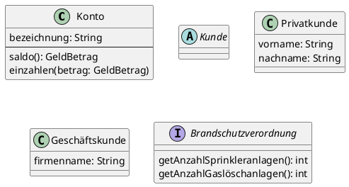

Notation der konzeptuellen Sicht – Assoziationen:
- Ungerichtete Assoziation: Beschreibt Semantik zwischen Klassen (bidirektional)
- Gerichtete Assoziation: Beschreibt Semantik von einer Klasse zu einer anderen, aber nicht umgekehrt
- Multiplizität: Beschreibt mit wie vielen Klassen eine Klasse assoziiert werden kann (konkrete Kardinalität oder Bereich)

### Assoziationen in Java

Ungerichtete Assoziation:

```java
import java.util.List;
public class Gebäude {
    List<Straße> ungerichteteAssoziation;
    public void assoziiereStraße(Straße straßenRef) {
        ungerichteteAssoziation.add(straßenRef);
    }
}
public class Straße {
    List<Gebäude> ungerichteteAssoziation;
    public void assoziiereGebäude(Gebäude gebäudeRef) {
        ungerichteteAssoziation.add(gebäudeRef);
    }
}
```

Gerichtete Assoziation:

```java
import java.util.List;
public class Gebäude {
}
public class Brandschutzbehörde {
    List<Gebäude> überprüft;
    public void assoziiereGebäude(Gebäude gebäudeRef) {
        überprüft.add(gebäudeRef);
    }
}
```

### Aggregation und Komposition

Aggregation:
- Keine gleichwertige Beziehung zwischen Klassen, sondern logische Hierarchie zwischen Ganzen und seinen Teilen
- In Java entspricht Aggregation der gerichteten Assoziation

Komposition:
- Spezialform der Aggregation, bei der die Teile eines Ganzen von diesem existenzabhängig sind

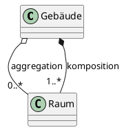

Komposition in Java (Multiplizität Raum: 0..n):

```java
public class Gebäude {
    List<Raum> räume;
    public void erstelleRaum() {
        // Räume existieren nur in Abhängigkeit von Gebäuden
        räume.add(new Raum());
    }
}
```

### Generalisierung und Realisierung

Generalisierung / Spezialisierung:
- Vererbung von Attributen und Operationen einer allgemeinen Klasse an eine spezielle
- Spezielle Klasse kann zusätzliche Eigenschaften hinzufügen und verhält sich kompatibel zur allgemeinen

Realisierung:
- Implementierung einer oder mehrerer Schnittstellenklassen und derer Attribute sowie Operationen durch eine Klasse

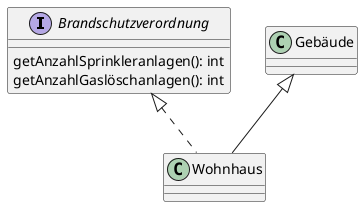

Generalisierung in Java:
```java
public class Wohnhaus extends Gebäude {
}
```

Realisierung in Java:
```java
public interface Brandschutzverordnung {
    public int getAnzahlSprinkleranlagen();
    public int getAnzahlGaslöschanlagen();
}
public class Wohnhaus implements Brandschutzverordnung {
    public int getAnzahlSprinkleranlagen() { /* Methodeninhalt */ }
    public int getAnzahlGaslöschanlagen() { /* Methodeninhalt */ }
}
```

### Beispiel Bankkonten

Klassendiagramm mit Assoziation, Generalisierung und Komposition:

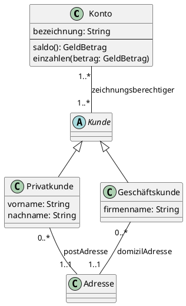

### Übersicht Gebäudeumfeld

Klassendiagramm: Beschreibung des Umfelds von Gebäuden:

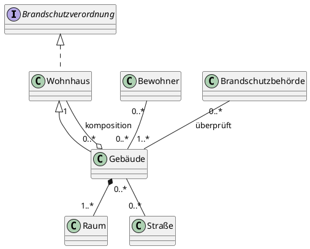

## UML-Methodikleitfaden für Analyse und Design

Phasen:
- Analyse: Ziele definieren, Systemkontext erstellen, Fachbegriffe und Fachbegriffsmodell erstellen, Nichtfunktionale Anforderungen klären, Anwendungsfälle identifizieren und fachlich gruppieren, Anwendungsfallessenzen beschreiben, Dialogprototypen
- Design: Softwarearchitektur, Komponentenschnittstellen identifizieren, Facharchitektur Komponenten identifizieren, Klassendesign, Verhalten detaillieren, Testfälle und Lösungen implementieren

Quelle: Oestereich, B., Scheithauer, A.: Analyse und Design mit der UML 2.5: Objektorientierte Softwareentwicklung. Oldenbourg Wissenschaftsverlag, München (2012)

## Analyse: Ziele und Systemkontext

Ziele definieren:
- Wozu: Klarheit, Motivation, Sinn
- Was: Grundsätzliches, Features, Visionen, Wünsche, Absichten
- Wie: Produktkarton, aktiv & überzeugend, kurz & knackig, 5–20 Sätze
- Wer: Analytiker, Stakeholder, Projektleiter

Systemkontext erstellen:
- Wozu: Abgrenzung des Systems nach außen: Was ist drinnen? Was ist draußen?
- Wie: Systemkontextdiagramm, `<<system>>` Stereotyp für Klasse, Akteure
- Wer: Analytiker in mehrfacher Abstimmung mit Stakeholdern und Architekten im Workshop

## Analyse: Fachbegriffe und Fachbegriffsmodell

Fachbegriffe identifizieren:
- Wozu: Einheitliches Begriffsverständnis aller Beteiligten
- Was: Fachliche systemrelevante Substantive identifizieren (z.B. Gegenstand, Konzept, Ort, Person)
- Wie: Einfache Klassen mit Attributen

Fachbegriffsmodell erstellen:
- Wozu: Zusammenhänge zwischen Fachbegriffen erkennen
- Wie: Einfaches Klassendiagramm mit Assoziationen – soweit notwendig – zum Erfüllen der Anforderungen

## Analyse: Nichtfunktionale Anforderungen und Anwendungsfälle

Nichtfunktionale Anforderungen klären:
- Wozu: Rahmenbedingungen und Qualitätsmerkmale des Systems festlegen, um darauf Architekturentscheidungen zu treffen
- Wie: z.B. nach dem FURPS-Modell (Functional, Usability, Reliability, Performance, Supportability)

Anwendungsfälle identifizieren und fachlich gruppieren:
- Wozu: Funktionale Anforderungen, Systemdienstleistungen identifizieren
- Was: Systemanwendungsfall als zielgerichtete und kohärente Interaktion eines Außenstehenden mit dem System
- Wie: Anwendungsfalldiagramme fachlich strukturiert; Workshop mit Fachexperten

## Analyse: Anwendungsfallessenzen und Dialogprototypen

Anwendungsfallessenzen beschreiben:
- Wozu: Schneller Überblick über den Gutfall, Redundanzen frühzeitig erkennen, einheitliches Verständnis
- Was: Fachliche Intention des Gutfall-Ablaufs, generalisiert, technologieunabhängig, abstrakt
- Wie: textuell

Dialogprototypen:
- Wozu: Visuelles Verständnis des Systems erhalten, Benutzbarkeitsanforderungen erarbeiten
- Wie: Stift & Papier oder elektronisch

## Design: Softwarearchitektur und Komponentenschnittstellen

Komponentenschnittstellen identifizieren:
- Wozu: Komponentenunabhängigkeit und technische Kommunikation festlegen
- Wie: Aktivitätsdiagramm mit Objektfluss, Sequenzdiagramme oder Zustandsdiagramme, Kompositionsstrukturdiagramme mit Schnittstellenkonnektoren

## Design: Facharchitektur

Facharchitektur – Komponenten identifizieren:
- Wozu: Fachliche Infrastrukturkomponenten auswählen und bestimmen
- Wie: Kompositionsstrukturdiagramm für die Architektenübersicht

## Design: Klassendesign

- Wozu: Detailentscheidungen treffen
- Was: Detailliertes Klassendesign als Realisierungsgrundlage
- Wie: Klassendiagramme mit Navigationsrichtungen, Kompositionen, Aggregation, Interfacerealisierung, Kollaborationen, Designprinzipien

## Design: Verhalten detaillieren

- Was: Detaillierte Aktivitätsdiagramme mit Objektfluss, Sequenzdiagramme, Zustandsdiagramme
- Wie: Für ausgezeichnetes Verhalten, komplexe Abläufe, kritische Situationen; Aktivitätsdiagramm mit Objektfluss zum Identifizieren von Operationen und Parametern; Sequenzdiagramme für den Nachrichtenaustausch

## Strukturdiagramme: Komponentendiagramm

Beschreibt die Architektur eines Systems sowie die Schnittstellen und Abhängigkeiten zwischen einzelnen Systembausteinen.

Notation:
- Komponente: Einzelner unabhängiger Systembaustein
- Komponentencontainer: Logische Zusammenfassung mehrerer Komponenten
- Port: Beinhaltet Schnittstellen, stellt Endpunkt für eine Kommunikation dar. Kommunikation verläuft über Ports (Entkopplung von den Komponenten)
- Benötigte Schnittstelle (Buchse): Von einer Komponente genutzt
- Bereitgestellte Schnittstelle (Stecker): Von einer Komponente angeboten
- Abhängigkeits-Beziehung: Verbindung zwischen Schnittstellen

### 3-Tier-Architektur

Komponentendiagramm: 3-Tier-Architektur einer Web-Applikation:

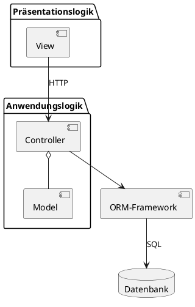

## Einsatz- und Verteilungsdiagramm

Strukturdiagramm, das die physische Verteilung von Artefakten auf Knoten (Hardware, Ausführungsumgebungen) beschreibt.

Beispiel – Beschreibung eines Bringdiensts:

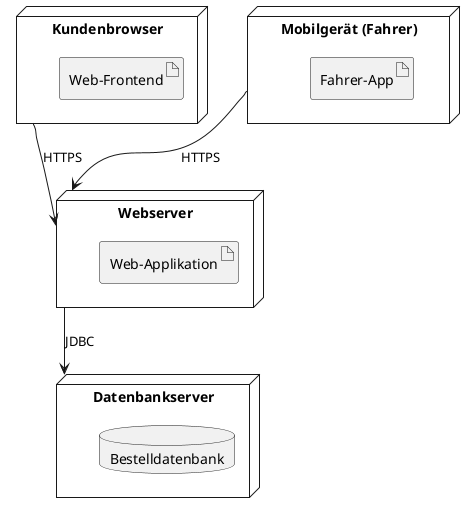

## Verhaltensdiagramme: Anwendungsfalldiagramm

- Abbildung von Anwendungsfällen (Use Cases), Akteuren und deren Beziehungen in einem System
- Definition (funktionaler) Anforderungen an ein System aus unterschiedlichen Benutzerperspektiven
- Verschiedene Abstraktionsebenen (der Funktionen) möglich

Notation:
- Geschäftsanwendungsfall: Abstrakter, geschäftlicher Ablauf ohne Berücksichtigung systemtechnischer Umsetzung
- Systemanwendungsfall: Konkrete Beschreibung einer Interaktion mit einem System
- Akteur: Interagiert als eine Rolle von außerhalb mit Anwendungsfällen des Systems (Personen, externe Systeme, Ereignisse)
- System: Abbildung von Systemgrenzen mehrerer involvierter Systeme
- Ungerichtete Assoziation: Verbindung von Anwendungsfällen mit Akteuren bzw. anderen Anwendungsfällen
- Gerichtete Assoziation: Ein- und Ausgabefluss zwischen Anwendungsfällen
- Realisierung: Umsetzung eines abstrakteren Anwendungsfalls durch einen anderen
- Generalisierung: Akteure und Anwendungsfälle; Kommunikationsbeziehungen werden weiter vererbt
- Include-Beziehung: Import des Verhaltens eines Anwendungsfalls durch einen anderen; Verbot zyklischer Abhängigkeiten
- Extend-Beziehung: Das Verhalten eines Anwendungsfalls kann durch einen anderen erweitert werden; Erweiterung an Bedingung geknüpft

### Anwendungsfalldiagramm – Beispiel: Post

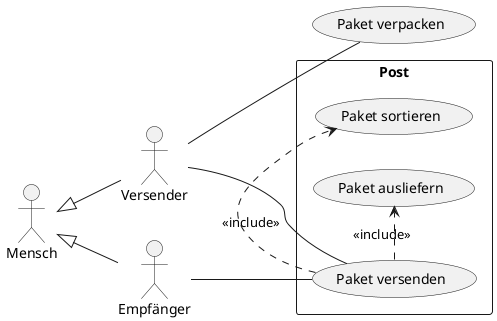

### Anwendungsfalldiagramm – Beispiel: Qualifizieren

Anwendungsfalldiagramm: Beschreibung des Anwendungsfalls „Qualifizieren":

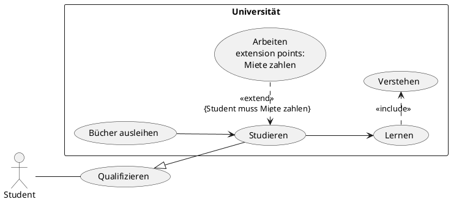

## Verhaltensdiagramme: Aktivitätsdiagramm

- Beschreibung von Handlungen (komplexe Prozesse) eines Systems als Graph mit gerichteten Kanten
- Sequenzielle, parallele, alternative und iterative Aktionen möglich

Notation:
- Aktivität: In sich abgeschlossener, komplexer Prozess; Abfolge von einzelnen atomaren Aktionen; können verschachtelt werden
- Aktion: Atomarer Vorgang innerhalb einer Aktivität
- Objekt: Während des Ablaufs eines Prozesses erzeugte Instanz einer Klasse; Zustand optional in eckigen Klammern
- Startknoten: Startpunkt einer Aktivität; beliebig viele möglich
- Endknoten: Endpunkt einer Aktivität; beliebig viele möglich
- Ablaufende: Endpunkt eines einzelnen Objekt- / Kontrollflusses
- Parallelisierungsknoten: Ein Ablauf wird in mehrere parallele Abläufe geteilt (und)
- Synchronisationsknoten: Mehrere Abläufe werden zu einem zusammengeführt (und)
- Verzweigungsknoten: Spaltet Kante in mehrere Varianten auf; Ablauf von Bedingungen abhängig (oder)
- Verbindungsknoten: Gegenstück zum Verzweigungsknoten; führt Kanten wieder zusammen (oder)
- Kontrollfluss (Kante): Kante zwischen 2 Aktionen oder zwischen einer Aktion und einem Kontrollelement; können mit Bedingungen versehen werden
- Objektfluss: Instanziierung oder Zuführung eines Objekts zu einem Ablauf
- Partition: Bereich mit gemeinsamen Verantwortlichkeiten (z.B. Swimlanes)
- Signal senden/empfangen: Abbildung asynchroner Abläufe

### Aktivitätsdiagramm: Beispiel Auftragsbearbeitung

Vereinfachte Darstellung einer Auftragsbearbeitung mit drei Swimlanes (Kunde, Unternehmen, Lieferant):

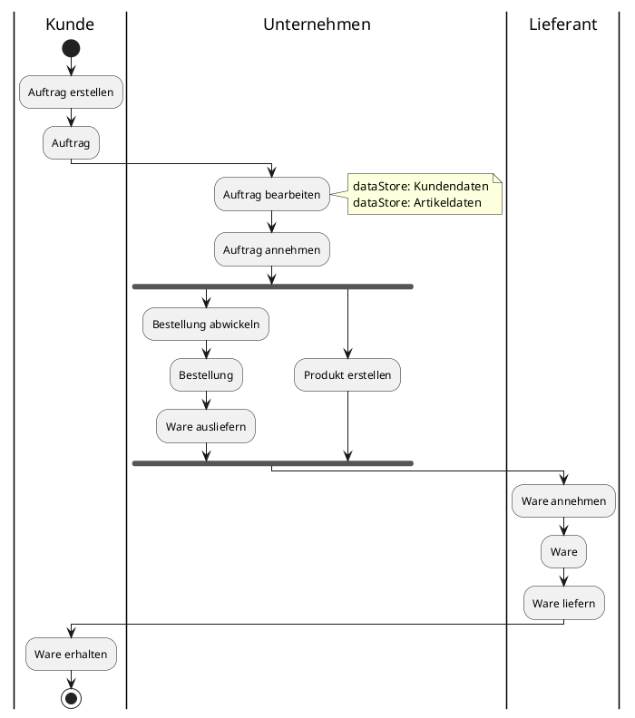

## Verhaltensdiagramme: Sequenzdiagramm

- Genaue Darstellung der Interaktionen zwischen Objekten: Nachrichtenaustausch, Interaktion von Benutzern mit Oberflächen
- Zeitliche Abfolge von Nachrichten zwischen Objekten
- Parallele, optionale, kritische Kommunikation möglich

Notation:
- Lebenslinie: Repräsentiert genau einen Teilnehmer (Person oder Objekt/System); Teilnehmer horizontal, zeitlicher Verlauf vertikal
- Ausführungsbalken: Aktive Zeit eines Teilnehmers
- Synchrone Nachricht: Mit Blockierung des Senders
- Asynchrone Nachricht: Ohne Blockierung des Senders
- Antwort: Rückgabe vom aufgerufenen Teilnehmer
- Zustandsinvariante: Spezifizierung des Zustands eines Teilnehmers
- Sendenachricht: `name(Argument1, .., ArgumentN)`
- Antwortnachricht: `name(Argument1, .., ArgumentN) : Rückgabewert`

Kombinierte Fragmente (Interaktionsoperatoren):

| Schlüsselwort | Bedeutung | Einsatzzweck |
|---|---|---|
| alt | Alternatives Fragment | Alternative Abläufe |
| break | Abbruchfragment | Ausnahmefälle |
| loop | Schleife | Schleifen |
| opt | Optionales Fragment | Optionaler Teil |
| par | Paralleles Fragment | Nebenläufiger Teil |

### Sequenzdiagramm – Übersicht: Haus betreten

```plantuml
@startuml
participant ":Bewohner" as B
participant ":Wohnhaus" as W
participant ":Schlüsseldienst" as S

B -> W : Türschlosszustand abfragen()
W --> B : :Türschlosszustand

alt Zustand Türschloss
  [Türschloss in Ordnung]
  B -> W : Tür aufschließen()
  W --> B : :Offen
else [Türschloss defekt]
  B -> S : Schlüsseldienst rufen()
  S --> B : :Ankunftszeit
end
@enduml
```

## Verhaltensdiagramme: Zustandsdiagramm

- Genaue Darstellung des dynamischen Verhaltens eines Systems
- Mögliche Zustände, Zustandsübergänge, Ereignisse, Aktionen
- Basiert auf dem Konzept eines deterministischen, endlichen Automaten

Zwei Arten von Zustandsautomaten:
- Verhaltenszustandsautomat: Modelliert Verhalten eines Modellelements
- Protokollzustandsautomat: Spezifiziert zulässige Nutzung der Verhaltensmerkmale eines Modellelements

Notation:
- Zustand: Elemente durchlaufen endliche Anzahl an Zuständen; zusammengesetzte Zustände möglich
- Transition: Gerichtete Beziehung zwischen zwei Zuständen; Syntax: `Ereignis [Bedingung] / Aktivität`
- Ereignistypen: CallEvent, SignalEvent, ChangeEvent, TimeEvent, AnyReceiveEvent
- Startzustand: Eine wegführende Kante pro Startzustand; ein Startzustand pro Zustandsautomat
- Endzustand: Ende einer Region von Zuständen; beliebig viele möglich
- Terminator: Beendet kompletten Zustandsautomaten
- Kreuzung: Verzweigt Transitionen statisch
- Entscheidung: Verzweigt Transitionen dynamisch; ausgehende Transition wird beim Erreichen anhand der Guards gewählt
- Gabelung: Teilt eine eingehende Transition in mehrere parallel geschaltete ausgehende Transitionen
- Vereinigung: Verbindet mehrere parallel geschaltete eingehende Transitionen in eine ausgehende Transition

### Zustandsdiagramm – Beispiel

Verhaltenszustandsautomat: Kaffeemaschine:

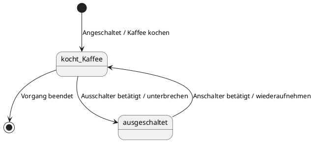

Protokollzustandsautomat: Reservierung:

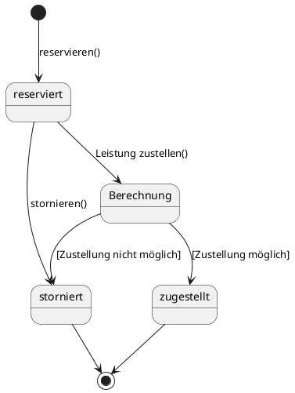

### Zustandsdiagramm – Beispiel: Fahrkartenautomat

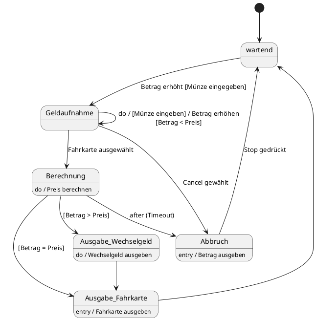

Quelle: http://se.cs.uni-magdeburg.de/tutorial/UML2/Zustandsdiagramm.htm

## Zusammenfassung UML

## Software-Entwicklung im Kontext von SCRUM

Anwendungsmöglichkeiten für UML-Diagramme je Phase:
- Problemdefinition / Analyse: Anwendungsfalldiagramm
- Spezifikation / Entwurf: Klassendiagramm, Verteilungsdiagramm, Aktivitätsdiagramm, Sequenzdiagramm, OCL, Zustandsdiagramm, Zeitverlaufsdiagramm, Klassendiagramm, Paketdiagramm, Interaktionsübersichtsdiagramm
- Implementierung / Test: Kommunikationsdiagramm
- Einführung / Wartung: Objektdiagramm

## Zusammenfassung – UML2 Standard

UML2 Standard besteht aus vier Teilen:
- Superstructure: Definition der Notation sowie der Semantik für Diagramme und ihre Modellelemente
- Infrastructure: Definition des UML-Metamodells für die Superstructure
- Object Constraint Language (OCL): Spezifikation von Regeln für Modellelemente
- Diagram Interchange (DI): Spezifiziert Layout der Diagramme

UML2 ist ein…:
- Standard, der ein Metamodell für die Modellierung von Systemen bereitstellt
- Standard, der Modellierungskonstrukte und deren Beziehungen untereinander festlegt

UML2 ist kein…:
- Standard für eine graphische Modellierungssprache (nur Vorschläge und Empfehlungen)
- Modell mit einer formal definierten Semantik (an vielen Stellen erfolgt eine Interpretation auf Basis des allgemeinen Verständnisses)

## Modelltheorie – Modellsysteme

Die Abbildungsrelation setzt zwei Systeme miteinander in Beziehung:
- Objektsystem (SO): Subjektive Interpretation eines zweckorientiert gewählten Realitätsausschnitts
- Modellsystem (SM): Subjektives Abbild des Objektsystems; Formulierung mittels geeignetem Metamodell
- Beziehung SO → SM (Homomorphismus): Elimination irrelevanter Sachverhalte; Typisierung relevanter Sachverhalte

## Informationsmodellierung

Morphologischer Kasten:

| Merkmal | Ausprägungen |
|---|---|
| Beschreibungssicht | Daten – Funktionen – Objekte – Organisation – Prozesse |
| Beschreibungsebene | Fachkonzept – DV-Konzept – Implementierungskonzept |
| Geltungsanspruch | Istmodell – Sollmodell – Idealmodell |
| Inhaltliche Individualität | Unternehmensmodell – Referenzmodell – Mastermodell |
| Abstraktionsgrad | Ausprägungsebene – Typebene – Metaebene – Meta-Meta-Ebene |

Beschreibungssichten:
- Daten: Passive Systemelemente, die durch Funktionen manipuliert werden; Was wird manipuliert?
- Funktionen: Definieren Zustandsänderungen von Daten (f: I → O); Wie wird manipuliert?
- Objekte: Semantisch zusammenhängende Funktionen und Daten sind in Objekten gekapselt
- Organisation: Organisationseinheiten und ihre Beziehungen; Wer manipuliert?
- Prozesse: Modell des Systemverhaltens; In welcher Reihenfolge wird manipuliert?

Beschreibungsebenen:
- Fachkonzept: (Semi-)formale, implementierungsunabhängige Beschreibung einer betriebswirtschaftlichen Konzeption
- DV-Konzept: Anreicherung des Fachkonzepts um Anforderungen und Restriktionen der DV-technischen Umsetzung
- Implementierungskonzept: Formulierung der DV-technischen Umsetzung

## Referenzmodelle und Mastermodelle

Referenzmodelle:
- Referenz = Empfehlung
- Charakteristisch: Forderung nach einer gewissen Allgemeingültigkeit
- Dem Anspruch nach ein Soll- oder Idealmodell für einen bestimmten Objektbereich (z.B. Referenz-Prozessmodell für die Auftragsabwicklung in der Papier-Industrie)

Mastermodelle:
- Entstehen durch Vereinigung (Komposition) mehrerer Referenzmodelle
- Entsprechen der Vereinigungsmenge verschiedener Referenzmodelle → „allgemeingültiger" als Referenzmodelle

## Grundsätze ordnungsmäßiger Modellierung (GoM)

Ein Ordnungsrahmen für die Reduktion der Subjektivität bei der Modellierung.

Ziel: Erhöhung der Qualität von Modellen eines Fachkonzepts durch:
- Angabe von Gestaltungsempfehlungen zur bedarfsgerechten Modellerstellung
- Reduzierung der Vielfalt möglicher Modellierungsvarianten
- Erhöhung von Vergleichbarkeit und Integrationsfähigkeit von Modellen

Grundsätze (notwendig):
- Grundsatz der Richtigkeit: Korrekte Abbildung der Realwelt auf das Modell (syntaktische und semantische Richtigkeit)
- Grundsatz der Relevanz: Modell muss subjektiv ziel- und zweckorientiert sein
- Grundsatz der Wirtschaftlichkeit: Verhältnismäßigkeit von Kosten und Ertrag ist zu berücksichtigen

Grundsätze (ergänzend):
- Grundsatz der Klarheit: Modell muss sowohl für Modellierer wie Adressat anschaulich sein (pragmatisch, ästhetisch: strukturiert, übersichtlich, lesbar)
- Grundsatz der Vergleichbarkeit: Identitäten, Äquivalenzen und Kompatibilitäten von Modellen müssen erkennbar sein
- Grundsatz des systematischen Aufbaus: Informationsarchitekturen umfassen verschiedene Sichten, die zueinander passen müssen

Klare Modelle sind:
- Einfach
- Grafisch wohlstrukturiert: Positionierung in Raster, Kanten in zwei orthogonalen Dimensionen, maximale Gradlinigkeit, minimale Kantenüberschneidungen, Anordnung in Leserichtung, Einhaltung von Namenskonventionen
