# Modeling with UML: Language, Concepts, Methods

**Author:** Bernhard Rumpe  
**Publisher:** Springer, 2016

---


# Chapter 1: Introduction

Introduction

The quest for knowledge is a natural
tendency of all human beings.
Aristotle

In recent years, software engineering has become an effective engineering discipline. Due to the constantly increasing complexity of its tasks and the
diversity of its application domains, a portfolio of software engineering techniques has been constructed, offering a customized range of suitable methods and concepts for the application domain, criticality, and complexity of each system to be developed. Techniques for management of projects, configuration, variant and quality, as well as software product lines, development processes, specification techniques, analysis and design patterns, and best practices for specific tasks are only some elements of this portfolio.
On the one hand, this portfolio offers competing approaches with problem-specific advantages. On the other hand, the evolution of the languages, frameworks, and tools used allows and requires continual supplementation and enlargement of this portfolio. Today, programming languages such as Java, well-engineered class libraries, and permanently improving software development tools admit methods which were inconceivable just a few years ago. For example, tool-based evolution or modification of a software architecture already in operation has become considerably easier in the meantime.
The rapidly changing technology, the flexibility expected by users, e.g., in the E-service domain, and the extensibility of systems as well as the high criticality of business applications require constant optimization and adjustment of development processes and their associated methods. Only by using available software development techniques can a high-quality system which suits the desires of the customer be developed in an agile way and complemented steadily with regard to given temporal and personnel resources. The widespread use of the Internet also facilitates increasing integration of business applications across company boundaries together with user integration through feedback mechanisms via social networks. Thus, complex networks of E-service and E-business applications arise, especially in the field of Internet-based software. This requires appropriate software engineering techniques. In this domain, mainly object technology is used, and the Unified Modeling Language (UML) standard is applied for modeling purposes.


### 1.4 Placement of UML/P

#### 1.4.1 Importance and Scope of UML
Especially for developer communication, there are a number of advantages of graphical notations compared with textual forms of expression. They enable the viewer to get a quick overview and simplify the perception of the system’s parts and their relations. But due to their two-dimensional character, graphical description methods also have disadvantages. They need, for instance, considerably more space when shown or printed. This lower information density easily leads to a lack of overview, especially with regard to large models. Furthermore, precise definition of the syntax and semantics of a graphical language is generally regarded to be more difficult. With the dominance of the object-oriented programming paradigm in almost every field of software and system development, and systems becoming increasingly complex, quite a number of object-oriented modeling approaches have been defined. The Unified Modeling Language (UML) was successful in integrating different notations and, thus, became a standard modeling language for software engineering. UML is now widely used. To allow this, the separation of methodological considerations and the notations used within methods was crucial. The aim of UML is to offer a modeling technique for preferably all application domains in software engineering. Accordingly, UML/P language profile defined in this book is partly methodically neutral, although it is especially suited for generative projects with Java as target language. Similar approaches are shown in recent books working on
the relationship between UML and a programming language such as Java. With UML, integration of several existing modeling languages has been achieved. Syntactic differences have been harmonized and concepts from differing fields have been integrated into the core language. Although this created a rather large and partly overloaded language, it can be expected that UML will claim to be the essential language standard for at least one more decade.

#### 1.4.2 UML Language Profiles
UML is no longer understood as a language defined completely in all its syntactic and semantic details but as a language framework or language family which allows, due to extension mechanisms and semantic variation possibilities, creation of language profiles that can be adjusted to the respective purpose of the application. Thus, UML has the characteristic of a colloquial language such as English which also allows for adjusting the vocabulary in the form of technical language and dialects.  Already defined the essential requirements for UML profile concept, and discussed how this affects the manifestation of businessor project-specific language profiles. Reveal how the organization of syntactic and semantic variations of a part of UML in the form of features and language configurations can be shown and how it can be applied for the configuration of a language which suits the project. Example language profiles include the specialization of UML to realtime systems, Enterprize Distributed Object Computing, multimedia applications, and frameworks. vocabulary is introduced directly into the model through the definition of classes, methods, attributes or states. In addition, profiles offer lightweight extension capabilities for UML syntax, such as the stereotypes and tags discussed in Fig. 2.17, and heavyweight extensions with new modeling constructs.1 The concept for defining a UML profile has, among others, the following purposes:

Precise definition of tags, stereotypes, and constraints is possible. Description of semantics using natural language is allowed. A more specific profile can adjust a more general profile to the desired form. The combination of profiles allows for simultaneous use of multiple profiles. Mechanisms for managing the profiles’ compatibility are provided. However, the goal of simple exchangeability and combinability of language profiles cannot be fulfilled that easily. On the contrary, tool-based lan1. Common languages also allow for the imprint of new vocabulary through the definition of terms. New modeling constructs would correspond to grammatical extension but are not common in other languages. Language profiles can usually be combined only when they are explicitly aligned with one another.

#### 1.4.3 Notations in UML/P
UML/P consists of six subnotations. Thereby, some subnotations of the UML standard are left out. UML/P is a language profile which in particular supports the activities of design, implementation, and evolution, because UML/P can also be used as a complete programming language. This explains the suffix “/P”, which stands for “usable for programming.”

Not least, the programming language’s applicability can be ascribed to the integration of Java code snippets into UML/P and the harmonization of textual parts of UML/P with the Java syntax.
The necessity of introducing further specializing language profiles discussed in the previous paragraph is facilitated in UML/P through the concrete definition of stereotypes and tags. Both forms of adapting language elements are used for defining UML/P itself but are also available for further adjustments, so that UML/P can act as a starting point for defining further application-, domain- or technology-specific language profiles.

#### 1.4.4 The Terms “Modeling” and “Model-Based Development”
The Term “Modeling”
In software engineering, the term “model” is used for several different concepts. Among others, there are product models, process models, and test models. It is generally accepted that a model is an abstraction of a modeled item, for instance, by reduction in detail. Furthermore, it is reasonable, although not in all definitions present, to demand that a model has a purpose. By its nature, a model is a reduced or abstracted representation of the original system in terms of scale, precision, and/or functionality. A model is an abstraction of a system that aims to simplify the reasoning about a system by omission of irrelevant details. A model is a simplified, goal-oriented representation of the function, of an item or a sequence of events that makes their examination or study easier or even possible at all. In software engineering, a model is the idealized, simplified, and in a way, similar presentation of an item, system or other part of the world with the aim of enabling the better study of certain properties of the original.

However, there is disagreement about the granularity of a model. On the one hand, talks about a complete product model and associates it with a collection of diagrams; on the other hand, he regards the model as an artifact which equates a model with a single diagram. We also use the term “model” in a broader sense and regard a class diagram or a Statechart as a model of a
part of the system to be realized. Principally, a model is a model of an ideal or an original. In software engineering, however, models are often designed prior to the original. Besides, due to the immateriality of software, it is possible to create a complete system out of a model without manual support but by automated adding of details. Model-Based Software Engineering In Sect. 2.4, the term “view” is identified as a representation of, e.g., a product model accessible to the developer. The two-stage model abstraction from the system to the complete model and, in the end, to the developer view taking place in this process is caused by the size and complexity of the modeled system. Usually, a complete product model has a complexity which does not easily allow one to understand its relationships. Thus, extracts of the product model are created using views that highlight certain aspects but leave out others at the same time. A view is also a model and therefore has a purpose. A view is created in order to communicate a “story.” A product model can be understood as the sum of its views. In comparison, for example, defines the term “model concept” more restrictively by not regarding views as independent models. Correspondingly, all test and refactoring techniques discussed there are formulated directly on the product model, which contains everything. While these levels of abstraction of modeling are generally accepted by developers, two approaches for their technical realization nowadays prevail among toolmakers:

The model-based approach requires administration of a complete and consistent model of the system in the respective tool and only allows development of steps that are consistently carried out on this model and all the views contained therein. The document-oriented approach permits editing of each single view as an autonomous document. Inconsistencies among as well as between documents are accepted at first and only recognized using respective analysis tools.
Both approaches show specific advantages and disadvantages. The advantages of the model-based approach are as follows:

A model’s consistency can only be preserved automatically in a modelbased form. In the document-oriented approach, the analysis is timeconsuming and therefore, for instance, slows down code generation. Due to the fact that tools need not offer techniques such as weaving of several class diagrams or Statecharts for the same class, their implementation is easier.
Experiences with syntax-driven editors for programming languages have shown that support is helpful while syntax-driven editors disturb the developer’s flow of thought and efficiency. The document-oriented approach better tolerates temporary inconsistencies and syntactically deficient documents. In large projects with many developers, model-based tools are necessary to take measures in order to ensure consistency of the model that is handled in parallel. This includes a shared repository with synchronization or locking mechanisms. While synchronization implies inefficiency, the locking prevents common model ownership and prohibits agility. Permanent model synchronization using a repository forbids local testing of alternatives. Hence, a transaction concept, version control or a similar mechanism has to be provided by the repository. But this also leads to the de facto problem of integrating model versions. In comparison, the document-oriented approach requires the usage of integration techniques for model parts modified in parallel, such as those used in version control systems. This integration becomes necessary when the developer commits the locally modified version into the version control system and, thus, makes it accessible to other project participants. Therefore, local experiments do not have consequences when they remain unpublished. For self-developed special tools, it is generally easier to process single, file-based documents instead of the complete models which are held in the repository and are subject to version or transaction control. An incremental, modular approach for model processing, especially for generation, can considerably increase the efficiency of the development because models only need to be loaded and code generated if the models have changed. But this requires a modularity of UML models in the sense that information that is to be exchanged between models has to be clarified in terms of interfaces and also separately filed analogously to programming languages.

In practice, a synergistic compromise of both approaches might prove to be the ideal approach. This already becomes apparent in integrated development environments (IDEs) for programming languages. An IDE contains an editor with syntax-driven highlighting, navigation, and replacement possibilities up to automatic analyses and code generation in the background. But storage of information happens in an artifact-based way in single files supported by additional and automatically calculated tables where applicable. Thus, single files remain accessible to other tools, but the developer gets the impression of a model-based development environment. It is also beneficial that developers can choose which files and, therefore, which part of the “model” they want to load and manipulate in the tool. Model-Driven Architecture (MDA). The model-driven architecture (MDA) approach is a continuation of the standardization ideas of the Object Management Group (OMG) based, among others, on UML. One of the key ideas of this approach is to define platform-independent models of business applications with UML in the first step of the development. A second step follows with mapping of this platform-independent model to an implementation on concrete hardware, a given operating system, middleware, and framework components. As a result, the development of the platform-independent UML model is decoupled from platform-specific concepts. The implementation then consists of a mapping of the platform-independent to a platform-specific UML model formulated in a distinctive UML language profile. For this purpose, for example, Common Object Request Broker Architecture (CORBA)-specific UML profiles should be available. Next, a preferably automated mapping of this model onto an implementation and corresponding interface definitions follows. Beside technology-specific mappings, MDA also involves standardization efforts for application domains. This, e.g., includes XML-based communication standards for E-commerce, telecommunications, or the data model for the finance industry. On the one hand, MDA is based on the observation that business applications have, on average, a much longer lifespan than technological platforms and that, thus, quite often migration of applications is necessary. On the other hand, MDA is grounded on the hope that this observation will simplify the reutilization or evolution of application-specific models for similar applications and the interoperability between systems. As a whole, MDA is an approach that intends to revolutionize the tools for software engineering as well as the process of their definition, and that especially deals with company-wide and cross-company interconnection of systems. Interestingly, a significant reduction of effort for software development through generation is intended, but suitable methods to achieve this goal are discussed only very little. The approach discussed in the second volume can also be understood as a concretization of a part of MDA. In contrast to MDA, we do not present an all-embracing approach, taking into account, e.g., metamodeling, available middleware techniques or the interoperability between applications. Instead, we suggest the simple but more effective solution here in the sense of XP, in which only those interfaces are served, those middleware components used, and those operating systems taken into account for which the system is to be developed now. We have to take into account that the availability of standardized mappings of platform-independent models on the respective technology will be unlikely for many areas. In general, those mappings are to be developed on the basis of predefined patterns by the developers themselves, and thus, the code generators need to be parameterized correspondingly. Accordingly, simplicity, and not the attempt to meet many unnecessary standards, should come first.

### 1.5 The Future: Agile Modeling with UML
In order to increase the efficiency of a project, it is necessary to provide effective notations, techniques, and methods for the developer. As the primary goal of every software development process is the executable and correctly implemented product system, UML should not only serve for documentation of drafts. Instead, the automated transformation into code through code generators, the definition of test cases with UML/P for quality management purposes, and the evolution of UML models with refactoring techniques are essential.
The combination of code generation, test case modeling, and refactoring presents considerable synergetic effects. Therefore, these techniques are described based on UML/P in the second book “Agile Modeling with UML” published by Springer. Both books complement each other. Agile Modeling: Some essential foundational elements of agile software engineering methods are elaborated, and an agile model-based developing method is outlined. The core of agile developing methods is the usage of models for a representation and discussion, but also especially for programming purposes and the definition of test cases through code generation and for the planning of evolution through model-based refactoring. Code Generation: A well-parameterized code generation based on abstract models is crucial for efficient development of a system. The discussed form of code generation allows the compact and mostly technology-independent development of application-specific models. Only during generation are technology-dependent aspects such as database connections, communication, or graphical user interface (GUI)-mapping added. As a result, UML/P can be used as a programming language and there is no conceptual breach between modeling and programming language. However, it is important to explicitly distinguish executable and abstract models in the software engineering process and to use them adequately. Modeling Automated Tests: Systematic and efficient testing is an essential part of the quality management of a system. The goal is that tests can run automatically after their generation. Code generation is not only used for developing production systems but also especially for test cases in order to check whether specification and implementation are consistent. Thus, the usage of UML/P in test case modeling is a fundamental element of an agile methodology. For this purpose, mainly object diagrams, OCL, and sequence diagrams are used. Evolution by Using Refactoring: The discussed flexibility to react quickly to changing requirements or technology requires a technique for systematic evolution of the already existing model and its implementation. The evolution of a system because of new requirements or a new field of application as well as the correction of structural deficits of the software architecture ideally happen through refactoring techniques. A further focus is on the foundation and embedding of refactoring techniques into the more general methods of model transformation and the discussion of which refactoring rules can be developed for UML/P or carried over from other approaches. There, especially class diagrams, Statecharts, and OCL are taken into account. In terms of test case modeling as well as refactoring techniques, insights originating from some theoretical approaches are outlined and transferred to UML/P. This book explains these concepts by means of numerous practical examples and prepares them in the form of test patterns and refactoring techniques for UML diagrams.

# Chapter 2: Class Diagrams
Class diagrams still represent by far the most important and widely used modeling technique of UML. Historically, class diagrams originated from the ideas of entity/relationship modeling and the graphical representation of modules, which themselves were influenced by data flow diagrams. Class diagrams describe the structure of a software system and thus form the first discussed core notation for object-oriented modeling.

### 2.1 Relevance of Class Diagrams
Object-oriented systems are highly dynamic. This makes the modeling of asystem’s structures a complex task in object-oriented software development. Class diagrams describe this structure, or architecture, of a system, forming the basis for nearly all other description techniques. However, class diagrams and the modeled classes fulfill various tasks.

**Structure Modeling**
In any object-oriented implementation, the code is organized into classes. Therefore, a class diagram constitutes an overview of the code structure and its internal relations. As programmers are familiar with the concept of class from programming, class diagrams used in modeling can be understood and communicated rather easily. Class diagrams are used for showing structural relations of a system and for that reason form the skeleton for almost all other notations and types of diagrams, as these rely on the classes and methods defined in class diagrams. Therefore, they also represent an essential—although not the only—form of description for modeling of software architectures and frameworks.

**Classes During Analysis, Design, and Implementation**
In analysis, class diagrams are used in order to structure real-world concepts. In contrast, in design and implementation documents, class diagrams are especially used to depict a structural view of the software system. The classes presented in the implementation view can actually be found in implemented systems too. But classes from analysis are often significantly modified, supplemented by technical aspects, or fully omitted when they only belong to the system context. One of the deficits of UML arises from the less-than-ideal option to explicitly ascribe diagrams a purpose. Assuming that a class diagram reflects an implementation, the semantics of a class diagram can be explained relatively easily and understandably. A number of introductory textbooks about class modeling or UML take this position. Besides, this point of view is often implied by tools. Fusion, however, clearly distinguishes between classes belonging to the system and external classes and, thus, demonstrates that modeling of non-software-engineering concepts with class diagrams is feasible and reasonable. The language profile UML/P is implementation oriented. This is why the following semantics of class diagrams based on the Java code modeled thereby is perfect for this purpose.

**Variety of Tasks for a Class**
In object-oriented programming and even more so in modeling, classes have numerous tasks. Primarily, they serve to group and encapsulate attributes and associated methods to create a conceptual unity. By assigning a class name, instances of the class can be created, saved, and passed on at arbitrary places in the code. Hence, class definitions at the same time act as type system and implementation description. They can (in general) be instantiated any number of times in the form of objects. In modeling, a class is also understood as the extension, i.e., the number of all objects existing at a certain point in time. Due to the explicit availability of this extension in modeling, invariants for each existing object of a class can, for example, be described. The potential unlimitedness of the number of objects in a system makes cataloging these objects into a finite number of classes necessary. Only this makes a finite definition of an object-oriented system possible. For this reason classes present a characterization of all possible structures of a system. This characterization at the same time also describes necessary structural constraints without determining a concrete object structure. As a result, there are usually an unlimited number of different object structures that conform to a class diagram. In fact, each correctly running system can be regarded as an evolving sequence of object structures where at each point in time the current object structure conforms to the class diagram. In contrast to objects, classes, however, in many programming languages have no directly manipulable representation during the runtime of a system. One exception is, for example, Smalltalk, which represents classes as objects and therefore allows for unrestricted reflective programming.1 Java is more restrictive, as it allows read-only access to the class code. Generally, reflective programming should be used only very reluctantly because maintenance of such a system gets far more complex due to reduced understandability. 
In Smalltalk, a class manifests as a normal object during runtime being manipulable like any other object. However, the content of such an object is a description of
the structure and behavior of the instances assigned to this class object. See [Gol84].

Classes fulfill the following tasks:
- Encapsulation of attributes and methods in order to create a conceptual unity
- Manifestation of instances as objects
- Typing of objects
- Description of the implementation
- Class code (translated, executable form of the implementation)
- Extension (set of all objects existing at a certain time)
- Characterization of all possible structures of a system

**Metamodeling**
Due to the two-dimensional form of model representations, metamodeling has prevailed as a form of description of a diagrammatic language and thus replaced the grammars commonly used for text. A metamodel defines the abstract syntax of a graphical notation. At least since UML standardization, it is customary to use a simplified form of class diagrams as the metamodel language. This approach has the advantage that only one language needs to be learnt. We discuss metamodeling in Appendix A and use a variant of the class diagrams in order to represent the graphical parts of UML/P. Further Concepts for Class Diagrams UML offers further concepts that should be mentioned here for the sake of completeness. Association classes, for example, are classes that are attached to the associations that are subsequently introduced to store information that cannot be assigned to any of the classes participating in the association but only to the relation itself. But there are standard processes for modeling such data without association classes. Modern programming languages such as C++ and Java as well as UML since version 2.3 now offer generic types first introduced by functional languages such as Haskell [Hut07]. In Java, this introduction has been integrated nicely. In UML, this has to be done carefully, because types appear in nearly all kinds of diagrams. As generics do not play such an important role in modeling but are applied for reuse of generic components especially in implementation, UML/P waives the full generality of generic classes with wildcards, bound typecasts, etc., and only the most important container classes are offered in a generically realized form, i.e., with type parameters. Thus, UML/P class diagrams do not provide mechanisms for defining generics. OCL/P, however, as well as the code generation allow us to use generics.

### 2.2 Classes and Inheritance
When introducing classes, attributes, methods, and inheritance, an implementation view—as already discussed—is taken as a basis in this section. Class A class consists of a collection of attributes and methods that determine the state and the behavior of its instances (objects). Classes are connected to each other by associations and inheritance relations. The class name identifies the class. Attribute State components of a class are called attributes. An attribute is described by its name and type. Method. The functionality of a class is stored in methods. A method consists of a signature and a body describing the implementation. In case of an abstract method, the body is missing. For the determination of visibility, instantiatability, and changeability of the modified elements, the modifiers public, protected, private, readonly, abstract, static, and final can be applied to classes, methods, roles, and attributes. UML/P offers the following iconic variants for the first four modifiers of these: “+”, “#”, “-”and “?”. Constants are defined as special attributes with the modifiers static and final. If two classes are in an inheritance relation to each other, the subclass inherits its attributes and methods from the superclass. The subclass can add further attributes and methods and redefine methods—as far as the modifiers allow. The subclass forms a subtype of the superclass that, according to the substitution principle, allows use of instances of the subclass where instances of the superclass are required. An interface describes the signatures of a collection of methods. In contrast to a class, no attributes (only constants) and no method bodies are specified. Interfaces are related to abstract classes and can also be in an inheritance relation to each other. Type is a basis data type such as int, a class or an interface. Interface implementation is a relation between an interface and a class, similar to inheritance. A class can implement any number of interfaces. Association is a binary relation between classes that is used for the realization of structural information. An association is described by an association name, a role name for each end, a cardinality, and information about the directions of navigation. The cardinality (also called multiplicity) is given for each end of the association. It has the form “0..1”, “1” or “*” and describes whether an association in this direction is optional or mandatory, or allows for multiple bindings.

**Figure 2.3.** Class Auction in the class diagram
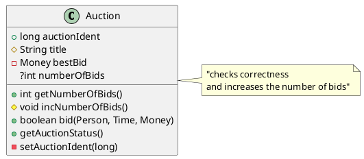

#### 2.2.1 Attributes
The middle compartment of a class definition describes the list of attributes that are defined in this class. The information on attributes can be incomplete in many respects. First, an attribute can be indicated with or without its type. As we use Java as target language, the default notation for the UML “attribute: Type” has been replaced by the Java-compliant version “Type attribute”. A number of modifiers are available for attributes, defining the attribute’s properties more precisely. As compact forms, UML provides “+” for public, “#” for protected, and “-” for private in order to describe the visibility of the attribute to foreign classes. “+” allows for general access, “#” for subclasses, and “-” allows access only within the defining class. The UML standard does not contain a fourth visibility declaration “?”, which is only offered by UML/P to mark an attribute as readonly. An attribute marked in this way is generally readable but can only be modified in subclasses and the class itself. This visibility thus has the same effect as public while reading and protected while modifying. It proves helpful in modeling in order to define access rights even more precisely. Further modifiers offered by the programming language Java such as static and final for the description of static and nonmodifiable attributes can also be used in the class diagram. In combination, these modifiers serve for defining constants. However, constants are often omitted in class diagrams. An attribute marked static is also called a class attribute and can be marked alternatively by an underscore.

UML provides derived attributes that are marked with “/” (see Fig. 2.5). Incase of a derived attribute, its value can be calculated (“derived”) from other attributes of the same or other objects and associations. Usually, the calculation formula is defined in the form of a constraint attr==... .

**Figure 2.5.** Derived attributes
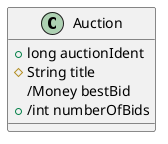

#### 2.2.2 Methods
In the third compartment of a class representation, methods are shown with names, signatures, and if any, modifiers for methods. Here, also the notation in line with Java Type method (Parameter) is used instead of the official UML notation method (Parameter): Type. While attributes store the state of an object, methods serve for the execution of tasks and data calculation. For this purpose, they use data stored in attributes and call other methods of the same or other objects. Like Java, UML/P also provides methods with variable arity that, e.g., are given in the form Type method(Type variable ...). The access rights for methods can be defined analogously to the visibilities for attributes with “+”, “#”, and “-”.
Further modifiers for methods are:
- static in order to make the method accessible even without an instantiated object
- final in order to make the method unchangeable for subclasses
- abstract in order to indicate that the method is not implemented in this class

Just like class attributes, UML prefers to outline static methods alternatively by underlining. Constructors are shown like static methods in the form class(arguments) and are underlined. If a class contains an abstract method, the class itself is abstract. Then, the class cannot instantiate objects. In subclasses, however, abstract methods of a class can be implemented appropriately.

#### 2.2.3 Inheritance
In order to structure classes into hierarchies, the inheritance relation can be used. If multiple classes with partly corresponding attributes or methods exist, these can be factorized in a common superclass. Figure 2.6 demonstrates this by means of similarities of several messages occurring in the auction system. If two classes are in an inheritance relation, the subclass inherits its attributes and methods from the superclass. The subclass can extend the list of attributes and methods as well as redefine methods—as far as the modifiers of the superclass permit. At the same time, the subclass forms a subtype of the superclass that, according to the substitution principle, allows for the use of instances of the subclass where instances of the superclass are required.

**Figure 2.6.** Inheritance and interface implementation
```plantuml
@startuml
interface Serializable { +void serialize(Buffer) }
abstract class Message {
  #Time time
  +Time getMessageTime()
  +deliverMessage(Auction)
}
Serializable <|.. Message
class BidMessage {
  #Person bidder
  #Auction auction
  #Money bidValue
  #int graphSymbol
  #Time biddingTime
}
class ExtensionMessage {
  #Auction auction
  #Time newClosing
  #String reason
}
class StatusMessage {
  #Auction auction
  #int newStatus
}
Message <|-- BidMessage
Message <|-- ExtensionMessage
Message <|-- StatusMessage
@enduml
```

In Java, each class (except Object) inherits from exactly one superclass. However, a superclass can have many subclasses that in turn can have further subclasses. By using inheritance as a means of structuring, we define an inheritance hierarchy. A superclass can be regarded as a generalization of its subclasses, as its attributes and method signatures determine the similarities of all subclasses. If in an inheritance hierarchy the code inheritance is less important than structuring, we speak of a generalization hierarchy. Especially for requirements elicitation and the architectural design, generalization plays a vital role to structure the system. In object-oriented modeling, inheritance is an essential structuring mechanism, but deep inheritance hierarchies should be avoided as inheritance couples the classes and, thus, the code contained. To fully comprehend a subclass, its direct as well as all other superclasses have to be understood.

#### 2.2.4 Interfaces
Java offers a special form of class, the interface. An interface consists of a collection of method signatures and constants and is applied especially for defining the usable interface between parts of the system, respectively its components. In Fig. 2.6, the interface Serializable is used in order to enforce a certain functionality from all classes that implement this interface. An interface, like a class, is depicted by a rectangle but marked with the stereotype ≪interface≫. Objects can be instantiated neither directly from an interface nor from an abstract class. Instead, the given method signatures have to be realized in classes which implement the interface. Furthermore, interfaces can only contain constants but no attributes. While in Java a class is only allowed to inherit from one superclass, it can implement any number of interfaces. An interface can extend other interfaces and, hence, have a subtype relation to these interfaces. In this case, the subinterface includes the method signatures defined by the superinterface in its own definition and extends these by additional methods. Figure 2.7 shows this by means of an extract of the Java class library.

**Figure 2.7.** Interface implementation and extension
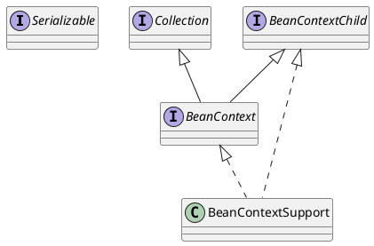

Technically, interfaces and classes as well as inheritance and interface implementation are similar concepts. That is why hereinafter, for the sake of simplification, the term class is often used as a generic term for classes and interfaces as well as inheritance for the inheritance between classes, the implementation relation between interfaces and classes, and for the subtype relation between interfaces. This simplification is reasonable especially with regard to analysis and early design if the decision of whether a class can be instantiated, is abstract, or becomes an interface as not yet been made.

### 2.3 Associations
An association has the purpose of relating objects of two classes. Using associations, complex data structures can be formed and methods of neighboring objects can be called. Figure 2.8 describes a part of the auction system with three classes, two interfaces, and five associations in different forms.

**Figure 2.8.** Class diagram with associations
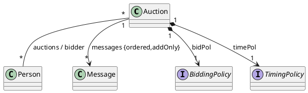

Usually, an association has an association name and an association role foreach of the two ends as well as information about the cardinality and a description of possible navigation directions. Details can also be omitted from the model if they are not important for the representation of the desired facts and if no ambiguity occurs. Association names, e.g., often serve only to distinguish associations, especially between the same classes. In case of a lack of the association or role name, there are standard rules for obtaining a surrogate name. Just like a class, an association is a modeling concept in the class diagram. During the system’s runtime, an association manifests through links between the connected objects. The number of links is limited by the association’s cardinality. If an association is navigable in one direction, the implementation provides mechanisms to efficiently realize this navigability.

#### 2.3.1 Roles
A role name is used to navigate to objects that are connected through an association or its links. In this way, one can access the auctions from an object of the class Person by using the role name auctions. If no explicit role name is given, we use the name of the association or that of the target class as role name, provided that these unambiguously describe the intended navigation. In the example in Fig. 2.8, one can access the respective objects from an object of the class Auction with the names biddingPolicy and messages. According to the programming language used for the implementation and the cardinalities given in the class diagram, schematic conversions of the first letter in the name are made. Role names in UML/P always begin with a lower-case letter while class names begin with an upper-case letter. If both ends of the association are connected to the same class, it is called a reflexive association. Reflexive associations enable the realization of a number of design patterns such as a part–whole relationship. In a reflexive association, it is necessary to furnish at least one end with role names. By doing so, a distinction of the participating objects by their roles is
possible. Although that leads to a reflexive structure, the recursion depth is limited to 1 because bidders themselves are not observers and observers have direct connection to the bidders.

#### 2.3.2 Navigation
During design and implementation activities, the navigation arrows of an association play an important role in a class diagram. Vice versa, (direct) access from a Message object to the Persons to which the object is linked is not possible. Therefore, the model allows the distribution of a message, e.g., using broadcasting, to several persons without duplication. Basically, associations can be uni- or bidirectional. If no explicit arrow direction is given, a bidirectional association is assumed. Formally, the navigation possibilities are regarded as unspecified, and thus, no restriction is given in this situation. If the fundamental navigability is modeled by the arrow, the role name determines how the association or the linked objects can be addressed. The modifiers public, protected, and private can be used for roles in order to correspondingly restrict the visibility of this navigation.

#### 2.3.3 Cardinality
A cardinality can be indicated at each end of an association; For example, the association participants enables a person to participate in multiple auctions and allows various persons to place bids in the same auction, but only exactly one TimingPolicy is linked to each auction. The three cardinality specifications “*”, “1”, and “0..1” permit linking any number of objects, exactly one, and at most one object respectively. More general cardinalities are of the form m..n or m..*, and they could even be combined in the earlier UML 1.x versions (example 3..7,9,11..*). However, especially the three forms mentioned first can be directly implemented. Because of this, we abstain from discussing the general forms of cardinalities here. OCL invariants introduced in Chap. 3 allow for the description and methodical use of generalized cardinalities. In the UML literature, a distinction is sometimes made between cardinality and multiplicity. In this case, cardinality designates the number of actual links of an association while multiplicity indicates the scope of potential cardinalities. The entity/relationship models do not make this distinction and consistently use the term cardinality.

#### 2.3.4 Composition
Composition is a special form of association. It is indicated by a filled diamond at one end of the association. In a composition, the subobjects are strongly dependent on the whole. This means that objects of these types are instantiated together with the Auction object and become obsolete at the end of the auction’s lifecycle. As BiddingPolicy and TimingPolicy are interfaces, suitable objects which implement these interfaces are used instead. An alternative form of representation expresses the nature of the composition of an association better by using graphic containedness instead of a diamond. It is possible neither to clarify the backwards direction of the navigation nor to add further tags to the composition associations. The cardinality on the composition side is “1” by default but can be adjusted to “0..1”, i.e., one object is assigned to at most one composite. There are a number of interpretation variants regarding the possibility to exchange objects and for the lifecycle of dependent objects in a composite. Thus, a precise definition of a composite’s semantics should always be determined project specifically. This can, for instance, be done by stereotypes, which accompany supplementary project- or companyspecific, informal explanations or by self-defined stereotypes.

#### 2.3.5 Derived Associations
Besides derived attributes, there are also derived associations in UML/P. They are also marked by a “/” in front of the association’s name. An association is considered derived if the set of its links can be calculated (“derived”) from other state elements. Other attributes and associations can be used for the calculation. Two associations are given, describing which persons are allowed to place bids in an auction and which persons can observe the behavior of a bidding colleague (“fellow”). The derived association /observers is calculated from these two associations. For this purpose, e.g., the OCL characterization can be used.

**Figure 2.10.** Derived association

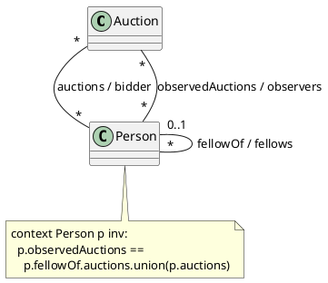

#### 2.3.6 Tags for Associations
The UML standard offers a variety of additional tags for associations that concretize the properties of associations more precisely. Figure 2.11 contains three tags that are interesting in this context. {ordered} indicates that an association with cardinality “*” allows ordered access. In the case shown, the order of the messages of an auction is relevant. {frozen} indicates that the two associations to the policy objects can no longer be changed after the initialization of an Auction object is completed. In this way, the same policies are available throughout the whole lifetime of an Auction object. {addOnly} models that objects can only be added to the association and that removing them is prohibited. Thus, the model in Fig. 2.11 expresses that messages that have been sent in an auction cannot be withdrawn.

**Figure 2.11.** Tags for associations
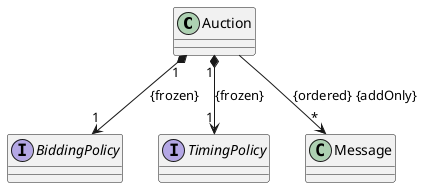

An association that is tagged with {ordered} on one end certainly has to provide a mechanism that allows access according to this order. Associations with the tag {ordered} present a special case of qualified associations.

#### 2.3.7 Qualified Associations
In their most general form, qualified associations provide an opportunity to select a single object from a set of assigned objects by means of a qualifier. In addition, it is possible to qualify a composition or to use qualification at both ends of an association. In the auction system, an object of the class AllData is used in order to store all currently loaded auctions and their participants. The qualified access via the auction identifier auctionIdent is understood as a mapping, and thus, the functionality of the interface Map<long, Auction> is provided, but this does not determine the form in which the qualified association is implemented. During code generation, a transformation into an alternative data structure can be applied or further functionality, e.g., from the NavigableMap, can be added. As the key for the mapping, the auction identifiers already existing in the auction are used in the example. Analogously, persons can be selected via their name, which is of the type String. However, there is a significant difference between the cases where the qualifier is a type (in the example: String) or an attribute name of the associated class. While in the first case any object or value of the given type can be used as a key, only the actual

While in explicitly qualified associations the type of qualifier can be freely chosen, ordered associations use integer intervals starting with 0.3. Wherever an explicit qualifier is used, only one object is reached by the qualified access even if another cardinality is given. Usually, the target object is uniquely identified only in terms of the source object and the qualifier; For example, each auction can store a different message at index 0. The qualifier allIdent is only unique system-wide as it presents at the same time an unambiguous key of the target object. In case the qualifier is not set, access requests have to react appropriately, e.g., with a null pointer as in Java maps or an exception. In an ordered association (tag {ordered}), the qualifier remains implicit and is not indicated in a respective box at the end of the association.

### 2.4 View and Representation
A class diagram is mainly used to describe the structure and the relations necessary for a certain task. A complete list of all methods and attributes is often obstructive in this case. Instead, only those methods and attributes that are helpful for presenting a “story” should be illustrated. “Story” is a 3. As common in Java, indexing starts with 0. A metaphor that is deliberately used to indicate that a diagram has a focus highlighting significant and omitting unimportant information. Diagrams can, e.g., model different parts of the system or particular system functions. Hence, a class diagram often represents an incomplete view of the whole system. Some classes or associations can be missing. Within classes, attributes and methods can be omitted or presented incompletely. For example, the argument list and the return type of a method can be omitted. Unfortunately, in general it is not evident from a UML diagram whether c ” has the information contained therein is complete or not. Therefore, “! been taken over from [FPR01] for the display of complete information. It supplements the representation indicator “. . .”already offered by UML to mark incomplete information.

**Figure 2.13.** Complete class representation
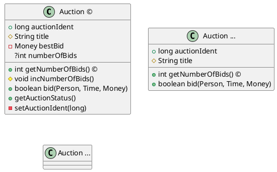

The indicators “! c ” in the class name shows their representation within the class diagram. A “! that the attribute as well as the method list is complete. In contrast, the incompleteness indicator “. . .” means that the presentation can be incomplete. Due to the dualism between associations and attributes later discussed, it is implied that all associations that can be navigated from this class are also modeled when the attribute list is marked as incomplete. Both indicators can also be applied to the list of attributes and methods individually. The incompleteness indicator “. . .” acts as default when no indicators are given. This corresponds to the usual assumption that a diagram presents an abstraction of the system. To explain the use of these indicators precisely, the three model levels illustrated in Fig. 2.14 are to be distinguished: the system itself, the complete UML model of the system, and a graphic, incomplete representation of the model, e.g., on screen. In most cases, the representation is also called a view c ” and “. . .” describe a relation bebut is itself a model. Both indicators “! tween the view and the incomplete UML model on which the view is based. There are a number of different views for the same class. The two marks are thus called representation indicators. If a software system reaches a certain size, a complete class diagram can seem quite overloaded. Due to the many details, the story is concealed rather than presented. Because of this, in software development it is reasonable to work with multiple smaller class diagrams. Necessarily, class diagrams that each show an extract of the system have overlaps. Through these overlaps, the correlation between the individual models is established. Figure 2.15 shows two extracts of the auction system in which the class Auction is represented in different forms. Here, the indicator “. . .” allows one to explicitly describe that only the information necessary for the respective story is illustrated. Through fusion, a complete class diagram can be obtained from a collection of single class diagrams. As discussed in Sect. 1.4.4, some tools always use a complete class diagram internally as their model and the user gets extracts in the form of views. A fusion of class diagrams is basically a unification of all the class, association, and inheritance relations, whereas in the case of a repeatedly occurring class, attribute and method lists are also consolidated. There are of course a number of consistency conditions to be followed. These include conforming types for attributes and methods, compatible navigation roles and multiplicity specifications for associations, as well as prevention of cyclical inheritance relations.

### 2.5 Stereotypes and Tags
Although UML is designed as a graphic language for the implementation, it has a lot in common with natural languages. UML has a core structure that corresponds to a grammar, and its sentences are built in the form of diagrams. Similar to natural languages, there are mechanisms to extend and adjust the language vocabulary according to the respective necessary requirements. These mechanisms form the basis for project- and company-specific dialects or profiles of UML. However, the introduction of a new class already extends the available vocabulary, as we can then use this class in other places. From this perspective, programming is a steady expansion of the vocabulary at hand in the system. But while in a programming language the introduction of a new control structure is not possible, UML allows, in a restricted form, the introduction of new kinds of model elements by offering stereotypes and tags by means of which existing model elements can be specialized and adjusted. Without providing an explicit mechanism, UML allows on the one hand for modification of the syntactic appearance through restriction or expansion, but on the other hand also to change the semantics of the language. As UML is designed as a “universal” language, its forms of use can impose a certain bandwidth for its semantics. This so-called semantic variability enables project-specific adjustment of the semantics and tools. “Semantic variation points” cannot be described in standard UML itself. This is why, in, an independent mechanism on the basis of feature
diagrams is defined and can be used for profile creation. The generally possible adaptations go far beyond the concept of stereotypes and tags introduced
here.

**Stereotype** 
A stereotype classifies model elements such as classes or attributes. Through a stereotype, the meaning of the model element is specialized and can thus, e.g., be treated more specifically in code generation. A stereotype can have a set of tags.

**Tag** 
A tag describes a property of a model element. A tag is denoted as a pair consisting of a keyword and value. Several such pairs can be combined in a commaseparated list. Model elements are the (fundamental) parts of UML diagrams. For instance, the class diagram has classes, interfaces, attributes, methods, inheritance relations, and associations as model elements. Tags and stereotypes can be applied to model elements, but they themselves are not model elements.

#### 2.5.1 Stereotypes
While the stereotype ≪interface≫ is provided by default by UML, the two stereotypes on the right ≪JavaBean≫ and ≪Message≫ are to be defined in the project, tool or framework itself. Stereotypes are normally indicated in French quotation marks (guillemots) with reversed tips. In principle, each UML model element can be equipped with one or several stereotypes. However, stereotypes are often used in order to assign special properties to classes. The stereotype ≪interface≫ tags an interface, which is regarded as a special form of class. The stereotype ≪JavaBean≫ acts as an indicator for the fact that the class tagged provides the functionality required by JavaBeans. The stereotype ≪Message≫ is used in the auction project in order to record in compact form that the class tagged is a subclass of Message and thus serves for the transfer of information. Hence, there are a multitude of application possibilities for stereotypes. They can classify model elements, e.g., in order to specify additional properties or functionalities or to impose restrictions. The UML standard offers a metamodel-based and a tabular approach for informal definition of stereotypes. Depending on the stereotype’s intention, restrictive conditions can also be formulated more precisely, or mechanisms for a specific code generation can be indicated. The following list shows some application possibilities for stereotypes:

- A stereotype describes syntactic properties of a model element by demanding additional properties or specializing already existing properties.
- A stereotype can describe the representation of a model provided to the c ” can be considered such a special form. user. The indicator “!
- A stereotype can describe application-specific requirements. The ≪persistent≫ stereotype, for example, can specify that objects of this class are persistently stored, although it is not explained how this storage is to happen.
- A stereotype can describe a methodical relation between model elements. For instance, the stereotype ≪refine≫ in the UML standard is designed for this purpose.
- A stereotype can reflect the modeler’s intention describing how a programmer should use a certain model element. A class can, e.g., be tagged as ≪adaptive≫ in order to imply that this class is well suited to extension. Such stereotypes are especially suited for frameworks. With stereotypes of the form ≪Wrapper≫, the role of a class in a design pattern can be documented.

Of course, there are a number of overlaps between the mentioned and further application options for stereotypes. To allow the developer to specify properties in a more detailed form, a stereotype can be equipped with a variety of tags. Then, the application of a stereotype in a model element implies that its assigned tags are also defined on the model element.


#### 2.5.2 Tags
Information on the indicated test and its execution is stored in the form of tags.

**Figure 2.18.** Tags applied on a test class
```plantuml
@startuml
class "«Testclass»
AuctionTest ..." as AT {
  {field} {CreatedOn = 13.12.2000}
  {field} {CreatedBy = B. Rumpe}
  {field} {LastChange = 23.04.2001}
  {field} {NoTestruns = 146}
  {field} {LastExecutionResult = Pass}
  {field} {LastExecution = 04.05.2001 14:07:48}
}
@enduml
```

Tags can be attached to basically each model element. In addition, tags, can be bound to a stereotype and thus applied together with the stereotype to model elements. In the example, the existence of the last three tags is demanded by the use of the stereotype ≪Testclass≫, as in the auction project these three tags are assigned to the stereotype. A tag is usually denoted in the form {name = value}. Principally, strings and numbers are accepted as values. An explicit typing of the tag values would be desirable, but up to now it is supported by neither the UML language standard nor the tools. If the value is not relevant or it is the Boolean value true, it can also be omitted; For example, {are Tests OK = true} and {are Tests OK} are alternative representations. The UML standard by default offers tags for associations such as {ordered} but also allows one to define new, situation-specific tags. Even if a tag is added to a class, it considerably differs from an attribute. A tag assigns a property to the model element, while an attribute has an independent value in each instance of the class. Attributes appear at the runtime of a system while tags do not exist there. Tags, however, can have effects on the system if they influence the properties of the model element with regard to its implementation. Among others, tags qualify for the presentation of the following properties:

- The initial value of an attribute can be specified.
- Informal comments can be indicated by tags.
- Designated techniques for data storage or transfer via a network can be filed, e.g., in the model.
- For graphic representation in a tool, a suitable graphic symbol can be assigned to a model element whose file name is stored in the tag.

#### 2.5.3 Introduction of New Elements
The variety of application options for stereotypes and tags makes it nearly impossible to describe the meaning of such elements directly within UML. Hence, when defining a tag or stereotype, usually an informal description is given. By doing so, not only the concrete appearance but especially the intention and the application domains are described. The most important reason for the introduction of a stereotype is the methodical, tool-supported handling during software development. As there are many different application possibilities for stereotypes, ranging from controlling code generation to documentation of unfinished pieces in the model, one can in general say little about the meaning of stereotypes. Therefore,
The stereotype can often be applied to a superior model element or a whole diagram in order to be applied element-wise on all subelements.
The definition of a stereotype follows the general form of design patterns, recipes, and process patterns [Amb98] by discussing motivation, requirements, application form, and effects on an informal basis. However, the template should not be regarded as rigid but, as needed, should be extended as appropriate or shortened by removing unnecessary sections. In principle, the same template can be used for tags. Tags, however, are basically more easily structured and easier to understand, so that such a detailed template often seems unnecessary. UML offers a third form of adaptations for model elements. Constraints are an instrument for the detailed specification of properties. As constraint languages, OCL or informal text is suggested. A constraint is generally given in the form {constraint}. The UML standard by default provides some constraints. These include the already known constraint {ordered} for associations that, however, can also be defined as a tag with Boolean type. This example illustrates in particular that the differences between constraints, tags, and stereotypes cannot always be clarified precisely. It also makes little sense to introduce a stereotype consisting of exactly one tag, as this tag could also be attached directly to a model element. When introducing new stereotypes, tags or constraints, certain creative freedom is given that can be used by the modeler in order to design a suitable model.


# Chapter 3: Object Constraint Language
Graphic notations are especially suited for giving the reader a quick overview of the modeled system. However, in order to achieve lucidity, it is necessary to abstract from details. That is why, e.g., class diagrams are not able to depict many structural and behavioral constraints. In general, due to their two-dimensional nature, graphic notations are only partly suited for the representation of any kind of constraints for a system. Pure visual programming languages such as VISTA attempt this, thus revealing an interesting approach but are not widespread. Hence, it can be expected that programming languages in the near future will continue to be text-based or contain tight interlocking of graphic and textual elements. A textual notation that conceptually leans on known mathematics is reasonable, particularly for constraints. Graphic abbreviations can, of course, be defined for certain kinds of properties that occur frequently. For example, UML provides cardinalities for associations as shortcuts for constraints. Also the type system of a language such as Java can be understood as a restriction regarding a system’s properties. Textual modeling of constraints allows one to model system properties that cannot be described with a graphic notation or often clumsily only. The compactness of a textual notation in contrast to a graphic description technique has the effect that the former is generally regarded as less comprehensible. Therefore, good modeling consists of comprehensible as well as compact and, thus, concisely formulated constraints. Furthermore, it is important to use the formulated constraints constructively in the software engineering process. Therefore, tools such as a parser or a checker for type correctness are helpful. In addition, the executability and, hence, the automated verifiability of a constraint is an essential prerequisite for the use of a constraint language for test definition. The Object Constraint Language (OCL) is defined by the UML standard and provides a textual notation that can be used for the definition of constraints in the form of invariants as well as for pre- and postconditions of methods. The history of the definition of programming and specification languages shows that it is very difficult to design a generally satisfying and sufficiently well-defined language on the first attempt. OCL offered in the UML standard is not derived from a widespread programming language. For this very reason, it has a rather unusual syntactic appearance that exacerbates the difficult access to OCL for many developers. Hence, a syntactic form of OCL that is derived from Java. 

### 3.1 Overview of OCL/P
A constraint is a Boolean statement about a system. It describes a property that a system or a result shall have. Its interpretation always yields one of the logical values true or false. A constraint is embedded in a context. Thus, a constraint includes statements about this context. The context is defined by a set of names used in the constraint and their signatures. That includes names of classes, methods, and attributes of the model and especially variables explicitly introduced in the context of a constraint. Interpretation of a constraint is carried out based on a concrete object structure. The variables introduced in the context are assigned values or objects. Invariant describes a property which must hold in a system at each (observed) point in time. The points in time of observation can be restricted in order to allow timelimited violations, e.g., during the execution of a method. Precondition of a method characterizes the properties that need to be valid to ensure that the method produces a defined and correct result. If the precondition does not hold, nothing is known about the result. Postcondition of a method describes which properties hold after the execution of the method has finished. Here, it is possible to refer to objects in the state which was valid directly before the method call (at the “time” of the interpretation of the precondition). Postconditions are interpreted by means of two object structures showing the situations before and after the method call. Method specification is a pair of pre- and postconditions. Query is a method offered by the implementation whose call does not affect the system’s state. New objects may be created as a result of the call. However, these must not be connected to the state of the system by links. So, queries do not have side-effects and can be used in OCL constraints.

#### 3.1.1 The Context of a Constraint
One of the prominent properties of OCL constraints is their embedding in a context consisting of UML models. Usually, this context is given by a class diagram. The class diagram in Fig. 3.2 provides such a context in the form of two classes and a number of attributes partly dependent on each other, modeling a part of the auction system. These attribute dependencies can be defined by means of OCL/P constraints.

**Figure 3.2.** Part of the auction system
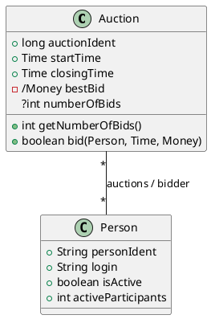

A simple constraint, for example, is the following: an auction always starts before it is completed. This constraint is described by explicitly including an Auction object in the context. The explicitly stated context of an OCL constraint consists of one or more objects whose name is declared by referencing them in the context of the constraint. The constraint uses a method of the Java class Time for comparison: context Auction a inv: a.startTime.lessThan(a.closingTime)
This constraint requires that the signature of class Auction is provided in the context. The variable name a is locally introduced by the context statement and acts like a variable definition. An alternative is to explicitly import variables, for example, if they have already been defined in another constraint or diagram. Using this importing form of the context, OCL constraints are combined and connected to object diagrams. By doing so, the objects named in the object diagrams can be used explicitly in the OCL constraints. Thus, the contexts defined by import are discussed in more detail in Chap. 4. The following context, for instance, characterizes a property of the Auction object a that might come from an object diagram:

import Auction a inv:
a.startTime.lessThan(a.closingTime)

Objects connected in associations can be included by using navigation expressions. The expression a.bidder provides a set of persons, i.e., a value of the type Set<Person>, whose size can be determined with the attribute size. To ensure that the number of active participants is not larger than the number of persons actually participating in an auction, the following constraint is formulated: context Auction a inv Bidders1: a.activeParticipants <= a.bidder.size

As this example shows, a constraint can be given its own name (like Bidders1) so that it is possible to refer to it at another point. Navigation expressions can be chained. To navigate along an association, the role names opposite to the initial object are used. If the association participants is implemented properly, the following constraint is correct: context Auction a inv: a in a.bidder.auctions
Refining the second last constraint Bidders1, it is now required that the number of active participants of an auction be the same as the number of its assigned persons whose attribute isActive is set:
context Auction a inv Bidders2:
a.activeParticipants == { p in a.bidder | p.isActive }.size

The set comprehension used here is a convenient extension not present in the OCL standard. It is further discussed in several forms later. If in a context only the class is defined instead of an explicit name, the name this is used by default. In this case, there is direct access also to attributes. This is shown by the following condition in which logic conjunctions are used as well:1 context Auction inv:
startTime.greaterThan(Time.now()) implies
numberOfBids == 0

This constraint is equivalent to the version with explicit use of the name this:
context Auction inv:
this.startTime.greaterThan(Time.now()) implies
this.numberOfBids == 0

Auctions can already exist but may not be open yet in the described auction system. The context of closed constraints, such as the following, is empty. A context can always be replaced by quantifiers that are defined from the context over all existing objects of the class. The following constraint with empty context is, thus, equivalent to the previous one:
inv:
forall a in Auction:
a.startTime.greaterThan(Time.now()) implies
a.numberOfBids == 0


#### 3.1.2 The let Construct
Intermediate results can be assigned to an auxiliary variable using the let construct in order to reuse them in the body of the construct, possibly several times. The subsequent constraint demands that the initial and final time of each auction obey the right relation. Here, the if-then-else known from Java is used in the compact form .?.:. as shown here:
context Auction a inv Time1:
let min = startTime.lessThan(closingTime)
? startTime : closingTime
in
min == startTime

The let construct introduces locally usable variables and operations which are only visible within the expression. The type of such a variable is inferred by the given expression on the right but can also be defined explicitly. In a let clause, several local variables and operations can be defined. A definition can use all variables defined before.2 To ensure that, in the auction system, the latest possible auction end obeys the right relation with the initial time, the following can be formulated: context Auction a inv Time2:
let min1 = a.startTime.lessThan(a.closingTime)
? a.startTime : a.closingTime;
min2 = min1.lessThan(a.finishTime) ? min1 : a.finishTime
in
min2 == a.startTime2

As described in [CK01], the simultaneous (recursive) use of a previously defined element increases the complexity of the typing in the body of the definition. Furthermore, a recursive equation in general has multiple solutions in a specification language such as OCL. As recursive definitions also become possible through the basic object system, the possibility of a recursive definition is relinquished.
Here, two intermediate results with the same structure but different parameters are defined. To simplify this, the let construct can also be used to define auxiliary functions. The following example illustrates the usage of an auxiliary function for calculating the minimum of timestamps and is, thus, equivalent to the constraint Time2: context Auction a inv Time3:
let min(Time x, Time y) = x.lessThan(y) ? x : y in min(a.startTime, min(a.closingTime,a.finishTime))
== a.startTime

When defining an auxiliary function, arguments have to be specified together with their types, as in usual Java methods. Operations are given in functional style that, at the same time, corresponds to object-oriented style for methods of the same object, as known from Java. If an auxiliary function is required more often, it is expedient to place it in a class of the underlying model or in a library specially provided for this purpose. Intermediate variables and auxiliary functions can also be regarded as attributes or methods, respectively, of an anonymous class that, in case of a let construction, is implicitly included into the context. A special case, which is further discussed in the next section, is, however, the handling of undefined results. The let construct allows undefined intermediate results and can provide a defined overall result if intermediate results do not occur there.3 For instance, the following holds:
inv:5 == (let x = 1/0 in 5)

#### 3.1.3 Conditional Expression
In contrast to an imperative programming language, a specification language has no control structures for steering the control flow. However, some operations oriented towards imperative constructs are offered. This, e.g., includes the conditional expression if-then-else or the equivalent form .?.:. already used in condition Time1. On the basis of the first argument, it is determined which of the two other arguments is evaluated and accepted as the result of the conditional expression. Contrary to imperative conditional expression, the then and the else path always need to be included. Both paths contain expressions of the same data type. A conditional expression then has the data type of the first expression; i.e., the second expression has to be a subtype of the first expression’s type. If the OCL condition is evaluated, the demand-oriented (“lazy”) evaluation of the expressions in let constructs is to be used. A special form of conditional expression allows the treatment of type conversions such as those occasionally occurring in case of subtype hierarchies. For this, OCL/P offers a type-safe construction using a combination of a type conversion and a conditional expression regarding its convertibility. According to Fig. 2.6, the bidder can be extracted from the bids as follows: context Message m inv:
let Person p =
typeif m instanceof BidMessage then m.bidder else null
in ...

Equivalently, a more compact form of the case differentiation can be chosen, as follows:
context Message m inv:
let Person p = m instanceof BidMessage ? m.bidder : null
in ...

In both forms, the type of the variable m is, in addition to a normal conditional expression, cast to BidMessage in the then path of the case distinction. Variable m temporarily switches to this type and thus allows for the selection m.bidder. In contrast to the type conversion with (BidMessage) common in Java, type safety is guaranteed with this construction; i.e., a conversion error leading to an exception in Java and to an undefined value in OCL cannot arise.

#### 3.1.4 Basic Data Types
The basic data types are those known from Java: boolean, char, int, long, float, byte, short, and double. Also, operators known from Java such as + or - are used in OCL/P. Table 3.3 contains a list of the infix and prefix operators available in OCL/P, including their priorities.4 This list also contains the subset of the operators of Table B.7 which may be used in OCL as they have no side-effects. Therefore, the increment operators ++ and -- as well as all assignments are excluded. Newly introduced are the Boolean operators implies and <=>, which denote implications and equivalence, and the postfix operators @pre and **. Like in Java the data type String is not a primitive data type but as a class available by default. From the Java class libraries and packages java.util and java.lang, a number of such classes are available. Among the primitive data types, the type of logical values boolean has a special role because it is also used for interpreting OCL conditions. The priorities are taken over from Java, thus the new operators implies and <=> contain a decimal point in priorities.

### 3.2 The OCL Logic
For practical usage of a constraint language, it is important to define the underlying logic correctly. Therefore, in this section we first introduce potential variants by means of an example and then define the OCL logic.

#### 3.2.1 The Boolean Conjunction
In Java, an expression of the type boolean can have three different “values”: it can evaluate towards the defined values true or false or have an undefined pseudovalue. This pseudovalue models that an exception is thrown or the calculation does not terminate. There are several possibilities to handle this third value. This can be discussed very well on the basis of possible semantics of the Boolean conjunction (&&). In this figure, it is assumed that the pseudovalue is indicated by undef. The five given interpretations for the conjunction each differ in their handling of this pseudovalue. If the classic two-valued case 3.4(a) should be taken, the logical values of the logic and the Boolean data type need to be strictly separated from each other. The CIP example shows that this leads to a duplication of the logic operators and, hence, becomes unwieldy in practice. Beside this approach, there are four sensible possibilities to extend the && operator to handle the undefined value. For the logic, mapping the undefined value onto the logical value false is the easiest, as this de facto leads to the two-valued logic again. Specifications as well as reasoning become particularly easy as a third case does not exist and, thus, need not be taken into consideration in conditional expressions. This is, at least, a remarkable reduction from nine to four cases that need to be taken into consideration. This semantics for the conjunction is quite comfortable for the specification but, unfortunately, cannot be fully implemented because one needs to determine whether a calculation does not terminate and then assign false as the output. In contrast, all other semantics in 3.4(b,c,d) can be implemented and also find practical utilization. The strict implementation (b) already provides an undefined value when one of the arguments is undefined. This corresponds to the Java operator &, always evaluating both arguments. However, this operator is slow as well as inappropriate for many conditions, as in Java the first expression often serves as a guard for the second one, which is to be evaluated only when the first one results true. This order of evaluation manifests The termination problem, however, is undecidable. In the UML standard, the Kleene logic is suggested for the conjunction’s semantics (case (c)) and formalized in HOL. There it is assumed that, if one argument evaluates to false, then the whole expression evaluates to false. Kleene logic has the very pleasing advantage that fundamental laws of Boolean logic such as the commutativity and associativity of the conjunction remain valid.6 But the conjunction can only be implemented with great effort in this logic, by evaluating both arguments in parallel. If an evaluation terminates with false, the other evaluation needs to be stopped. Unfortunately, this form of implementation is computationally intensive for programming languages such as Java.

#### 3.2.2 Two-Valued Semantics and Lifting
Due to the considerations in the previous section, the following questions arise for the semantics of the expressions of a specification language:
1. Which semantics is chosen for the logic operators?
2. Which Boolean laws hold or are violated?
3. Does the official (denotational) semantics correspond to the evaluation strategy implemented in a tool? What effects do differences have?
For the abstract specification of functionality, the two-valued logic seems to be the best. It alone does not force the modeler to perpetually consider the third, undefined case. This is why lifting is introduced for the semantics of OCL constraints when it comes to handling undefined subexpressions. Lifting means that an OCL expression is interpreted as not fulfilled also when it evaluates the pseudovalue undef. As a consequence, the OCL operator && cannot be implemented and correct code generation from OCL expressions is not possible. This poses a problem for test procedures and simulations, but it shows that in practice this problem is only rarely of significance as there are only two kinds of situations in the programming language Java. The OCL standard describes only in the noncommittal, informative appendix that the Kleene logic should apply. On the one hand, exceptions are thrown, on the other hand it can be a nonterminating calculation. In the first case, this exception can be caught and evaluated as false. 
Nonterminating calculations occur relatively rarely in object-oriented practice. Apparently, nonterminating calculations such as infinite whileloops can be avoided quite easily. Due to the restrictedness of the resources in Java, less apparent situations such as nonterminating recursions usually also lead to exceptions (e.g., stack overflow). Thus, all in all, it can be observed that there exists an evaluation strategy for OCL expressions that is sufficient for pragmatic purposes and nearly identical to the two-valued semantics. This is why, after this digression into the evaluability of OCL expressions. In accordance with, we demand use of a two-valued logic for OCL.

For this semantics definition, there is an alternative explanatory approach, namely the usage of a lifting operator ↑ that is applied to each argument of a Boolean operator. This operator ↑ has the interesting property to lift ↑undef==false while the normal Boolean values ↑true==true and ↑false==false remain unchanged. Thus, a&&b corresponds to the expression (↑a)&&(↑b), and the Boolean operators remain two-valued. The lifting operator ↑ must not be provided explicitly in OCL as it can be added implicitly by a parser. However, the lifting operator cannot be implemented completely. A workaround uses catch exceptions as described above.

#### 3.2.3 Control Structures and Comparisons
Some of the operators provided by OCL/P describe comparisons between objects or values. Like the data type boolean, all data types contain an undefined pseudovalue. Therefore, comparison operators are extended by this undefined value. For reasons of convenience, it is determined that all OCL constructs on undefined values—despite the already described logic operators, the two case distinctions and the let construct—are always strict, i.e., always yield undefined if they receive an undefined argument. In particular, a==b is undefined when a or b are undefined. This also means that, even if both expressions a and b are undefined, they are not equal. Each of the two arguments of the then-else expression can have undefined values that, however, have no effects if the other expression is chosen and evaluated. Also, the Boolean condition of the case differentiation may be undefined. In this case, the else expression is evaluated. The comparison == used in OCL is, with the above-described convention, identical to the comparison == available in Java. On primitive data types it compares values, and on object classes it compares the objects’s identity. Furthermore, the comparison equals() offered by the data model is provided as a normal query in OCL. The usage of comparisons on containers is discussed in the following section.


### 3.3 Container Data Structures
In OCL, navigation via associations is an essential concept for the compact description of constraints. Starting from a single object, a set or a list of reachable objects can be described by a navigation expression, and certain properties can be attached to its elements. These two data structures serve for the management of collections of objects and are therefore summarized under the expression collection in OCL. Quite similar to the generic types from Java, OCL/P offers three type constructors for containers. However, OCL does not provide the full genericity of Java. Set<X> describes sets over a data type X. On these sets, the usual operators such as unification or addition are provided. For the type X, each primitive data type, class, and container type can be used. For checking equality, value comparison for primitive data types and object identity for classes are used, although objects of selected classes such as String can use and overwrite the comparison equals() and, thus, also provide a value comparison via their attributes. List<X> describes ordered lists and their viable operations. List<X> allows the administration of its objects in linear order, starting with the index 0. Collection<X> is a supertype for both above-mentioned types Set<X> and List<X>. It provides their common functionality. Comparison of containers requires a binary operation executing an equality test on the elements. If the elements are primitive data types or again containers, the comparison == is used for the elements. But if the elements are objects, the comparison equals() is used.
In OCL, containers have no object identity. The OCL comparison ==, thus, corresponds to the Java operation equals() on containers.
The subtype relation of Set<X> and List<X> towards Collection<X>
allows for use of values of types Set<X> or List<X> instead of values of
type Collection<X> for any type X. Containers can be nested in more complex type structures. So the following data types are, for instance, allowed in
OCL/P:
inv:
let Set<int>
si = { 1, 3, 5 };
Set<Set<int>> ssi = { {}, {1}, {1,2}, si };
List<Set<int>> lsp = List{ {1}, {} }
in ...

The type constructor Set<X> allows to use an arbitrary data type for the element type X. However, experience shows that nested data structures strongly increase the complexity of a model and should, hence, be used only to a very limited extent. This complexity can be isolated, e.g., by embedding complex data structures in classes specifically designed for this purpose. In OCL/P, nested container structures are avoided as navigation along associations only has flattened container structures as results. For details, see
Regarding containers, OCL/P shows some differences compared with the OCL standard. Instead of the original Sequence from OCL, the type constructor List was taken over from Java. Furthermore, a type constructor for multisets (also called bags) was waived. This was done for mere pragmatic reasons as practice has shown that multisets are a rarely used concept that rather contributes to the increase of complexity.

#### 3.3.1 Representation of Sets and Lists
In OCL, a class (or an interface) can be used as a type and, at the same time, as extension, i.e., the set of all currently existing objects; For example, inv: Auction.size < 1700 describes the maximum number of simultaneous auctions in a system. So, the expression Auction indicates the set of all currently existing objects of the type Auction. This set has the type Set<Auction>. It contains all objects belonging to the class Auction or its subclass. The redefinition of equals() must be used by the modeler only with great precaution as it has considerable effects on the OCL logic. However, practice has proven that responsible handling leads to specification and implementation advantages. Classes and interfaces may be used for building an extension; Neither primitive data types nor container types constitute extensions. A second possibility for the description of sets is direct enumeration in the form Set{...} with a list of object expressions separated by commas. Set{}, e.g., is the empty set, Set{8,5,6,8} a set of three integers, and Set{"text",(Auction)a} consists of a string and an Auction object. Optionally, the indicator Set can also be left out, as {}, {8,5,6,8}, and {"text",(Auction)a} describe the same sets. As the last example shows, type correctness has to be guaranteed when enumerating sets with heterogeneous (i.e., differently typed) arguments. In explicitly enumerated sets, the type of the first argument X determines the type of the whole expression Set<X>. All other arguments of the list have to be subtypes of X. If the explicit enumeration is heterogeneous, the desired result type can be enforced by explicitly adding the of the element type in the set comprehension: Set<Object>{"text",(auction)a} is typed with Set<Object>. The empty set can also be typed, e.g., as Set<Person>{}. If no type is indicated, the elementary type is left open, i.e., an anonymous type variable is assumed. Using the extensions of the class AllData and a one-element set, the following condition describes that the class AllData instantiates exactly one object, i.e., represents a Singleton [GHJV94]: context AllData ad inv AllDataIsSingleton: AllData == {ad}

#### 3.3.2 Set and List Comprehensions
In contrast to the OCL standard, OCL/P offers a comprehensive number of possibilities for property-oriented and enumerating description of sets and lists. These were taken over from the functional programming language Haskell. They allow compact handling of containers and have a precise and elegant semantics. As for sets generally, the following transformation for a correct body “characterization” applies (the description is explained for lists):9 Set{ characterization } == List{ characterization }.asSet 

In an enumeration, the first as well as the last element in the list are included. Lists can use increments. Enumerations and single elements can be used in a mixed way. The given limits do not necessarily have to be constants. While enumerations are only suited for the enumeration types numbers and characters, list comprehensions can be used more generally. The common syntax of a list comprehension is in the form List { expression | characterization }.
Here, new variables are defined in the characterization (right) that can be used in the expression (left). For this purpose, the characterization consists of multiple, comma separated variable definitions and filter conditions. The expressiveness of such list comprehension lies precisely in the combination of the three mechanisms introduced below: the generator, the filter, and the local variable definition. A generator v in list lets a new variable v vary over a list list. In this way, e.g., square numbers can be described:
inv: List{ x*x | x in List{1..5} } == List{1,4,9,16,25}

The type of variable x equals the element type of the list over which the variation takes place. It can, however, explicitly be defined, as in the case of other local variable definitions. In the following example, messages are converted into milliseconds:
context Auction a inv:
let List<long> tlist =
List{ m.time.asMsec() | Message m in a.message }
in ...

The filter describes a restriction on a list of elements. Such a filter evaluates to a truth value which decides whether an element is included in a list. In its pure form, without combination with a generator, its characterization is as follows:
List{ expr | condition } ==
if condition then List{ expr } else List{}

In combination with a generator, filters can be described to select sublists; For example, a list with odd square numbers can be described with:10

inv:
List{ x*x | x in List{1..8}, !even(x) } == List{1,9,25,49}

Analogously, a list of messages can be filtered by timeframes:
context Auction a inv MessageTimes:
let List<long> tlist = List{ m.time.asMsec()
| m in a.message, m.time.lessThan(a.startTime) }
in ...

For further convenience of the description, intermediate results can be calculated and assigned to local variables. The definition of a new variable has the form v=expression and is considered the same as the introduction of a new variable by means of the let construct. The type of the variable can be defined explicitly, or it is inferred from the type of the expression as in case of the let construct. The set of all odd square numbers can therewith also be described as follows:
inv:
List{ y | x in List{1..8}, int y = x*x, !even(y) } ==
List{1,9,25,49}

The definition MessageTimes can, thus, be modified to
context Auction a inv MessageTimes2:
let List<long> tlist = List{ t | m in a.message,
t = m.time.asMsec(), t < a.startTime.asMsec() }
in ...
10

Multiple generators can also be used forexample for the generation of concatenated strings:
inv:
List{ z+"?" | x in List{"school","team","play"},
y in List{"mate","grounds"},
String z = x+y,
z != "teamgrounds" }
==
List{ "schoolmate?", "schoolgrounds?",
"teammate?",
"playmate?",
"playgrounds?" }

Here, the order of the emerging list is precisely determined. The generators are varied from the right to the left. Thus, all elements of the right generators are iterated first. In addition, the characterizations being further to the right, typically constraints, are allowed to access the variables of the characterizations on the left, i.e., generators and local definitions. Up to now, only list-valued data types have been discussed for generators, but a generator can also be set-valued and yet used in a list comprehension. The chronology of the list, however, is not uniquely defined for the user:
inv:
let la = List{ a | a in Set{1,2} }
in la == List{1,2} || la == List{2,1}

The ambiguity of this description has the advantage that certain degrees of freedom remain for a realization. But it is essential that, despite the ambiguity of the description of the result, the result is determined, i.e., the same OCL expression always has the same value in the same context. According to this convention the following applies:
inv:
let la = List{ a | a in Set{1,2} };
lb = List{ a | a in Set{1,2} }
in la == lb


#### 3.3.3 Set Operations
This signature outlines an integration of sets known from the Java realization and the functionality offered by the OCL standard, and is defined as a collection of method signatures. When operator names with the same functionality were contradictory, Java names were chosen. In OCL, the operators size, isEmpty, and asList can, like attributes, be written without brackets because a query without arguments can be treated as an attribute. Notation as a query with brackets is also possible due to the compatibility with Java. All set operators, other than the flatten operator. In contrast to a Java implementation, there is no concept of exceptions for OCL expressions. Instead, all OCL operators are robust in the sense that their interpretation always yields reasonable results. The expression Set{e}.add(e), for instance, has Set{e} as the result. In Java, there is the equality on identifiers == and the equality on content equals() individually definable for each class. The latter is used within Java containers for comparing elements and thus allows a flexibilization of the element comparison in the implementation. This distinction also exists in some specification languages which allow a freely definable equality besides the built-in equality. As in OCL containers have no object identity, both operators == and equals are identical on containers: context Set<X> sa, Set<X> sb inv: sa.equals(sb) <=> sa==sb
By definition, the equality of two sets exactly applies when both have pairwise the same elements. When comparing the elements, equals is used for objects and == for primitive data types. So, if X is a primitive data type or a container, the following applies:
context Set<X> sa, Set<X> sb inv:
sa==sb <=> (forall a in sa: exists b in sb: a==b) &&
(forall b in sb: exists a in sa: a==b)

For object types X, the following holds:
context Set<X> sa, Set<X> sb inv:
sa==sb <=> (forall a in sa: exists b in sb: a.equals(b))
&& (forall b in sb: exists a in sa: a.equals(b))

Hence, in OCL, == for containers is dependent on the freely definable equality equals on elements and differs from the comparison in Java. Type Inference in Heterogeneous Sets A comfortable feature of OCL is automatic type conversion of arguments of set operators. If Guest is a subclass of Person, a part of the induced subtype hierarchy for containers. Here, OCL differs from the type system in Java, which cannot provide a subtype relation between Set<Guest> and Set<Person>. This is restricted in Java, because Sets are implemented as modifiable, identity-aware objects. One could, otherwise, add Person objects to Set<Guest> sets. In OCL, containers basically do not have an identity. In the strict sense, they are not modified either; rather when, for example, objects are added, new containers are always created. Therefore, the subtype relation can be established here. This means in particular that merging of a set of persons with a list of guests is possible, as the latter can implicitly be converted to the type Collection<Person>. The result of this merge (with the function addAll) is again a set of persons:
let Set<Person> pset = ...;
List<Guest> glist= ...
in
pset.addAll(glist)
// has the type Set<Person>

So, for heterogeneous usage of set operators, the types of arguments are converted, if necessary. The set on which the operator is applied is not converted, though. Thus, the last line in the following condition is not typecorrect: let Set<Person> pset = ...;
Set<Guest> gset = ...
in
gset.addAll(pset)
// not type-correct

The authors of point out that the typing rules can be generalized for OCL in order to assign a correct type to the last expression. In principle, even further type information could be gained from the knowledge about the result of an operation. So, the following intersection of two sets:
let Set<Person> pset = ...;
Set<Guest> gset = ...
in
pset.retainAll(gset)

contains only objects of the class Guest and could, hence, not only have the type Set<Person> calculated by the type system but even the subtype Set<Guest>. An unambiguous assignment of a type as in Java, however, is not always possible in the presence of multiple inheritance or multiple instantiation of interfaces. The restrictive typing for the first argument can also be understood here as protection, forcing the modeler to carry out an explicit type conversion of the first argument, if applicable.

#### 3.3.4 List Operations
There are a number of operations for selecting, combining, and modifying lists as well. As in the case of sets, the interpretation of container expressions is free from side-effects and, thus, differs from lists offered in Java. As in the case of sets, an integration of the functionality known from the Java realization of lists and offered by the OCL standard has been carried out here as well. Regarding practical issues, it is convenient, i.e., more systematic, to start the indexing of the list elements with 0 as known from Java and to exclude the upper border at subList. The properties of lists can be demonstrated by means of some valid statements:
List{0,1}
List{0,1,1}
List{0,1,2}.add(3)
List{’a’,’b’,’c’}.add(1,’d’)
List{0,1,2}.prepend(3)
List{0,1}.addAll(List{2,3})

!= List{1,0};
!= List{0,1};
== List{0,1,2,3};
== List{’a’,’d’,’b’,’c’};
== List{3,0,1,2};
== List{0,1,2,3};

List{0,1,2}.set(1,3)
== List{0,3,2};
List{0,1,2}.get(1)
== 1;
List{0,1,2}.first
== 0;
List{0,1,2}.last
== 2;
List{0,1,2}.rest
== List{1,2};
List{0,1,2,1}.remove(1)
== List{0,2};
List{0,1,2,3}.removeAtIndex(1) == List{0,2,3};
List{0,1,2,3,2,1}.removeAll(List{1,2}) == List{0,3};
List{0..4}.subList(1,3)
== List{1,2};
List{0..4}.subList(3,3)
== List{};

Adding elements of a container to a list with the aid of addAll has an unambiguous result only when this container is itself a list. Otherwise, the order of newly added elements is not fixed. By convention, however, it is guaranteed that an OCL expression is deterministic, i.e., the same OCL expression always describes the same values in the same context. In particular, the following applies:
inv:
forall s1 in Set<X>, s2 in Set<X>:
s1 == s2 implies s1.asList == s2.asList

The operations remove and removeAll each eliminate all appearances of their arguments from the list on which they operate. For comparison, the equality equals is used for objects and == for primitive data types. Different than in Java, the removal of an element at a certain index cannot also be called remove, as lists can directly be occupied with elements of primitive data types, i.e., also with int. This is why removeAtIndex has been introduced.

#### 3.3.5 Container Operations
A container is either a set or a list. Thus, the signature assigned to containers consists of all operations common to sets and lists. Figure 3.12 summarizes the signature for containers. The conversion functions asSet and asList allow for transformation of arbitrary containers into sets and lists, respectively. When applying one of these operations, a real transformation takes place. On the contrary, type conversions using (Set<X>), (List<X>), and (Collection<X>) have the purpose of changing type information without modifying the fundamental data structure. For a list l, a transformation into a set l.asSet is, therefore, reasonable but the type conversion (Set<X>)l is forbidden. The interaction of the conversions can be illustrated by the following example:
let Collection<int> ci = List{1,2,1};
in
ci.asSet == {1,2} &&
ci.asList == List{1,2,1} &&
ci.asSet.asList.size == 2 &&

Collection<X> add(X o);
Signature
Collection<X> addAll(Collection<X> c);
boolean
contains(X o);
boolean
containsAll(Collection<X> c);
boolean
isEmpty;
int
count(X o);
Collection<X> remove(X o);
Collection<X> removeAll(Collection<X> c);
Collection<X> retainAll(Collection<X> c);
int
size;
Collection<Y> flatten; // X has the form Collection<Y> or Set<Y>
List<Y>
flatten; // X has the form List<Y>
Set<X>
asSet;
List<X>
asList;
**Figure 3.12.** Signature of containers of the type Collection<X>

(List<int>) ci == List{1,2,1} &&
!( (Set<int>) ci == {1,2} )
// as left side is undefined

To prevent an undefined conversion, the operator instanceof can be used to check whether an object or value has a certain type. 
let Collection<int> ci = List{1,2,1};
in
(ci instanceof Set<int>
<=> false) &&
(ci instanceof List<int>
<=> true ) &&
(ci instanceof Collection<int> <=> true )

In combination with the typeif operator, this enables safe type conversion that prohibits explicit type conversion and possible emerging failures and makes the specifier explicitly think about the case of erroneous type conversion. If, e.g., the second element from the above-mentioned list ci is to be selected with the type Collection<int>, this can be done as follows (-42 is a chosen replacement value):
let Collection<int> ci = List{1,2,1};
in result ==
typeif ci instanceof List<int> then ci.get(0) else -42

The above expression represents a shortcut for
let Collection<int> ci = List{1,2,1};
in result ==
if ci instanceof List<int> then
let List<int> cinew = (List<int>) ci
in cinew.get(0)
else -42

The auxiliary variable cinew is required in order to assign another type to the value stored in ci that allows access as a list element.

#### 3.3.6 Flattening of Containers
Deeply nested container structures contain certain structuring information that, in some cases, is helpful for specifying systems. Thus, a grouping of persons can be described with the type Set<Set<Person>>, e.g.,
let Set<Set<Person>> ssp = { a.bidder | a in Auction }
in ...
describes the groups of persons each participating in an auction. However, such deep structuring is often not desired and a simple set or list is already sufficient. Therefore, the operator flatten is used to flatten nested container structures. The constraints for this operator given show that it can only be applied on nested container structures. Depending on the type of the container, either a set or a list emerges when flattening. But if only the type Collection is known from the argument, the type Collection may be the only information about the result. The different variants of the flatten operator have the signatures, with the result given on the left and the type of the argument given in front of the dot.
Set<X>
List<X>
Collection<X>
List<X>
List<X>
List<X>
Collection<X>
List<X>
Collection<X>

Set<Set<X>>.flatten;
Set<List<X>>.flatten;
Set<Collection<X>>.flatten;
List<Set<X>>.flatten;
List<List<X>>.flatten;
List<Collection<X>>.flatten;
Collection<Set<X>>.flatten;
Collection<List<X>>.flatten;
Collection<Collection<X>>.flatten;

The flatten operator merges only the two “upper” container levels without taking into consideration the internal structure of the element type X contained therein. This is also referred to as shallow flattening. Complete flattening to a set or a list of simple objects can be achieved through repeated use. When flattening containers, generally the tenet was followed that a list is created if a list is involved (i.e., lists dominate). If no list but a container is involved, a container results. Only nested sets become sets again. This flattening rule can be comprehended more easily than the one used in the OCL standard, where a less intuitive typing emerges due to the usage of multisets. The use of nested containers partly leads to conditions formulated more complicatedly than the problem requires. Hence, the flatten operator is implicitly used in navigation chains so that the result of such a chain never represents a container structure which is nested more deeply than the initial structure. The only exception is the navigation chain starting from a single object, which can result in a set or sequence.

#### 3.3.7 Typing of Containers
In the previous sections, the problem of correct typing of OCL expressions has already been discussed occasionally. This section now gives an overview, in which the already discussed aspects are briefly repeated:
There is a collection of primitive data types known from Java. Subtypes only exist between numbers in the familiar form. Each class and each interface of the model underlying OCL is a type. This includes in particular classes of the Java library and all type instantiations of generic classes. The inheritance relations from the class diagram are taken over. The special type Object is the common superclass of all these types (primitive data types and containers excluded). By using type constructors, set- and list-valued types as well as types for collections are built. For all types X, the generic terms Set<X>, List<X>, and Collection<X> again denote types.

For operations with several arguments with the same type and a container as the result, usually the first argument is used to determine the element type of the container. This also includes enumerations. If necessary, the first argument can be typed, e.g. Set{(Object)"Text", person}. As container types can be nested arbitrarily, further types and subtype relations are induced. In Java, the class Object is, just like in OCL/P, the most general superclass which contains all other classes and interfaces. This means that the extension of Object contains all objects of the system. In contrast to Java, containers are not classes in OCL. This is why an inheritance relation between Set<Person> and Object does not exist. By strictly separating the type hierarchy for objects and sets of objects, some semantically unpleasant implications are prohibited. Set<Object>, for example, is not a subtype of Object and the typing ensures that a set cannot contain itself as an element.12 This separation continues on further levels; for instance, Set<Set<Object>> is not a subtype of Set<Object>, and List<Object> is not a subtype of Object. Therefore, the creation of the following set illustrating the anomaly in set theory is not type-correct. The problem of a set that contains itself is well studied in mathematics and leads to some surprising anomalies of the previously used logic theory. Among others, the hierarchical type theory of B. Russell, that has, concerning typing, finally been taken over into programming languages, offers a solution. The question of whether x contains itself would cause contradictions, but it cannot be asked, as either the conversion or the instanceof inquiry is not type-correct.

#### 3.3.8 Set- and List-Valued Navigation
Navigation along a chain of associations attracts particular attention in OCL as, with this construct, states of a whole object group can be described even if the explicitly indicated context only consists of one object. The extract of the auction system serves as a basis for explaining the navigation possibilities of OCL/P. To make sure that employees of the company “BAD” do not participate in auctions, the following constraint can be imposed: context Auction a inv: !("BAD" in a.bidder.company.name)
In doing so, a navigation chain with three steps is applied. While a represents a single object of the type Auction, the navigation over a.bidder provides a number of objects of the type Set<Person>, as the association participants in this navigation direction has the cardinality *. Beginning with the set of persons, the set of companies assigned to these persons can be described with .company. The result is still a set in which the company of each person previously detected is contained. Finally, the whole navigation expression a.bidder.company.name provides a set of company names belonging to the type Set<String>. In the following example, the association between persons and companies is passed through against the given navigation direction. In a specification, this is allowed without further ado even if the implementation would not facilitate it: context Company co inv: co.name == "BAD" implies co.person.auctions == {}

The navigation along an association can be formulated in three ways. Starting from the object a of the class Auction, the navigation towards the persons usually takes place with the role name bidder opposite the initial class in the class diagram in Fig. 3.8. However, it is also possible to use the association name (a.participants) if it is given and, e.g., the role name is lacking. If there is only one association between the two classes and if the role name is missing, the opposite class name can be used in decapitalized form: p.message. A specification language such as OCL is used in several activities of the software development process. Especially regarding the specification and the design of a system, it is thus of interest to access encapsulated attributes of a class, even if the constraint was not defined in the class context. Therefore, the modifiers protected and private are ignored when defining OCL constraints, so that attributes and methods with these modifiers can be used in OCL constraints as well. This is quite convenient. If an association has a cardinality other than 1 or 0..1, the navigation result based on an object is set-valued. If the end of an association, furthermore, has the tag {ordered}, the result is a list. If the navigation already starts using a set, the navigation is applied pointwise and the result is a union of the pointwise results. In the class diagram, it can, e.g., be specified that a person does not participate in more than 20 auctions using the set-valued navigation expression ad.auction.bidder: context AllData ad inv: forall p in ad.auction.bidder: p.auctions <= 20

For pragmatic reasons, nested sets are not used in the OCL standard while navigating.14 In case of set-valued navigation chains, flattening leads to clearer and easier data structures, but it has the disadvantage that structural information gets lost. So, in case of a navigation chain along multivalued associations, flattening happens according to given rules using the flatten operator.
The OCL standard has no mechanism for representation of nested containers, sets of sets, for example. Through “flattening,” navigation results instead become again a simple set, or at most a multiset. In a navigation chain in which first a list emerges and then a set-valued navigation is conducted, the result also is a partly underspecified list. The expression ad.auction.message should represent a set of lists, but it results in a data structure of type List<Message>. Here, one may assess, for example, how often a message occurs in total but not if it would have occurred in the first place in each list, as the information about the beginning of the single lists was lost during flattening. To ensure that the welcome message is sent in all auctions in the same form, a nesting of quantifiers can be used, where each single list becomes accessible, instead of a chain of navigations.
The typing of a navigation along an association can be characterized by the following specification based on the situation. Starting from a single object, the result depends on the association’s cardinality:
let Auction
a = ...;
Policy
po = a.policy;
Set<Person> spe = a.person;
List<Message> lm = a.message
in ...

When starting from a set of objects, the flatten operator is used for keeping the nesting depth. As the association towards Policy is not setvalued itself, the flatten operator is not necessary here. All three subsequent statements compare sets: let Set<Auction> sa = ...;
in
sa.policy == { a.policy | a in sa } &&
sa.person == { a.person | a in sa }.flatten &&
sa.message == { a.message | a in sa }.flatten

More deeply nested structures keep the nesting depth. This means in particular that flattening is not applied completely down to the lowest level. The
following equations compare sets of sets Set<Set<X>>:
let Set<Set<Auction>> ssa = ...;
in
ssa.policy == { elem.policy | elem in ssa } &&
ssa.person == { elem.person | elem in ssa } &&
ssa.message == { elem.message | elem in ssa }

The flatten operator is already contained implicitly in the expressions
elem.person and elem.message, but is not necessary in elem.policy
due to the cardinality 1. The next example shows a list where the inner flattening is once again explicitly depicted:
let List<Set<Auction>> lsa = ...;
List<Set<Person>>
lsp = lsa.person
in
lsp == List{ {a.person | a in sa}.flatten

| sa in lsa }

The difference between an application of the flatten operator inside and outside is only relevant at nesting depth of at least three. This example also demonstrates the sometimes subtle problems leading to complexities during specification that a modeler should only take on in exceptional cases. Thus, we suggest to avoid nested container structures.

#### 3.3.9 Qualified Association
Qualifiers were introduced to facilitate access to single objects via a set-valued association. An example in analogy to the class diagram using qualifiers. Starting from the AllData object ad, the set of auctions can be reached by normal (unqualified) navigation in the form ad.auction. The result is of the type Set<Auction>. A qualified navigation allows the use of a selector to describe a specific auction. If acIdent denotes an auction identifier, the corresponding auction is selected with ad.auction. This expression evaluates to an object of the type Auction. If the auction does not exist, the expression has the value null. For further processing of a qualified association, methods of the type Map are available, for example, to allow determination of the set of used qualifier values. The result of a qualified navigation has an element type (here: Auction) because the initial expression (here: ad) had an element type, and qualified associations in the navigation direction are distinctly marked with a cardinality 1 or 0..1. The tag {ordered} describes that both associations marked by it can also be used as qualified associations. Then, an integer from the interval 0..message.size-1 is used as qualifier. The result of a qualified access has an element type, as shown by the following statement equivalent to Qualified access via an association is also possible if already starting from a container. In this case, the selection by the qualifier is carried out elementwise. The following example characterizes how such a navigation is to be
understood. For the qualified navigation starting from the container structures container, the following holds:
container.role[qualifier] == { elem.role[qualifier] | elem in container }

#### 3.3.10 Quantifiers
The two quantifiers forall and exists allow the description of properties that have to be valid for all or at least one element from a given set, respectively. Universal Quantifier forall Quantifiers can be combined over multiple variables. Several universal quantifiers can, e.g., be summarized into one. The OCL standard uses the form set.forall(body) and is, thus, not suited for summarizing quantifiers. Furthermore, the quantified variable remains optionally undesignated, and as default, the variable self is assumed. In the first quantifier, only the type was given, at the same time acting as an extension. In the second quantifier, an explicit typing was left out, and in the third quantifier, both were used. This condition makes it apparent that the universal quantifier is an alternative notation for the formulation of a constraint’s context. The above constraint Message3 can, therefore, also be formulated using context as: context Auction a, Person p inv Message4: forall m in a.message: p in a.bidder implies m in p.message Here, the difference between a context definition with context versus import becomes very clear. The condition import Auction a, Person p inv Message5: forall m in a.message: p in a.bidder implies m in p.message needs to be valid only for the external objects a and p; i.e., it is dependent on the context of its use. On the contrary, the body of Message4 holds for all Auction objects a and for all person objects p. It is always possible to express contexts introduced with the keyword context by universal quantifiers. The inversion for universal quantifiers, however, does not always hold, as the basic set of a quantifier can be described by a real expression instead of only an extension. The following invariant demands the existence of a test auction where all auction participants can practice: inv TestAuction: exists Auction testauction: testauction.startTime.lessThan(Time.now()) && Time.now().lessThan(testauction.closingTime) && (forall Person p: !p.auctions.isEmpty implies p in testauction.bidder) Note that this is an interesting constraint regarding its implications with regards to time, as the invariant requires that such a test auction be open at any time. Since auctions close at a certain time, new test auctions have to be set up regularly to fulfill the above-mentioned condition. The existential quantifier is dual to the universal quantifier. It demands that a property be fulfilled by at least one element. The invariant TestAuction has already demonstrated the application of the existential quantifier. These quantifiers can also be nested. The existential quantifier can be characterized using the universal quantifier as follows:

**Finite and Infinite Quantifiers**
Up to now, both quantifiers have only been applied to finite container structures. In fact, OCL is defined to work with finite sets and lists. This has several consequences that need to be taken into consideration when using quantifiers. The finiteness of the quantified set has the advantage of (at least theoretical) computability by assigning all values or objects to the quantified variable and, thus, interpreting the body. It is essential for the quantified set that the extension in the form of all currently existing objects assigned to classes such as Person is unrestricted but finite. If, instead, the set of all potential objects were assigned, a quantifier would not be testable. Thus, a sideeffect is that a quantified variable quantifies neither over the pseudovalue undef for undefined expressions nor over the replacement value null but only over actually existing objects. 
From the logic’s point of view, OCL is no more powerful than without these finite quantifiers. In principal, a finite universal quantifier can also be expressed by a conjunction. However, besides the explicitly used quantifiers and the context definition, which also acts as a universal quantifier, there is another, implicit universal quantification: An invariant is equally valid for all occurring object structures of all system runs. The quantification over all potential object structures remains implicit. However, it is exactly this quantifier that is infinite and leads to the fact that an invariant cannot be completely verified by tests but new system runs with new object structures can always arise. The correctness of an invariant over this quantification had, therefore, to be verified. Besides finite sets of objects, OCL/P also allows use of quantifiers over primitive data types. If int is the set of all integers existing at a certain time in a system, the above constraint only means that 5 must not be used in the system. This semantics, however, is far less intuitive for a quantifier over integers and contradicts the mathematical usage of a quantifier. In the usual mathematical interpretation, instead, the above invariant is not satisfiable. For specification purposes, OCL/P allows quantification over infinite sets. However, these cannot be used for a direct mapping to code or tests without adaptation. The same holds for the processing of infinite sets in set comprehensions.

#### 3.3.11 Special Operators
Many constraints can be conveniently formulated with the operations described so far. Therefore, OCL/P waives an operator for the description of the unambiguity of a set-valued expression and, instead, shows how these can be defined by given constructs. The following constraint describes that the login of each person is unambiguous: context AllData ad inv:
forall String lg in Person.login:
{ Person p | p.login == lg }.size == 1

For selecting an element from a container structure, we use the special operator any. This operator is not clearly determined for sets, as the following defining equations show:
(any listExpr) == listExpr.get(0);
(any setExpr) == any setExpr.asList;
(any var in collection: expr) == any { var in collection | expr }

An element-wise processing of sets and lists can be described very easily by the existing forms of comprehension. A multiplication of a given set of numbers m with 2 can, e.g., be formulated easily with {2*x | x in m}. For more general cases, OCL offers the iterate operator which mimics a loop with state storage from functional as well as from imperative programming. The iterate operator can, e.g., be used for calculating the sum of a set of numbers. The locally defined variable elem iterates over the given set Auction. The also locally introduced variable acc acts as an “intermediate” storage for the accumulation of the results. It is initialized with 0. The expression acc+elem.numberOfBids is executed iteratively for all elements and the current stored value respectively. The general structure of the iterate operator can be characterized by iterate { elementVar in setExpr; Type accumulatorVar = initExpr : accumulatorVar = expr}
An iteration’s result over a set can be ambiguous, as it, like a conversion into a list, depends on the order of processing. Implicitly, in case of sets, again a transformation into a list is applied. However, in the case where the accumulation is commutative and associative, the result is determined unambiguously anyway. In the example Sum, addition was used, which also fulfills these properties. The iterate operator is a relatively powerful but also implementationrelated and less intuitive operator.18 It is recommended not to use this operator, if possible.
Due to its implementation-specific character, this operator is not part of the usual functional or specification-oriented flavor of OCL. This is why a syntax similar to the assignment was explicitly chosen. For this purpose, the particular operator defined is introduced, evaluating to true exactly when its argument is a defined value. For undefined arguments, this operator evaluates to false. As an example, the existence of an object specified with a let construct can be checked therewith. The defined operator can decide whether an expression is defined. For this reason, this specification operator cannot be (fully) implemented. Due to the approach regarding handling of undefined values, however, a good approximation for this operator can be realized by using try-catch statements from Java. So, this operator is suited as an alternative to typeif in order to, for example, recognize elements from subclasses. In some cases, the evaluation of the right side of the let assignment throws an exception that is stored in the variable bm and constitutes a representation for an undefined value. defined(bm) allows us to react to this undefined value.

### 3.4 Functions in OCL
So far, only OCL invariants have been defined, which characterize a property over a system state consisting of a collection of objects. In doing so, predefined methods of OCL for processing of container data structures were used. While OCL, on the one hand, cannot define its own functions or methods outside the let construct, it is, on the other hand, perfectly suited for specification of effects of methods of the underlying models by means of pairs of pre- and postcondition. Vice versa, the model can also provide methods for specification of OCL conditions. An extension of OCL could allow one to access exceptions also in the logical language and, hence, to handle different “undefined values.” OCL/P offers methods in libraries which have been defined within the language in the OCL standard. Thus, OCL/P is on the one hand leaner and shows on the other hand how other functions of this kind can be defined by modelers themselves. Such specification of methods by using pre/postcondition pairs corresponds to the specification of behaviors with contracts propagated. This approach is refined on the basis of an independent core language called “Aicken,” where also a theory including side-effects is designed. The “observer” functions used are consistent with the subsequently introduced queries but do not allow creation of new objects.

#### 3.4.1 Queries
In the hitherto formulated constraints, we have mostly used functions offered by OCL itself. However, in many places, it is helpful to access the methods provided by the implementation in order to compactly formulate a condition. Such a method is called a query and is characterized by the stereotype. These queries allow selection of a set of messages assigned to a specific auction. These can, thus, be compared with the messages contained in an auction to ensure that messages for distinctive auctions are forwarded correctly and in the right order to their participants. Due to the chosen two-valued logic, however, it is possible to formulate this in a shorter form if one assumes that the call getAuction() provides an undefined value or null in case the message is not auction specific.
Conditions are not allowed to cause side-effects if they are evaluated during a system run, e.g., for test purposes. This is why methods of the underlying model cannot be called arbitrarily in constraints. query marks methods that are free of side-effects and, thus, applicable in constraints. A method marked with query is called a query.
A query computes a result without changing the state of the system. Neither foreign nor object-local attributes can be manipulated. However, the result can consist of newly created objects if these are not accessible from the original system. query is inherited and carries over from interfaces to their implementations. A query can be overwritten, but a new implementation also has to avoid state changes. Methods marked with query can be used for formulating constraints in OCL. According to coding standards common for Java, queries mostly begin with a prefix in the form get, is, has, or give. Queries may call other methods. However, it is only ensured that there are no side-effects if these methods are also queries. The creation of new objects requires calling a constructor. If a constructor has side-effects on other objects, it cannot be used in a query (but according to the coding standards, this should not be the case). OCL for queries that are not implemented in the production system.

Classes and interfaces if each method defined therein or inherited by a subtype relation is a query. query then distributes to all methods of the class or interface.
As the description of the stereotype query, it is an essential property of queries that they do not modify the underlying object structure. This means that neither attributes are modified nor associations changed in existing objects. Only in this way can it be ensured that an evaluation of a condition at runtime does not change the system itself. The allocation of the stereotype query to a method, thus, means an obligation of the programmer to not make any modifications of object states. The stereotype query is inherited to the methods of the subclasses. Queries can be overwritten, but in subclasses they must also be implemented as queries. Nowadays, it is good programming style and advised by coding standards to let query methods begin with the prefixes get, is, has, or give. However, a query may create new objects and return these to the caller as long as new objects are not accessible from the previous data structure. In an implementation, these “temporary” objects are automatically removed by the Java runtime system. These new objects can be connected to each other and can have links into the original object structure. Unfortunately, the creation of objects is not completely free of side-effects, as the set of all objects of a class (the extension) changes. If a query generates new objects, it is called impure. If an impure query is applied in a specification, the generated objects are not included in the extension. If a query were not allowed to modify these objects after their creation, queries would be recognizable by static program analysis. The Java implementation of a query would then only be allowed to assign values to local variables, perform computations, and call other queries. Impure queries have been allowed for pragmatic reasons. Potential problems can be recognized by suitable data and control flow analysis techniques.
Such an algorithm cannot recognize all cases as correct, but it is already sufficient if it conservatively rejects all implementations that are doubtful without excluding too many query implementations. A query is an ordinary method of a class of the UML class diagram. Like other methods, a query is usually designed for use in an implementation. The result of a query, for example, can be integrated into the existing object structure by a calling method.

**OCL Methods**
For modeling more complex properties, it is often reasonable or even necessary to define additional queries. However, such queries are usually not designed for implementation but exclusively for specification. Therefore, they are not available in a product installation. In order to tag pure specification queries, the stereotype OCL. In its meaning, it differs from query only by the fact that an implementation is not designated in the production system. The OCL standarddoes not store these methods in a class diagram but offers a definition clause similar to an OCL constraint. The same as in query: the use of the method is allowed in constraints. However, these methods are available only in specifications and are not realized in the production system. A method marked with OCL is called a specification query. Specification queries have the same restrictions as queries. Furthermore, they must not be used in the implementation code. Methods marked with OCL can be used in OCL.

Pitfalls
Like queries, these mostly begin with a prefix in the form get, is, has, or give. The same as in query methods.
Stereotype query.
Expandable Can be used on classes and interfaces if each method defined to therein or inherited by a subtype relation is a specification query. OCL then spreads onto all methods. Usually, such classes belong to a specification library and are not included in a product installation. Like the properties of queries or ordinary methods, these functions can be defined by a method specification or by a direct implementation in Java. However, a direct implementation in Java can only be realized if the signature does not contain OCL data types.

#### 3.4.3 Method Specification
The goal of a software system is especially the adequacy of the behavior visible to the user. This behavior is mostly realized by complex interaction of methods. The data structure on which these methods work is, thus, actually only a means to an end. Correspondingly, it is interesting not only to characterize invariants with OCL but particularly to specify the behavior of methods. Hence, we introduce the pre/postcondition style particularly suitable for method specifications. The context of a method specification is determined by the method, which is usually qualified with the containing class as well as by its parameters. Two constraints, the precondition and the postcondition, which can both be decorated with names, characterize the method’s effect. The method isAuctionSpecific  can be specified in the subclass BidMessage. The precondition with the name IAS1 states that the method can be called at any time. The postcondition IAS2, in the variable result, characterizes the result of the method call. It states that each message of the type BidMessage is auction specific. As the next constraint shows, the auction concerned can be queried by messages of this type:
context Auction Message.getAuction()
pre: isAuctionSpecific()
post: exists p in result.bidder: this in p.message

The postcondition describes that a person p that has received this message participates in the auction delivered as the result (result). The restriction in the precondition of a method describes that, in case the precondition is fulfilled, the postcondition is guaranteed. It especially ensures that the method does not terminate with an exception. This contract in the sense of, however, makes no statement about what can happen if the precondition is not fulfilled. A robust implementation should, also in this case, respond with a defined reaction. In the above condition, the keyword this is used in order to make a reference to the object on which the method is applied. The keyword is only available if the specified method is to be applied to an object, i.e., if it does not have the tag static. If the class MessageFactory, which this static method belongs to, is of subordinate significance or if this is not yet determined, the class can also be omitted. This is of interest particularly for the specification queries introduced in the last section, as these are usually not implemented and, thus, not assigned to a class. The used list comprehension selects all messages that are assigned to an auction a. This example also shows that the specification queries attributed with the stereotype OCL are characterized with the presented specification technique without the need to indicate an implementation. The postcondition of the method specification contains an explicit reference to the state before the method call by using the postfix @pre: Like in Java, it is possible to define methods with variable arity, as shown in the following example. The method addMessages can be called with many variable messages. Its parameter ml is, like in Java, of type
[Message]:
context Person.addMessages(Message ml ...)
pre: forall t in ml.time: t >= messageList.last.time
&& ml.time.isSorted()
post: messageList == messageList@pre.addAll(ml)

@pre in Postconditions
The operator @pre can only be applied to single attributes or navigation elements. Already syntactically, an expression of the form (a.b)@pre is prohibited. However, the detailed meaning of @pre is to be defined precisely. Therefore, we show, using the example taken from, what effects the operator @pre has in dynamically changing object structures.

In the postcondition, the operator @pre can be used in various ways when the expression is in the form john.company.employees: john.company.employees == 1, as this expression is completely evaluated in the state after the method call. The navigation through company leads to the project c2 with the corresponding attribute content. john@pre.company.employees == 1, as the reference to object john has not changed during the method call. It holds that john==john@pre. Only through consideration of the attributes do the changes in object john become apparent. john.company@pre.employees == 3; as with company@pre, one accesses the original state of the object john, and this subexpression evaluates to the object c1. But then, the current state of c1 is reached by means of access via employees. john.company@pre.employees@pre == 4, as, here, the evaluation accesses the original object c1 in its original state. john.company.employees@pre is undefined as john.company evaluates to c2 and this object did not exist in the original state. An alternative but equivalent approach for the comprehension of postconditions is possible by treating expressions in the form company@pre as additionally existing attributes in which old values of the attribute company are stored.

#### 3.4.4 Libraries of Queries
OCL is designed as a constraint language that, with the exception of local definitions in let constructs, does not allow for the definition of its own data types, methods, or variables. Instead, data types and methods of the underlying model as well as the stereotypes query and OCL are used. Thus, the underlying model can offer predefined libraries of queries that enable a compact definition of OCL constraints. As examples, some of these functions are discussed in this section, and it is shown how libraries of this kind can be compiled. Formally, the specification queries defined here are offered by a class that, for simplicity reasons, is called OCLlib. We assume that this class always implicitly exists in a constraint’s context, so that its static queries can also be used, like sum instead of OCLlib.sum. The queries contained therein are declared static by underlining, so that they can be used without a reference to an object.

### 3.5 Expressiveness of OCL
To use OCL successfully, it is reasonable to understand what OCL cannot describe or, at least, what it cannot describe adequately. Also, the nature of an invariant in object-oriented system runs and its field of application are to be explained further. The question of executability also belongs to the investigation of a language’s expressiveness. A comparison with a complete specification language such as Spectrum provides further information about the abilities of OCL.

#### 3.5.1 Transitive Closure
A popular example for demonstrating OCL’s abilities is the modeling of a transitive closure of a binary relation. For this, a self-referential association of the underlying model is used as the basis relation. The whole–part relation used in compositions is a typical example of this. A further example is the transitive closure of the inheritance relation used for modeling context constraints at metamodel level in the UML standard. The derived association clique is now supposed to be specified in such a way that it depicts the transitive closure of the friend association and, thus, makes the set of all ancestors directly accessible. Sequences also have an inductive structure and can, thus, also be used for defining a transitive closure, but this is often rather laborious. However, as in particular handling of the transitive closure of reflexive associations occurs rather often, OCL/P offers a special operator, characterizing the transitive closure. This operator is applied in the following form: context Person inv Transitive4: this.clique = this.friend

The expression friend** itself can be regarded as a derived association and can be used in OCL in exactly this form, whereby the additional association clique becomes redundant. The operator ** is only directly applied to a reflexive association. It cannot be applied on chains of associations of the form (a.b.c)**. In order to still be able to talk about nested associations, a derived association that consists of a chain of associations can be introduced. The transitive closure of an association is also calculated if the association’s source and target are not identical or even if they are not subclasses of each other. In that case, the transitive closure is identical to the initial association. However, the cardinality of the transitive closure is always “*”. Likewise, the transitive closure and a number of similar constructions can be cleverly modeled by functions of higher order. Functions of higher order are functions that have other functions as arguments. However, in objectoriented programming and modeling and, thus, also in OCL, functions of use the procedural operator iterate and the data structure of the sequences to describe the Warshall algorithm for calculating a transitive closure. An association is called reflexive if both ends belong to the same class and are subclasses of each other. Reflexivity of the depicted relation at link level is not demanded.

#### 3.5.2 The Nature of an Invariant
OCL constraints are usually applied as invariants, pre- or postconditions. Although there is an intuitive understanding that invariants hold at “each point in time of the system run,” a detailed consideration of the actual validity of an invariant is necessary. Invariants of the system are primarily formulated by OCL constraints. However, object diagrams are used for defining invariants. As well, several modeling concepts of class diagrams can be understood as invariants. Extensions that cannot directly be expressed in class diagrams, such as cardinalities of associations, can also be expressed as invariants. Due to the invariant Equals, developers may need to rely on the fact that the values of both attributes actually are the same. As Java does not have the possibility to atomically make a set of attribute modifications, the invariant, however, does not hold at all times. In the case where another code is executed in parallel and method incX is briefly interrupted at point (1), this violation, in fact, can have effects on the system behavior. Basically, there are two options where foreign code is executed: on the one hand, concurrent processes (threads) can interact with the code; on the other hand, method calls can be bound to other objects at point (1). Although Java has no transaction concept, concurrent execution of code can be controlled by synchronization of methods. In the implementation, an invariant can then be violated “temporarily” without any effect because the critical location is blocked. If an invariant is more complex, this can theoretically lead to system runs where it is permanently violated, although the system works properly. The invariant could, for example, be alternately violated and restored by concurrent processes at different points. In pure sequential systems without concurrency, control can be passed on only be a method call. Therefore, a method call should only be conducted very sparingly while an invariant is violated, as the called method may have been overridden and, thus, behave in a different way than expected. This is why method calls should be carried out before violation or after restoration of the invariants. The conclusion of this discussion is that an invariant’s scope of validity does not stretch across the total runtime of the system. Thus, a precise approach is to explicitly determine the validity of an OCL constraint in Java code. The integration of OCL constraints with Java code bodies by using the ocl statement for assertions, as presented in Appendix B, can form a basis for the Hoare logic for the programming language Java. Articles [vO01,

**3.6 Summary**
Another helpful tool is the Extended Static Checker for Java (ESC/Java) that allows, due to a number of annotations, for example, to formulate assertions and statically verify these. However, the explicit annotation of code with assertions in larger systems requires considerable effort as, at many places, invariants that only become relevant in called methods have to be “dragged along.” In development, invariants are practically used for the formulation of properties that still need to be realized, in tests, for assertions that need to be automatically verified, and for invariants in the code. Using assertions, however, is also of interest when advancing models in which, e.g., an old data structure is related to a new one.
Another helpful tool is the Extended Static Checker for Java (ESC/Java) that allows, due to a number of annotations, for example, to formulate assertions and statically verify these. However, the explicit annotation of code with assertions in larger systems requires considerable effort as, at many places, invariants that only become relevant in called methods have to be “dragged along.” In development, invariants are practically used for the formulation of properties that still need to be realized, in tests, for assertions that need to be automatically verified, and for invariants in the code. Using assertions, however, is also of interest when advancing models in which, e.g., an old data structure is related to a new one.

### 3.6 Summary
In this section, OCL/P has been introduced as an integration of the OCL standard from and the programming language Java. By doing so, semantic adjustments of the logic and syntactical modifications of the appearance of OCL have been carried out. In addition, elements of functional languages such as Gofer [Jon96] have been integrated to allow smart handling of sets and lists. The extended possibilities for the property-oriented definition of containers, in particular, provide considerably elegant options for the formulation of constraints. The modified form of OCL provides a solid basis for the chapters to come. It can be applied for the generation of tests as well as for the description of functions and actions in Statecharts.

# Chapter 4: Object Diagrams
Object diagrams are wellsuited for modeling the structure of a software system and, thus, complement class diagrams. An object diagram describes a collection of objects and their relations at a point in time in the lifecycle of a system. Therefore, object diagrams focus on instances and have exemplary character. Several object diagrams can describe differing situations at different points in time within the same part of the system. An object diagram can, for instance, be used in order to characterize the situation during the startup of a system, describe an initial or a desired situation for a test, or illustrate an imperfect situation. Due to their exemplary nature, object diagrams lack expressiveness if the situation’s context is not described. This is why we discuss in this chapter how to use object diagrams and, in addition, how to integrate them with the OCL logic. On the one hand, OCL constraints are used for characterizing additional properties of an object diagram; on the other hand, the OCL logic is used in order to combine object diagrams and use them as pre- and postconditions for method specifications. In the UML standard, object diagrams are treated as standalone notation. This has led to the situation that this kind of diagram still receives too little attention and is only now escaping from its niche existence in form of better tool support and improved methodical use. Amongst other things, an object diagram is perfectly suited for describing the initial situation of a test. In the test framework JUnit, special methods for the setup of object structures that can be generated from object diagrams are used. By separating the notations for object diagrams and class diagrams, a stand-alone kind of diagram emerges that can be used in a methodically independent way. Still, object diagrams are less important than class diagrams, because class diagrams show and constrain the essential architectural description of a system. Object diagrams mainly have illustrative character and, due to their exemplary nature, are usually not able to completely describe a system. Nevertheless, object diagrams can be very important in several different phases of software development, starting from the definition of requirements up to the representation of erroneous situations in maintenance. Apart from the UML standard [OMG10a], there is hardly any independent literature covering the use of object diagrams. For example, extensions that are especially interesting due to a number of notational constructs for particular situations are discussed. An extension of object diagrams for interface descriptions is introduced in [HRR98]. The question of how to model large object structures has been dealt with. There, an interesting expansion is discussed, breaking down objects into subobjects along the inheritance hierarchy and, thus, being able to present objectinternal call structures. This is particularly practical when using multiple inheritance, as in C++. Additionally, relatively rich component diagrams in which components can communicate via ports are introduced. Another form of handling object-diagram-like structures can be found in graph grammars

### 4.1 Introduction to Object Diagrams
Object diagrams have to conform to the structure predefined by class diagrams. As most of the object diagrams in this chapter are taken from the auction system, the properties of the auction system that are essential for the object diagrams in this chapter are summarized in the class diagram shown in Fig. 4.3.

**Figure 4.3.** Excerpt of the auction system
```plantuml
@startuml
class AllData
class Auction {
  +long auctionIdent
  #String title
  -/Money bestBid
  ?int numberOfBids
}
class Person {
  +String personIdent
  #String name; #String login; -boolean isActive
}
class Message { #Time time }
class BidMessage {
  #Person bidder; #Auction auction
  #Money bidValue; #int graphSymbol; #Time biddingTime
}
class StatusMessage { #Auction auction; #int newStatus }
AllData "[auctionIdent]" --> "*" Auction : auctions
AllData "[login]"        --> "1" Person
Auction "*"  -- "*" Person  : auctions / bidder
Auction "*"  -- "*" Person  : observedAuctions / observers
Auction "*"  -- "*" Person  : participants {ordered}
Person       --    Person   : fellowOf / fellows
Auction "1" *--> "1" BiddingPolicy  : {frozen}
Auction "1" *--> "1" TimingPolicy   : {frozen}
Auction      --> "*" Message : {ordered,addOnly}
Message <|-- BidMessage
Message <|-- StatusMessage
@enduml
```


#### 4.1.1 Objects
Objects are the core elements of an object diagram. The object shows crucial elements for depicting such an object. The graphic representation of an object is very similar to that of a class. The first field includes the object name together with the type of the object. The object name is a freely chosen identifier for this object that is unambiguous within the diagram. It plays a role similar to that of the actual object identifier of objects in the real system, but these two must not be confused. The real object identifier is an anonymous entity that occurs explicitly neither in the model nor in the program code. The top right marker OD for object diagrams serves for the precise distinction of class and object diagrams. Furthermore, object names are underlined in the form name:Type. The name begins with a lower-case letter. If the name of the object is of no further significance, it may be omitted. The colon, however, before the type declaration is preserved (see Fig. 4.4(b)). If, vice versa, the object type is already known from the context or if it can be deduced from the attribute list, we can omit the type instead (see Fig. 4.4(c)).1

**Figure 4.4.** Forms of representation of the Auction object
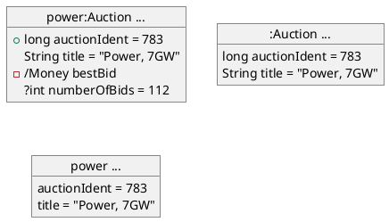

This figure also shows that attributes obey the same rules for the usage of visibility modifiers and other tags as in class diagrams. The attribute list need not be complete. Accordingly, the two representation indicators “. . . ” c ” introduced in Fig. 2.4 are used. and “! Even if a type declaration exists, it does not necessarily describe the object’s class. Instead, the object can also be an instance of a subclass. Hence, it is a real type declaration. Therefore, abstract classes and interfaces are also allowed as types for the objects of the object diagram.

#### 4.1.2 Attributes
The second field in an object representation consists of a list of attributes. This field closely resembles that of class diagrams. Attributes can be omitted or visibilities, tags, and stereotypes attached to attributes. According to Java, Type name would be common. Then, however, the optional omission of the object name name or type Type would be ambiguous. Therefore, the notation from the UML standard is used. A completely described attribute without additional tags thus consists of the attribute type, the attribute name and the attribute value in the form Type name = value. A concrete value can be omitted if the content of the attribute is not relevant for depicting the desired facts or if it is described by another concept, e.g., an OCL constraint. The type of an attribute can be omitted as well, as it can be found in a class diagram. If required by the representation, not only attributes directly assigned to the object can explicitly be listed in an object, but also class attributes, derived attributes and inherited attributes. If the value of a class attribute is given, it remains the same in all depicted objects of this class. Generally, derived attributes are related to other attributes of the object by an invariant. Such invariants need to be taken into consideration in an object diagram. There is no representation of inheritance relations in an object diagram. Instead, the attributes inherited from the superclass are usually explicitly listed in the subclass. The inheritance structure between classes is thus “expanded” in an object diagram. While classes in class diagrams have a third field for methods, no methods are shown in the object diagram. Therefore, a method list does not exist in the object diagram.

#### 4.1.3 Links
A link brings two objects into relation. An object is an instance of a class, so a link is an instance of an association. This is why there may be multiple objects of the same type and multiple links of the same association in an object diagram. One of them is permitted only as an observer. Usually, links are marked with the association name and, optionally, with further tags of the association. Especially role names and the navigation direction are expedient when it comes to links and can be taken over from the association. Like associations, links can be bidirectional, unidirectional or depicted without explicitly defined direction. If the association name is not given explicitly, role names can be used, as in the case of an association. If the association can be identified from the connected ends, the link does not need a name. In this case, however, the types of both objects participating in a link must be given. Links of derived associations are depicted like those of ordinary ones. However, the invariant that characterizes a derived association must be taken into account in order to obtain a valid object diagram. The association tag {frozen} that, for instance, was used for associations to message lists can, in object diagrams, be applied to links as well. It shows that the link is already created and that it must not be changed during the lifetime of the two objects. Two prototypical objects depicted in a diagram represent two different objects in the system. This also applies when both objects have the same type and cannot be distinguished by their names or their attribute values. Figure 4.6 shows an object diagram with seven different anonymous Person objects, all participating in the auction copper913. This rule for distinction also applies for links.

**Figure 4.6.** Several anonymous objects
```plantuml
@startuml
object "copper913:Auction ..." as a {
  long auctionIdent = 913
  String title = "380t Copper"
  int numberOfBids = 0
}
object ":Person ..." as p1 { personIdent=1783; name="Theobald Schmidt"; isActive=false }
object ":Person ..." as p2 { personIdent=20544; name="Ottokar Huber"; isActive=true }
object ":Person ..." as p3 { personIdent=45362; name="Elisabeth Müller"; isActive=true }
object ":Person ..." as p4
object ":Person ..." as p5
object ":Person ..." as p6
object ":Person ..." as p7
a --> p1 : participants
a --> p2 : participants
a --> p3 : participants
a --> p4 : participants
a --> p5 : participants
a --> p6 : participants
a --> p7 : participants
note bottom : Seven different anonymous Person objects
@enduml
```

The level of detail for presenting an object is left to the modeler. The example in Fig. 4.6 shows that even objects of the same type can be presented in distinctly detailed forms. In analogy to the class diagram, it is, of course, possible to depict objects and links with some helpful icons. In object diagrams, the legibility can be increased through appropriate application of icons as well.

#### 4.1.4 Qualified Links
An association can have a qualifier at one end that is used to select a unique target object from a number of objects. In an object diagram, the concrete qualifier value can be added to each link of such an association. Figure 4.7 contains an object diagram with multiple auctions that can be reached using a qualifier starting from the singleton of the class AllData.

**Figure 4.7.** Qualified links
```plantuml
@startuml
object ":AllData" as ad
object ":Auction ..." as a1 { long auctionIdent=1213; String title="fast drills"; int numberOfBids=0 }
object ":Auction ..." as a2 { long auctionIdent=1214; String title="thread rods"; int numberOfBids=0 }
object ":Person ..." as p  { personIdent=1783; login="schmidt"; name="Theobald Schmidt"; isActive=false }
ad --> a1 : [1213]
ad --> a2 : [1214]
ad --> p  : ["schmidt"]
note right : qualifier value used at a link
@enduml
```

The qualifiers in this example are always identical to the attribute of the target object distinctly defining the target. If this attribute is defined in the object, the qualifier value is redundant information. In these cases, the qualifier can also be omitted, or the link can name the qualifying attribute instead of indicating a concrete qualifier value. An association is regarded as qualified if it has the tag {ordered}. In this case, integers can be used as qualifier values. Figure 4.9 shows a collection of message objects that are assigned to an auction. The highest given qualifier is 14 so that, due to the completeness of the interval available as qualifier scope, at least 15 messages with the indexes 0 to 14 must be available. Here, the 12 bids are not shown.

#### 4.1.5 Composition
A composition is shown by a filled diamond at one end of the association in the object diagram as well. This expresses a strong dependency of the subobjects from the whole. We have already seen that, for links, these diamonds can be taken over in a similar manner. The anonymous objects shown with :BiddingPolicy and :TimingPolicy are in fact objects that implement respective interfaces. These are created together with the Auction object and become obsolete at the end of its lifecycle. When it comes to exchangeability and the lifecycle of dependent objects in a composite, there are, however, considerable differences in interpretation. While in class diagrams a class may occur in several compositions, it is not allowed in the object diagram to assign a subobject to multiple composition links. This is demonstrated by the two valid diagrams (a) and (b) as well as the illegal diagrams (c) and (d). The only exception is a hierarchically nested composition in which a subobject belongs at the same time to the subordinate composite and, thus, indirectly to the superior one. In order to underline more strongly the dependency of the subobject on the whole as well as the compositional character, there is, like in the case of classes, an alternative form of representation that makes use of graphic containedness as a form of expression. In a composition, subobjects are often shown in anonymous form or given a name that is identical to the attribute name of the contained object. The object names bidPol and timePol were chosen in the object diagrams  accordingly. The subobjects of a composition can, for their part, contain attributes, have links to other objects (also to objects outside the composite), and themselves contain further subobjects. Thus, a complex composition structure can arise, although it should not be nested too deeply as, otherwise, the clarity of the representation is lost.

#### 4.1.6 Tags and Stereotypes
In a class diagram, tags and stereotypes are used to specialize the semantics of the marked element or to specify its usage. These tags and stereotypes can be transferred from the class to their objects and from associations to their links. Therefore, it is possible to point to special properties of the depicted objects or links, also outside the class diagram. This, for example, is helpful for {frozen} in order to indicate that the link does not change during the lifetime of both participating objects. However, tags can also be directly assigned to elements of the object diagram without these being valid in the class diagram. The tag {addOnly} for associations also has the effect that links, once established, are not changed. Thus, the tag {frozen} can be assigned for their links without the association itself having this tag. Prototypical objects in an object diagram can also be marked with tags which, belong to the project management. This, e.g., includes tags for the creator and date of creation.

### 4.2 Meaning of an Object Diagram
In order to correctly assess the methodical use of object diagrams, the exemplary character and the relation between the prototypical objects of the object diagram and the real objects of the system need to be understood.

#### 4.2.1 Incompleteness and Exemplaricity
Like class diagrams, object diagrams are also in general incomplete. Due to the dynamic instantiation and destruction of objects, the number of objects in a system is rapidly changing. In contrast to the number of classes, it is even unrestricted. Moreover, links in object structures can change dynamically. As a result, there is no limit on the number of object structures that emerge. And these, of course, cannot be completely depicted. Therefore, an object diagram models an excerpt of a system. This snippet is valid for a limited period of time that is, in extreme cases, reduced to a single point in time, a snapshot, for example, between two method calls. An object diagram illustrates this situation and contains all relevant data without being overloaded. It is at the modeler’s discretion to find the correct level of abstraction. In doing so, attribute values or types, links, tags or whole objects can be omitted.

#### 4.2.2 Prototypical Objects
The structures modeled with object diagrams have a prototypical, pattern-like character. They exemplarily show a situation that does not necessarily need to have a normative character. Because of this, the usage of object diagrams in descriptions of design and architecture patterns is popular. The situation described by the object diagram need not occur in the actual system execution, but it can occur more than once, in a timely succession, or even at the same time. Different or (partly) the same objects can participate in each of the occurring situations. Thus, object diagrams can represent overlapping structures in a system. Therefore, it is necessary to clearly distinguish between the representation of an object in an object diagram and the real object in a system. Hence, objects depicted in object diagrams are called prototypical. An object diagram, however, can be filled with concrete values such that, as derivable from the context, it can occur at maximally one point in the system. For example, the Auction objects of the previous figures always contain an explicit value for their identifier auctionIdent. On the other hand, the object diagram can be applied to many of the auctions. Actually, this diagram represents a pattern for many purchasing auctions, as concrete values have been omitted at several places. The attributes that are not specified in the object diagram can have arbitrary values in the system. In order to specify the potential scope of an attribute, we can use OCL to contain its values. In this way, it can be determined that, in this pattern, the minimal value is lower than the maximum value and that the auction takes two to three hours. min.amount < max.amount; start.timeSec + 2*60*60 <= finish.timeSec; finish.timeSec <= start.timeSec + 3*60*60;
Therefore, not only an object a of the type auction is nominally available but also the objects min, bidPol, start, etc. Object min, for instance, is identical to a.bidPol.min. The integration of OCL constraints into object diagrams and the combination of object diagrams using the OCL logic. Occasionally, not only object diagrams (in the respective syntactic form) but also their expansion by call structures in the form of communication diagrams are utilized. Based on the integration of the OCL logic into object diagrams, a powerful notation emerges which is used for modeling and the testing of systems. This notation also allows to describe under which conditions the situations defined by object diagrams arise, whether they have universal validity, whether they have a unique or pattern-like character, or for how long they are valid.

#### 4.2.3 Instance Versus Model Instance
A prototypical object of an object diagram is an element of a model and not an element of the production system. There is, however, a kind of instance relation between the prototypical object and its class that is similar to the instance relation between a class and a system’s real objects. The model level is further divided into layers between which a model instantiation takes place. A class diagram is located one layer higher than the object diagram. Hence, a prototypical object is a model instance of the class assigned to it. This triangular relationship can be extended if the manifestation of a class at runtime is considered as an entity on its own. In Smalltalk, classes at runtime are even separate objects that can be arbitrarily manipulated. Java also represents classes as objects but only with restricted possibilities for their access. Other programming languages, such as C++, also have structures that correspond to the representation of a class, but usually, these are not accessible by the programming code. We call the (accessible or inaccessible) manifestation of a class at runtime class code.

In the system, there is exactly one class code for each class. In contrast, there can be several different representations of the same class in the model.
In each class diagram, a separate representation can be given with a slightly different focus that describes a part of the class code. The number of prototypical objects of a class in a model is also unrestricted. Frequently, multiple objects of the same class occur within an object diagram. Each of these prototypical objects must conform to each of the class representations in the model. The number of real objects is unrestricted as well. Their structure and functionality, however, are determined by the class code and, thus, also conform to all class representations of the model. As prototypical objects contain additional information in the form of concrete values and links, real objects can intermittently conform to prototypical objects. Basically, it would also be possible that the same real object takes over the roles of two prototypical objects in the same object diagram. This is only prevented by the corresponding rule saying that, for reasons of clarity, two different prototypical objects in the object diagram should be mapped to two individual objects in the system. The distinction between objects, prototypical objects, classes, and class code might seem rather artificial for practical application, but it leads to a considerably clearer and, especially, simpler description than, e.g., metamodeling with its four-layer model could provide. There, model and system level mingle and a clear distinction between syntax and semantics is considerably aggravated. In practical use, however, these semantic details can often be neglected provided that the users of a language can recall these differences when necessary.

### 4.3 Logic of Object Diagrams
This and the following section introduce an essential expansion of object diagrams that facilitates their methodical application. For this purpose, we use operators from OCL that allow one to precisely define when object diagrams are valid and how they are interconnected. The integration of the object diagrams with the OCL operators results in a “logic of object diagrams.” Thus, object diagrams can be integrated into OCL as statements but also combined with each other in different ways.

#### 4.3.1 Name for a Diagram
In order to be able to include object diagrams in OCL constraints, the diagrams are named.  This allows us to determine additional constraints that must hold in an object structure described by BidTime1: OD.BidTime1 && timePol.start.lessThan(bid.biddingTime) && bid.biddingTime.lessThan(timePol.finish)
However, in order to achieve the desired effect of the statement, one needs to pay special attention to the names used in object diagrams and OCL constraints. The desired statement is of the form: “always when an object structure like the one in the object diagram BidTime1 occurs, the constraints . . . additionally hold.” This statement is actually an invariant that, in part, is graphically specified by the object diagram. The above-mentioned OCL statement does not achieve the desired effect, as the quantification of the vacant variables is ambiguous.

#### 4.3.2 Binding of Object Names
In object diagrams, usually several objects that can be referred to in the OCL constraint are introduced by name. The binding scope of the names a, timePol, and bid in the object diagram shown for BidTime1 are, hence, to be determined outside the object diagram. The above OCL constraint can, therefore, be embedded in a completing context: context Auction a, ConstantTimingPolicy timePol, BidMessage bid inv BidTime1A: OD.BidTime1 implies timePol.start.lessThan(bid.biddingTime) && bid.biddingTime.lessThan(timePol.finish)

If an object diagram is used in an OCL constraint, one needs to pay attention to the fact that all names used in the object diagram are introduced in the OCL constraint; i.e., the constraint has no free variables anymore. Using the quantifier for binding object names allows flexible application of object diagrams. With the following statement, it can be demanded that, in each auction that has already started, a welcome message is sent. Compared with the first example BidTime1A, not all objects of the object diagrams are bound by a universal quantification here. Therefore, both diagrams are used in different forms. The statement is: “if objects a and timePol exist and fulfill the object diagram Welcome1A, then object welcome exists and all properties formulated in the object diagram Welcome1B hold.” The details of the first subdiagram need not be repeated. Specifying the new relevant properties (i.e., the existence of the link with the qualifier 0) is sufficient. As a precondition for formulating the constraint Welcome1, it was defined that the auction is already RUNNING. If the auction is closed, nothing is said about the existence of a welcome message. We note that the statement using two object structures has no temporal implications but is interpreted on only one snapshot of the system. The used keyword implies results in a statement of the form: “if the state is RUNNING, then a welcome message exists in the auction with the index 0.” A similar statement would be: “if the state is set to RUNNING, then a welcome message is to be sent.” This, however, cannot be be specified as an invariant but, e.g., as a method specification (of a still unknown method to open auctions), because this second statement contains a temporal implication. The assertion Welcome1, in contrast, is truly weaker, as it allows implementation alternatives by, for example, creating the welcome message already together with the auction.

#### 4.3.3 Integration of Object Diagram and OCL
Basically all structural properties of object diagrams and the attribute values contained therein can also be expressed directly by OCL, because all constructs of an object diagram can be implemented in OCL statements. Hence, the means for specifying properties can be chosen freely. As an example, the statement Welcome1 can be specified as an OCL formula as follows:
inv Welcome2:
forall Auction a, TimingPolicy timePol:
(Object)a != timePol &&
a.timePol == timePol &&
timePol.status == TimingPolicy.RUNNING
implies
exists Message welcome:
(Object)a != welcome &&
a.messages[0] == welcome

In OCL, the pairwise distinction of objects of an object diagram must be defined explicitly using inequations. This can be achieved with inequations of the form a != timePol.4,5 Practice shows that comprehensive specifications of object structures using OCL quickly become unclear. On the other hand, object diagrams have restricted expressiveness. The synergy of both notations allows a powerful and compact representation of object structures.

#### 4.3.4 Anonymous Objects
The usage of explicit object names in an object diagram enables access to these objects from outside the diagram. Anonymous objects show that such objects must exist but only allow indirect access via links. The implementation of an anonymous object can be explained by a transformation introducing an existential quantification. Actually, the implementation of anonymous objects is helpful as they reduce the dependence on the context of an object diagram.  In order to obtain syntactic correctness of the comparison, the type of the first object needs to be converted, if applicable. As a is of the type Auction and timePol of the type TimingPolicy, both objects seem to be necessarily different anyway. But it may occur that, later in the project, a subclass of Auction is developed that directly implements the interface TimingPolicy. Then, the inequation is no longer redundant. In Welcome1, the object timePol is universally quantified, as it was moved outside the implication. It holds that ∀a : (X =⇒ Y ) is equivalent to (∃a : X) =⇒ Y , as Y is independent of a. 

#### 4.3.5 OCL Constraints in Object Diagrams
The previous examples have shown how object diagrams are embedded in OCL constraints. That, of course, is possible vice versa. Thereby, the context is defined by the object diagram and the OCL constraint can use the objects modeled therein for defining its statement. This does not restrict the binding scope of the object names. The names are still usable outside the object diagram and the OCL constraint. Therefore, the OCL constraint’s context is defined by another keyword called import. As Fig. 4.22 shows, such OCL constraints are part of the object diagram or are assigned to the object diagram. The given OCL constraints are of rather different nature. TwoBids1 is an invariant universally valid for Auction objects. It could be formulated in a class diagram as well. TwoBids2 is an invariant over both bids that rank second and third in the message bar. This invariant could be generalized, as it analogously holds for other bids in the list of messages. TwoBids3 is not an invariant but a more detailed description of the appearance of a concrete object structure. This is typical for the description of object structures for  tests. However, the value for the attribute auctionIdent could have been entered directly into the object structure.

#### 4.3.6 Abstract Object Diagrams
So far, modeling with object diagrams has been confined to either using a constant or leaving the attribute value unspecified. Now, this is generalized by the option of using free OCL expressions as attribute values. The concrete qualifiers for selection in the list of messages used in the previous object diagram TwoBids have been replaced by abstract values in NBids. These abstract values can be imported into an OCL constraint and used for the specification of properties. OCL expressions can describe constraints between single attributes and qualifiers more precisely. In order to set up a test auction, for example, with 100 persons, the simple object diagram NPersons in Fig. 4.24 can be used. Here, the abstract value x is used in order to determine the appearance of the individual person. The 100 persons in the test auction are determined by the OCL constraint Test32. Because of the requirement that there is an incarnation of the object diagram for each x from the set 1..100 and that the attributes of the Person objects are set differently, there must be at least these 100 Person objects in the auction test32. The use of OCL expressions in object diagrams is also especially suited for describing derived attributes. Therefore, OCL constraints for describing derived elements can often be replaced by a representation in the object diagram.

### 4.4 Methodical Use of Object Diagrams
The last section defined the basics for using object diagrams in different situations and for specifying them in combination with OCL constraints. In this section, default situations are outlined by means of examples in order to give better insight into the abilities and to illustrate the methodical use of object diagrams. The expressiveness of the notation integrated with OCL and object diagrams is the same as in OCL. The reason for this is that each object diagram can be translated into an OCL formula, even though it is rather illegible. Correspondingly, the resulting integration provides a higher level of convenience when compactly and understandably describing situations. Vice versa, the expressiveness of object diagrams has increased as, for instance, alternatives, combinations, or generalizations can be used through abstract values. The previous section showed how both notations, i.e., object diagrams and OCL expressions, can be integrated into the other notation. Conversely, it is possible to integrate object diagrams as short forms for expressions using OD.Name. The unassigned names of the object diagram, i.e., object names and variables for abstract values, can be referred to in the OCL constraint. These references and the embedding into the OCL logic enable flexible use of object diagrams. This is discussed for several methodical applications using examples. Structural combinations of object diagrams, alternatives, or undesired situations can be modeled with the help of operators of the propositional logic &&, ||, and !.

#### 4.4.1 Composition of Object Diagrams
The && operator can combine multiple object diagrams and, thus, describe a larger object structure. The elements where the object diagrams are combined are the objects with common names. With this technique a larger object structure can be decomposed into manageable pieces and illustrated by suitable object diagrams. Figure 4.25 shows several individual diagrams that are connected using a conjunction. The resulting OCL constraint PowerAuction can be understood as composed object diagram. The Auction object named power serves as a connecting element because it occurs in all object diagrams. A more complex decomposition of an object diagram with 100 similarly looking persons has already been shown by the OCL statement Test32. This example demonstrates how complex data structures can be modeled out of relatively simple representations by combining OCL quantifiers and parameterizing object diagrams. With this technique, complex object structures can be decomposed into modular parts and these parts can be reused in other combinations. For structuring tests, it is particularly With this technique, complex object structures can be decomposed into situations.

#### 4.4.2 Negation
Apart from the conjunction, the other Boolean operators can also be used. For example, undesirable situations can be depicted with negation. However, an object diagram’s negation is relatively weak in its expressiveness as it only states that the object diagram does not occur in exactly this form. This means that only one detail has to be different. Figure 4.26 shows the constraint that each message, except the first message (the “welcome”), belongs to at most one auction, using an object diagram.

#### 4.4.3 Alternative Object Structures
The disjunction is a suitable means for depicting alternatives. As our application example uses two primary kinds of auctions that are characterized by a rising or falling bidding curve, two classes are provided that realize the rules for these auctions. Each auction possesses exactly one of these two policy classes.

#### 4.4.4 Object Diagrams in a Method Specification
A method specification represents a contract between the calling method and the method which is called: if the caller ensures that the called object is in an appropriate state and provides a context that conforms to the precondition, the calling method ensures that the postcondition is fulfilled after the call. In this precondition, the new company is assumed to be already present in the system. The object diagram used here has no illustrative function but is an essential element of the specification.

An object diagram can, hence, describe a situation in the execution of a software system and, thus, be used as a characterization of both the pre- as well as the postcondition. Similar to the rules of graph grammars two individual but in many details corresponding diagrams are necessary. Graph grammars often allow this characterization within a single diagram by offering additional graphic concepts for depicting the deletion or creation of objects and links. In the proposed form, object diagrams are less expressive but at the same time less overloaded with syntactic concepts. Graph grammars, however, are better suited for certain application forms and can serve as an interesting extension of the introduced usage of object diagrams for specifying methods. If we use two object diagrams for the pre- and postcondition, it is not necessary to repeat all objects of the precondition in the postcondition. As a result, the postcondition becomes considerably smaller. In the object diagram, the old company object, for example, could have been omitted. In graph grammars, this would have meant that the company object was to be deleted. The example also shows the technique applied for binding shared variables in object diagrams. The object this is introduced by the definition of the method context and, thus, is the same for the pre- and postcondition. The objects of both object diagrams labeled c2 are identified by making use of the let construct. This is not the case for the two anonymous objects in the object diagrams BeforeChange and AfterChange. Therefore, these two objects are not the same, although this is suggested by their position in the respective object diagram. While the anonymous object in (a) can still be clearly identified, the anonymous object in (b) can be an arbitrary one (except c2). A certain deficit of the specification style with pre- and postconditions becomes apparent by this example. In the postcondition, there is no possibility of accessing existentially quantified objects of the precondition. This becomes especially clear when using object diagrams together with anonymous objects. Such an object, thus, has to be, like the object c2, explicitly labeled and determined by the let construct outside both conditions. But this is only possible if the object can clearly be characterized in the let construct. Otherwise, the characterization in the pre- and postcondition must be indicated twice, if necessary.


#### 4.4.6 Validity of Object Diagrams
An object diagram can describe an exemplary situation but can also, as shown above, be applied as an invariant. However, if the structure of an object diagram is not always valid, the invariant can be restricted by an OCL constraint. Typical “scopes of validity” for object diagrams are:
1. Always (invariant)
2. At the beginning of a method call (precondition)
3. After a method call (postcondition)
4. If a variable (usually a “state variable”) has a certain state
5. At the beginning of an object’s existence (initial structure)

The usage of object diagrams in invariants, pre- and postconditions has already been fully discussed. We restrict the validity of an object diagram by
an OCL constraint illustrated in Fig. 4.31. Here, we look at the state of the applets that the user sees in order to participate in auctions. The applet has various states, whereas one of them is the initial state AppStatus.INITIAL. The applet is always in the initial state if the user is not logged in. In this state, the user can already adjust general settings such as language and signals via the option panel. However, some other panels are set to null. For any other state of the applet, another object diagram can be designed to show the structure of this state. Some states also have the same structure or, at least, a clear overlap and, thus, can share and reuse subdiagrams.

#### 4.4.7 Initialization of Object Structures
During their own creation, many objects trigger the creation of further objects and combine these into a complex object structure.  This structure is already created during the creation of WebBidding objects. These subobjects are created in the constructor. Therefore, the initial object structure can be described in the postcondition of the constructor. In applets, however, the creation of the applet object and the initialization are implemented separately. This is why the constructor basically has an empty body and an independent method init conducts the initialization. For this purpose, parameters are determined with the function getParameter, which works as a query and, thus, can be used here. The object diagram WBinit is designed in such a way that each individual attribute can effectively be calculated therein and the link structure can be generated automatically. Attribute values can, e.g., be omitted if, in the class diagram, an initialization value is given for the attribute. Code generation for the creation of initial object structures is, in fact, a helpful technique for efficiently developing object systems. However, this procedure is quickly stretched to its limit if, in the initialization process, already existing object structures are to be incorporated or, as in the auction example, effects on the graphical user interface and the server system cannot be described by an object structure. So, if the description of an initialization or structure change by means of object diagrams is chosen, the decision is to be made whether a complete (and, thus, for code generation suitable) modeling with an object diagram is possible or whether an object diagram rather has illustrative effects. In the latter case, objects can also be depicted incompletely and it is possible to use derived attributes. Depicting new object structures is of particular interest if these objects realize data structures. Thereby, the generation of a new person object with its dependencies. This constructor is used in order to create personal data that are entered via a web form.

### 4.5 Summary
Currently, object diagrams do not receive the attention in the UML standard that they should, although they have been defined as an independent notation since UML 2.0. UML/P upgrades object diagrams and improves the methodical application of object diagrams in the software development process. This includes techniques for:

- Illustrative representation of a situation (snapshot)
- Representation of negative situations
- Usage of an object diagram as an invariant
- Composition of object diagrams
- Representation of alternative possibilities for object structures
- Modeling of initial structures in object creation
- Modeling of defaults for test cases
- Modeling of design patterns

To facilitate precise methodical use of object diagrams, the notation has been introduced and especially the semantics of language concepts in object diagrams discussed in detail. The difference between the object in the system and the prototypical object in the object diagram has been developed, and the exemplary character of object diagrams explained. As a consequence of the restricted expressiveness of object diagrams, we combined object diagrams with the OCL logic. A “logic for object diagrams” arose that not only expands object diagrams by logical statements; Instead, it is possible to depict unsolicited situations, alternatives or compositions of object diagrams with Boolean operations and, hence, increase their expressiveness from exemplary to universally valid statements. With the help of quantifiers, object diagrams parameterized with variables can finally be used also as patterns (similar to the design pattern [GHJV94]). This methodical usage of object diagrams has been discussed in detail by means of examples to demonstrate the benefit of this chapter.

# Chapter 5: Statecharts
Statecharts are an advancement of finite automata for the description of object behavior. Each complex system has steering and controlling parts that can be modeled with Statecharts. The Statechart variant introduced here uses OCL as the constraint language and Java instructions as actions. In the first two sections, fundamental properties of Statecharts are discussed. The next three sections introduce Statecharts as a description technique. We discuss the usage of Statecharts in the context of other UML diagrams to complete the introduction of Statecharts. Automata, state transition diagrams, transition systems, as well as Statecharts constitute various manifestations of an elementary concept for statebased representation of behavior. While the class and object diagrams described in Chapters 2 and 4 basically focus on the structure of a software system, state transition diagrams in their different manifestations constitute the link between state and behavior of system components. There are various manifestations of automata. Automata can be executable or used for recognizing sequences of characters or messages, describing the state space of an object, or specifying the response behavior to a stimulus. In UML, Statecharts are used as a variant of hierarchical automata principally based on the Statecharts for embedded systems. While in the original version Statecharts were used for both the structure and the behavior of communicating systems, the function of a Statechart in the context of UML is reduced to modeling the objects’ behavior. Despite the resulting simplification of a Statechart semantics, these are complex enough to discuss the basics in the form of finite automata first and, then, to introduce Statecharts with all their concepts. The overview given in shows that there are a number of syntactic variants and semantic interpretation possibilities for Statecharts which are adjusted to the respective fields of application. By profiling with suitable stereotypes, Statecharts of UML/P can be used for modeling, code generation, and description of test cases.

### 5.1 Properties of Statecharts
As already mentioned, there are numerous variants and fields of application for Statecharts. In order to determine not only the notation but also the semantics and the methodical usage of Statecharts precisely enough to benefit software quality, development time, and work effort, it is important to make some fundamental assumptions about the usage of Statecharts. 
Tasks of a Statechart can be (overlaps possible):

- Representation of an object’s lifecycle
- Implementation description of a method
- Implementation description of an object’s behavior
- Requirements for the (abstract) state space of an object
- Representation of the order of stimuli allowed to occur (sequence of invocation)
- Characterization of the possible or allowed behavior of an object
- Link between state and behavior description

One of the basic assumptions for using a Statechart is that a Statechart describes only the behavior of a single object. For describing interaction patterns between different objects, sequence diagrams are better suited. A Statechart describes the response behavior of an object that emerges when a stimulus triggers this object. For now, it is not important whether the stimulus represents a method call, an asynchronous message, a timeout, or something else. However, it is essential that the processing of the stimulus takes place in atomic form, i.e., it is neither interruptible nor hierarchically nested. Thus, a transition is initiated by a stimulus and then executed without interruption. In doing so, it is assumed that the behavior specified in the transition does not lead to the immediate stimulation of further transitions of the same object. If the stimuli of a Statechart are, for example, method calls, the transition must not lead to further recursive method calls on the same object described by the Statechart. In the case of Statecharts, this required uninterruptibility is also called “run to completion”. Some Statechart variants, however, have softened this by allowing compound or prioritized transitions. Statecharts process their stimuli in sequential order. This means that parallel processing of stimuli does not take place and that, therefore, synchronization between transitions is not necessary. This concept corresponds to the synchronization of object methods using the keyword synchronized in Java. Like any other UML diagram type, a Statechart presents a certain view on an excerpt of the system to be implemented. While an object usually has an infinite state space, a Statechart consists of a not only finite but typically even very small set of diagram states. Hence, the diagram states (often five to ten) necessarily represent an abstraction of the object state space. Depending on the application area of the Statechart, the relation between diagram and object states can be precisely defined by using OCL constraints. The like is true for preconditions and effects of transitions. Therefore, a Statechart can be regarded as an executable implementation or abstract requirement description, depending on the level of detail and the form of representation of these constraints. So the field of application of Statecharts stretches from requirement analysis to the implementation. Statecharts can describe lifecycles of objects as well as detailed object behavior. One advantage of Statecharts is their intuitive form of representation of the operational behavior description. Due to the additional use of hierarchy, it is possible to structure the state space of the objects described even more intuitively. Unfortunately, such state hierarchy introduces some subtile semantic problems and thus should be applied very carefully and not too extensively. By giving up communication between substatecharts, hierarchically structured states can be semantically dealt with more easily and explained more understandably. Therefore, we do not apply the hierarchy for the composition of subautomata of different objects, as was the case for many original Statechart variants.

### 5.2 Automaton Theory and Its Interpretation
Basically, the Statecharts used in UML are a form of finite automata extended by hierarchy concepts where outputs may be produced by states and transitions. Let us briefly introduce output-producing Moore and Mealy automata and discuss their properties. The finite automaton theory allows this discussion in condensed form as, for example, the input and the output alphabet are not interpreted further. In practical use, these characters of the alphabet are, e.g., replaced by complex method calls with arguments and actions formulated in Java. The following compact introduction is essentially.

#### 5.2.1 Recognizing and Mealy Automata
A transition always connects a source state with a target state and carries either an input symbol or the symbol ε. The latter transitions are called spontaneous, as they do not depend on an input symbol while firing. The semantics of a recognizing automaton consists of the set of all words of the alphabet E for which there is a path through the automaton starting from an initial state to a final state. Moreover, final states can also be passed through repeatedly. The semantics of a recognizing automaton is given by the set of words that are accepted on a path from an initial state to a final state.

**Figure 5.3.** Examples for recognizing automata

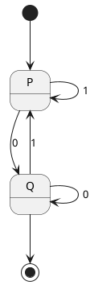

If an automaton is used for modeling object-oriented behavior, the recognition of input sequences plays a minor role. Instead, the output as a reaction to an input element and the destination state reached are considered relevant. The automaton states can, e.g., correspond to the states of the graphical user interface and thus be directly visible to the user of the modeled system. Therefore, the nondeterminism in the automaton discussed in more detail below has a totally different purpose than it does in the recognition of word sets. Alternatively, it would also have been possible to extend the recognizing automaton by an output at each state to a Moore automaton. It is known from finite automaton theory that these two extensions do not principally differ in their expressiveness but are convertible into each other. An alphabetic (nondeterministic and incomplete) Mealy automaton is a sextuplet (S, I, O, t, S0 , F ) that contains a recognizing automaton (S, I, t, S0 , F ) and in addition has:
- An output alphabet O
- A transition relation t ⊆ S × I ε × Oε × S extended by an output

The semantics of the Mealy automaton consists of the relation describing which input words lead to which output words. If in addition the state space is of interest, as it is in object-oriented modeling, the semantics of an automaton can be extended to the set of possible paths through the automaton. Figure 5.5 contains a Mealy automaton that replaces consecutive sequences of the digit 0 in the input by a single X or several Y. The nondeterminism in the automaton has an effect on the state transitions as well as the produced output. For Mealy automata, final states often do not play a vital role and are, thus, frequently not specified.

**Figure 5.5.** Example of Mealy automaton
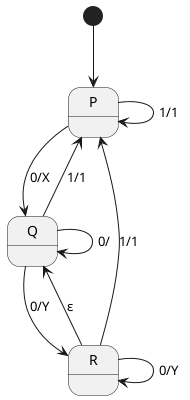

#### 5.2.2 Interpretation
A formalism, such as the theory of finite automata, concentrates on the representation of structures that are important for the respective analysis. Therefore, it is suited for studying capabilities and restrictions of automaton representations, simplification rules, as well as sequential or alternative compositions. Such a formalism is a closed mathematical structure that abstracts from the real world and can, thus, be applied to many real-world phenomena. In modeling, however, this relation to the real world is of great importance. In order to establish this relation, each concept of a finite automaton has to be interpreted by real-world elements, i.e., within object-oriented systems. A possible interpretation is the following:

- Each state of the automaton corresponds to one state of an object.
- An initial state is the state of an object that directly eventuates after its creation.
- A final state is irrelevant, because of the garbage collection in Java, which removes unreachable objects in each state.
- An input symbol is a method call including its arguments.
- An output symbol is an action that is executed in the body of a method. It can contain several method calls.
- A transition is the execution of a method body.

This interpretation permits transfer of the insights of automaton theory to the state-based modeling of objectoriented systems. However, this is by far not the only possible interpretation. For practical purposes, the set of states as well as the input and output symbols in automata are infinite in this interpretation. These infinite sets are, of course, not suited for representation in a finite, concise diagram. The finite set of diagram states of a Statechart, therefore, needs a better interpretation. Therefore, we use a two-stage interpretation of a Statechart diagram. This Mealy automaton describes the behavior of an object. The interpretation of a diagram element by a set of states or a set of transitions introduces some effects that need to be considered when using Statecharts for modeling purposes. We discuss these effects below.

#### 5.2.3 Nondeterminism as Underspecification
Considering, for instance, the interpretation of a single transition, we can see that a large set of target states are possible, even though a concrete object state with a given method call is assumed. Thus, a transition can be highly underspecified. This is expressed in the fact that many object state changes that only differ in the object’s target states are possible when interpreting a diagram transition. In automaton theory, this form of underspecification is called nondeterminism. Indeed, this nondeterminism can be of methodical interest, for example, if an object’s behavior cannot or should not be specified in full detail. But if this nondeterminism is not wanted, it can be avoided by additional OCL constraints, for example. Nondeterminism, however, can also occur already in the diagram itself. Several diagram transitions starting from the same source state can process the same input symbol but produce different output symbols. This form of nondeterminism can also be understood in various ways:
1. The developers have not yet decided exactly which transition should be taken. They will either question the users or leave it to the implementation.
2. The automaton is an incomplete representation of the object state, and the information that would be necessary to precisely decide which transition to take has been abstracted in the diagram.
3. The compiler chooses (according to criteria that are not further defined) one of the transitions and ignores all others.
4. In fact, the system is nondeterministic and can choose one transition each time when at this state, depending on external factors or random generators. The existence of nondeterminism always means a choice. Whether this choice is made by the developer, the user, the compiler or, at least, by the system is not determined. In particular, nondeterminism in the automaton does not necessarily mean a occurring and constantly recurring nondeterministic decision within the system. In contrast, in many systems, especially in Java implementations, nondeterminism can only be realized with additional effort. Instead, this nondeterminism of the automaton can generally be regarded as underspecification of the model.

###5.2.4 ε-Transitions
ε-Transitions offer a special form of nondeterminism. They represent spontaneous transitions whose trigger is not modeled in the diagram. This also offers a number of possible interpretations:
1. A timer has expired and causes the transition.
2. The automaton provides an incomplete representation of the object’s interaction possibilities, and the message leading to this transition has not been modeled. However, its occurrence has effects on the visible state of the object.
3. The transition is a logical consequence of a previous transition and is automatically executed by the system. Thereby, long actions can be broken down into sequences, intersections, and even iterations, and ε-transitions can be interpreted as notational convenience.
In concurrent, time-controlled systems, alternative 1 is of interest, while alternative 2 is used for representation of interface behavior. Alternative 3 can be used for modeling single complex methods. The function of these Statecharts is not to represent the character of a lifecycle but to serve as a control flow diagram. The interconnection of several ε-transitions into an ε-loop is in principle not forbidden, but it is not helpful either.

#### 5.2.5 Incompleteness
Besides the option of defining several transitions for one situation, there could also be no transition. Then, the automaton is incomplete. In state p, it is not described how to react to the input symbol “ . ” (period). Such incompleteness can, for instance, be interpreted in the following ways:
1. The incoming symbol is ignored by not carrying out an action or change of state.
2. A chaotic reaction allows an arbitrary state transition and an arbitrary action. Even a “crash” of the object or the whole system is possible.
3. The object transitions into an explicit error state that can only be left through an explicit reset message.
4. An explicit error message in the mold of “Message not understood” known from Smalltalk is displayed without carrying out a state change.
While alternatives 1, 3, and 4 are typical for dealing with incomplete automata in automatic code generation, the second alternative is methodically interesting. As discussed in [Rum96], the loose approach that does not make promises about what is not explicitly represented in the diagram is particularly suited to urge the developer to model soundly. Thus, the modeler cannot only rely on the code generator. Methodically, this approach is also interesting, because adding transitions in order to reduce this incompleteness represents a refinement in the sense of the precision of the described behavior. The same loose approach is also used for class diagrams where the incompleteness indicator “. . .” shows that other classes, methods, or attributes which are not mentioned in the diagram can exist. However, in order to be able to work with incomplete automata in prototyping, respective defaults should exist for code generators to reasonably realize code for incomplete situations or those underspecified by nondeterminism.

#### 5.2.6 Lifecycle
The possibilities for interpreting the incompleteness of an automaton mentioned are closely related to the way in which an automaton can be interpreted as a description of a lifecycle. As discussed, it is possible to understand an automaton as the description of the set of all possible sequences of method calls. This describes the external view of a fictional observer of an object who determines whether the set of potential call sequences described for that object has been adhered to. Alternatively, there is also the possibility of regarding an automaton as the set of possible sequences of calls. This describes the internal view on an implementation that needs to be able to process the method call sequences specified by the automaton. In a sound implementation, the implementer can admit even more call sequences as required by the automaton. The implementers’ and observers’ views are compatible, as observers behave correctly as callers regarding the modeled permissible call sequences and ideally do not require a robust implementation. Crucial differences between these two interpretations arise if modifications are applied to automata to, e.g., specialize the behavior or to supplement and inherit it. If an automaton describes guaranteed behavior, transformations, such as the conversions of Statecharts described in Sect. 5.6.2, are only allowed to add and detail behavior. This is only possible in a flexible way if the automaton is understood as underspecified, i.e., with chaos completion as the interpretation. In this sense, an automaton is a description of a minimal set of lifecycles of the object, which can be extended. If the automaton is completed with an error state or if unaccepted method calls are ignored, the automaton describes a maximal set of lifecycles. This means that it determines the set of all possible call sequences that do not lead to an error state or to ignoring a method call. The choice of the interpretation of incompleteness is thus a choice of whether the automaton is interpreted as a minimally assured or maximally possible lifecycle. In both interpretations, however, the behavior is identical for the call sequences described by the automaton, as it is processed by a predefined sequence of transitions. In a nondeterministic automaton, it is possible to transit into different target states as a reaction to the same input. Because of this, the subsequent behavior can be different. Thus, there are sequences of method calls that can be correctly processed by a sequence of transitions, but that can also lead to incomplete situations. To prevent an object described by an automaton from receiving an illegal input in a certain state, the calling environment has to examine, e.g., through inquiry or internal calculation, whether a call is possible.

#### 5.2.7 Expressiveness
We know that finite automata are restricted in their expressiveness. They are suited to describe regular sets but are not able to specify bracket structures such as those appearing in Java expressions, for example. The principal problem is that a finite automaton only has a finite state space, so that opening brackets cannot be counted arbitrarily deeply and, thus, clearly assigned to closing brackets. This restriction known from automaton theory also manifests when using automata for modeling object-oriented systems, especially when methods of an object call other methods of the same object. Recursion does not necessarily have to take place in the same method (method recursion); it already suffices if another method of the same object is called directly or indirectly within the method. Objects realizing complex protocols typically contain state components that each contain an abstraction of the state of the communication partners. Thus, both simulate an abstraction of the state space of the communication partner, as far as it is possible for them to do so on the basis of the observed behavior. So, they know in which state each communication partner can be. Nesting of transitions cannot be adequately represented by the automaton itself. It is, for example, not clear whether the state transition caused by bar does lead to the fact that the target state T is taken. Generally, the relation of the states S and T to the state Q remains unclear. In order to avoid such problems, suitable restrictions must be made on the usage of Statecharts when modeling object behavior in the case of nested method calls. In case that communication is based on asynchronous messages, finite automata, however, are sufficient. This processing only takes place after the current transition is finished, i.e., after reaching the state Q. This discussion shows that the underlying communication mechanism plays a role in the assignment of a semantics for Statecharts if objects are allowed to send messages or method calls in recursive form to themselves.

#### 5.2.8 Transformations on Automata
In automaton theory, possibilities for transformation, refinement, and composition of automata have been studied in detail. These transformations, primarily introduced for minimization or removal of nondeterminism and incompleteness in the automaton, have already been used in different variants for modeling object-oriented or embedded systems. The refactoring techniques that have become prominent in the context of the Extreme Programming approach show the helpfulness of manageable, systematically executed transformation steps on the notations used in the software development process. While refactoring techniques in Java are especially suited for maintaining the behavior, transformation steps on automata can also be used for detailing the behavior. Some of these transformation steps. After having examined the basics of Statecharts in this section, the following sections introduce Statecharts in detail and discuss their interpretation in the context of object-oriented modeling.

### 5.3 States
Statechart notation is used to describe the behavior of an object on the basis of its state spaces. Hence, states, transitions, and assigned actions are essential elements of a Statechart.  According to the UML standard, a state is a situation for an object in which the object meets a certain condition and, thereby, awaits an event or executes an internal activity. Typically, an object remains in such State. A state (synonym: diagram state) represents a subset of possible object states. A diagram state is modeled by a state name and an optional state invariant, entryaction, exit-action, and do-activity. Initial state. Objects begin their lifecycle in an initial state. Multiple initial states allow the representation of multiple forms of object creation. In a method Statechart, the initial state marks the beginning of the method. The semantics of the Statechart as part of another state is described in Sect. 5.4.2. Final state. A final state describes that the object has fulfilled its duty in this state and is not necessary anymore. However, final states can be left again, if transitions emerge. In a method Statechart, the final state marks the end of the method processing. States can be nested hierarchically. A containing state contains several substates. State invariant is an OCL constraint that characterizes for a diagram state which object states are assigned to it. State invariants of different states may generally overlap. Stimulus is caused by other objects or the runtime environment and leads to the execution of a transition. A stimulus can, e.g., be a method call, a remote procedure call, the receipt of an asynchronously sent message, or a timeout. A transition leads from a source state to a target state and contains a description of the stimulus as well as the reaction in the form of an action. Additional OCL constraints allow one to constrain the enabledness and the reaction of a transition in great detail. A transition is enabled exactly if the object is in the source state of a transition, the stimulus is correct, and the precondition of the transition is true. If multiple transitions are enabled in the same situation, the Statechart is nondeterministic, and it is not defined which transition is chosen. Precondition of the Transition. In addition to the source state and the stimulus, it is possible to restrict a transition’s enabledness via an OCL constraint using the attribute and the stimulus values. Postcondition of the Transition (also: action constraint). In addition to the operational description of the reaction to a stimulus, a property-oriented restriction of the potential reaction can be given by an OCL constraint. Action. An action is a change of an object’s state and its environment described through operational code (for example, Java) or an OCL constraint. A transition typically contains an action. Entry Action. A state can contain an entry-action that is executed if the object enters the state. If actions are described operationally, the entry-action is executed after the transition action. If a property-oriented description is used, the conjunction of both descriptions holds. Exit-action. Analogous to the entry-action, a state can contain an exit-action. If operational, the exit-action is executed before the transition action; if described as properties, the conjunction holds. Do-activity A permanently running activity contained in a state is called a doactivity. By different mechanisms such as local threads for timers, its implementation can be executed and simulate parallelism. Nondeterminism. If there are several alternative transition in one situations that are enabled, this is called nondeterminism of the Statechart. Then, the object’s behavior is underspecified. There are several methodically reasonable possibilities to use and refine underspecification in the software design process.

**Figure 5.11.** A state of the class Auction with invariant and actions
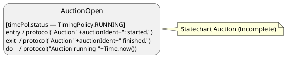

#### 5.3.1 State Invariants
As a diagram state corresponds to a set of object states, it is often necessary to describe this set more precisely. For this, the state invariant can be used, denoted in the form of an OCL condition. The OCL constraint is formulated in the context of the described object. In Fig. 5.11 that is an object of the class Auction. It is possible to access attributes of the own object but also of dependent objects (i.e., of the object environment). The state invariant, thus, could also have been used in a regular OCL constraint. It is recommendable to restrict the state invariant by using local attributes and, if needed, attributes of dependent objects, as otherwise a diagram state could change without an explicit stimulus of the modeled object being processed. Usually, such Statecharts only have descriptive character and are suited for modeling tests but not for code generation. A state invariant can fulfill various tasks:
1. Similar to a contract [Mey97], a transition starting from the state can rely on the fact that the object state fulfills the given condition.
2. Vice versa, this means for a transition ending in this state that it is obliged to establish the state invariant.
3. If, furthermore, a nonvisible, external activity that affects the object can happen on the object environment, while the object is in the state, this activity also has to ensure that the state invariant is not infringed. Such a guarantee is, e.g., necessary if the object has public attributes or if the state invariant accesses the object state of foreign objects.
If, in case of a Statechart, there is the risk of overloading the diagram with information, outsourcing of state elements into a table is recommended as an alternative. Table 5.13 illustrates this for state invariants. Various forms of tabular representation can also be implemented also for transitions and actions where reasonable. To understand the state concept in object-oriented modeling, it is helpful to consider its components. The data state of an object is determined by its own attributes and possibly attributes of dependent objects. This also includes links to other objects. A second component of the object state is, however, the control state, which manifests in the running system through the program counter and the call stack. A state invariant can only specify the data state while the control state remains hidden. Figure 5.12, for example, shows four data states of the class Auction that each have disjoint state invariants.

**Figure 5.12.** Four data states of the class Auction
```plantuml
@startuml
state "AuctionReady" as r1 {
  r1 : [timePol.status == TimingPolicy.READY_TO_GO]
}
state "AuctionRegularOpen" as r2 {
  r2 : [timePol.status==TimingPolicy.RUNNING && !timePol.isInExtension]
}
state "AuctionFinished" as r3 {
  r3 : [timePol.status == TimingPolicy.FINISHED]
}
state "AuctionExtended" as r4 {
  r4 : [timePol.status==TimingPolicy.RUNNING && timePol.isInExtension]
}
note top : Statechart Auction (incomplete)
@enduml
```

The control state cannot be modeled in full detail with a Statechart. However, states in a Statechart that describe the process of a single method represent an abstraction of the control state space. State invariants of data states need not necessarily be disjoint either; For example, the usage of state invariants can be completely neglected if they do not contribute to the representation of the desired information. To distinguish control states from data states, the usage of stereotypes is suitable. For this purpose, Table 5.14 introduces the stereotypes ≪datastate≫ and 
An object state consists of data and control states. This is to be modeled in the Statechart. A state tagged with ≪datastate≫ is called a data state. ≪controlstate≫ tags a control state. Usually, a Statechart consists of only one sort, either data or control states. Attributes and links alone can determine whether an object are located in a state tagged with ≪datastate≫. For control states, also the program counter and the stack are relevant. Control states are used in the modeling of internal states of complex methods. The state invariant in ≪datastate≫ states does not necessarily suffice for identification of the current state. In particular, state invariants can be incomplete or missing and, thus, overlap the invariants of data states in the diagram. ≪statedefining≫ to keep the defining character of the state invariant. A whole Statechart if it applies to each single state. This is usually the case. Furthermore, for Statecharts that are assigned to classes, ≪datastate≫ is assumed as default. A state invariant typically characterizes a property of the state respectively the object in this state. An object, however, can also fulfill the state invariant if it is currently located in another state. A rating that, among other aspects, includes correct behavior in previous auctions is used to distinguish three groups of persons. The stereotype ≪statedefining≫ in the state BadPerson leads to the fact that each person with a rating smaller than zero is definitely located in this state. Therefore, this condition is defining for the state BadPerson. The condition, in contrast, only has characterizing character in the state VIP-Person. Hence, according to the Statechart in Fig. 5.15, there can be persons in the state NormalPerson that also reach a rating higher than 4500. The background of this modeling is the fact that a person only becomes a VIP if this is explicitly decided by, e.g., the auctioneer, while, in the case of a negative rating, the state BadPerson is taken automatically.
Usually, the invariant alone does not define which diagram state an object state belongs to. Thus, the invariant has describing but not defining character. This is changed by a stereotype. A state invariant tagged with ≪statedefining≫ is called defining. Defining state invariants need to be disjoint. All object states that do not belong to that diagram state necessarily do not fulfill the invariant. The stereotype ≪statedefining≫ for a state invariant implies the stereotype ≪datastate≫ for the corresponding state and can, thus, only be used for data states. For the purpose of simplification, it is determined that all state invariants have to be of the same kind in a hierarchically composed state. Therefore, it is enough to apply the stereotype ≪statedefining≫ to the state invariant at the highest level. The question of whether an object is located in the diagram state can be answered precisely by evaluation of the state invariant. Defining state invariants have to be disjoint. For more complex conditions, this might be hard to ensure. A complete Statechart if it applies to each single state invariant.
Depending on whether the states modeled in the Statechart are controlor data states and whether these are described by defining state invariants, different strategies for implementation of a Statechart are possible. Defining invariants, for example, can be realized by Boolean predicates and used for deriving the state directly from the attributes. If defining state invariants are missing, almost always an additional attribute needs to be used, storing the diagram state explicitly in the object state space.

#### 5.3.2 Hierarchical States
Hierarchy can be used to prevent a state explosion by structuring complex state spaces with it. Additionally, hierarchy is of methodical interest, as it allows one to first define states of the higher level and than refine them later into substates. The use of hierarchies thus allows defining an abstract view of the state space. A hierarchically divided state has, like any other state, a name and can contain a state invariant as well as an entry-action, exit-action, and do-activity. In addition, it contains one or more substates. Figure 5.17 shows an alternative representation of the Statechart, where two states
have been hierarchically aggregated.

**Figure 5.17.** Hierarchical decomposition of the state space
```plantuml
@startuml
state "AuctionOpen ©" as open {
  open : [timePol.status == TimingPolicy.RUNNING]
  state "AuctionRegularOpen" as ro { ro : [!timePol.isInExtension] }
  state "AuctionExtended"    as ex { ex : [timePol.isInExtension]  }
}
note right of open : Statechart Auction (incomplete)
@enduml
```

The state AuctionOpen is structured by two substates AuctionRegularOpen and AuctionExtended. These substates are denoted separately from the other components of the superstate in their own compartment. c determines that the state AuctionOpen is parThe completeness mark ! titioned by the two substates. This means that, if the object is located in the state AuctionOpen, it is in exactly one of the two substates, and vice versa. If the completeness mark had been omitted or incompleteness mark “. . .” given, it would be possible that objects of the modeled class take the superstate AuctionOpen without being in one of the two substates. This is, e.g., possible if another substate exists but is not explicitly given in the diagram. One of the advantages of hierarchical decomposition of states is the possibility to note common parts of state invariants in the superstates. This leads to a more compact version of the state invariant for both substates. The actual state invariant of a substate is, hence, the conjunction of all state invariants of its superstates. The concept of the equivalence of two Statecharts is subsequently used to, e.g., introduce a new element of the Statechart notation by relating it to the already known elements. In this sense, some of the equivalences can be regarded as defining. But
generally, these equivalences are used in a rather illustrative way and serve for better understandability. Most representations, thus, illustrate only a special case. It is possible that a state invariant is not satisfiable. This means that there is no object state where the state invariant evaluates to true. In hierarchically structured states, the state invariant must not be considered separately but the conjunction of all state invariants of the substate and its superstates. A side-effect of the possibility to explicitly take over state invariants from the superstate to the substate and the later discussed options of leading transitions from or to the superstate directly into substates allow for introduction or removal of a hierarchy in the state space where necessary. Due to this equivalence, hierarchy is mainly a convenience to prevent the explosion of states and transitions.

**Figure 5.19.** Introduction and expansion of hierarchy
```plantuml
@startuml
state "superstate ©" as ss {
  ss : [condition1]
  state substateA { substateA : [conditionA] }
  state substateB { substateB : [conditionB] }
  [*] --> substateA
  [*] --> substateB
}
note right
  Flat equivalent:
  substateA [conditionA && condition1]
  substateB [conditionB && condition1]
end note
@enduml
```

Compared with the original Statecharts [Har87] and the UML standard, only the so-called or-decomposition of states is used, just like in ROOM. This form of decomposition allows the hierarchical decomposition of the state space but is not suitable to describe parallelism or concurrency within an object. As today parallelism is immanent in many systems at larger granularity, but sequential processing is the dominant concept within an object, the and-decomposition of states for modeling concurrent behavior components is not necessary in UML.

#### 5.3.3 Initial and Final States
As Statecharts mostly model the lifecycle of an object or the process of a method, they require a description to identify diagram states as initial or final states. Figure 5.20 shows how initial and final states are marked.

**Figure 5.20.** Initial and final states
```plantuml
@startuml
[*] --> AuctionCreated
[*] --> AuctionReady
state AuctionCreated { AuctionCreated : [timePol.status==TimingPolicy.WAIT_FOR_RELEASE] }
state AuctionReady   { AuctionReady   : [timePol.status==TimingPolicy.READY_TO_GO] }
state AuctionFinished{ AuctionFinished: [timePol.status==TimingPolicy.FINISHED] }
AuctionCreated --> [*]
AuctionFinished --> [*]
note right : Statechart Auction (incomplete)
@enduml
```

A Statechart may have several initial and final states. States can even be initial and final state at the same time. Figure 5.20 shows that there are two ways to initiate an auction. Normal customers can set up an auction, but it additionally needs to be released. Only an authorized group of good customers are allowed to set up auctions in a directly released state. If an auction is, for example, not released because of a lack of solvency of the person setting up the auction or if the auction is terminated, the lifecycle of the auction object is also terminated. Thus, the black circles and the arrows from or to them do not represent states or transitions themselves, although their representation might create this impression. The developer can either restrict this freedom of choice in the further process of the project or leave all possibilities to the system when implemented with different constructors. This view is consistent with the target language Java, which also prevents parallelism within objects by providing the keyword synchronized. Initial and final states can also be labeled within a hierarchically decomposed state.

### 5.4 Transitions
A transition describes an excerpt of the object behavior. The transition can be executed if the object is in the source state of the transition and if the triggering condition is fulfilled. An action is executed and the target state of the transition is taken. This section deals in detail with the stimuli and triggering conditions leading to the execution of a transition. In the next section, actions are discussed. 

#### 5.4.1 State Invariants Within the State Hierarchy
The start() transition leads from the state AuctionReady into the substate AuctionRegularOpen. Besides the explicitly given precondition, there is an additional precondition resulting from the source state AuctionReady. The complete precondition for this transition is thus timePol.status == TimingPolicy.READY TO GO && Time.now() >= timePol.start 
The transition labeled with finish() leading to the closure of an auction has the source state AuctionOpen. As this state is completely partitioned by c ), it is equivalent to instead let two transitions start from the its substates (! two substates.

#### 5.4.2 Initial and Final States in the State Hierarchy
The transition start() described in the Statechart has the substate AuctionRegularOpen as target state. Alternatively, it is possible that this transition only targets the superstate AuctionOpen. However, it is then not described in which of the two substates the auction really is after the execution of this transition. This is indicated by using an initial state mark within a hierarchically partitioned state. The equivalence suggested by Figures 5.21 and 5.24 can generally be expressed as shown in Fig. 5.25. This rule can even be used repeatedly if the initial substate in turn is again refined by substates.

**Figure 5.25.** Initial state marks in hierarchical states
```plantuml
@startuml
state "superstate ©" as ss {
  state substate1 as s1
  state substate2 as s2
  state substate3 as s3
  [*] --> s1
  [*] --> s2
}
note right : Initial marks in substates determine
targets of incoming transitions
@enduml
```

In a similar manner, it is also possible to use final state marks within hierarchical states. They describe when transitions originating from the superstate may be triggered. However, as the clarity of the Statecharts quickly suffers, it is recommended to use marks for initial and final states not too often. For the same reason, hierarchies should be used carefully in automata. If a superstate does not contain initial states, it is equivalent to the fact that all substates also are initial states. The same holds for missing final states.

#### 5.4.3 Stimuli for Transitions
As we have now clarified the relation between transitions and the state hierarchy, we discuss in this section which events can cause the firing of transitions. We distinguish five different categories of stimuli leading to the firing of a transition:

- A message is received
- A method is called
- The result of a return-statement is returned as an answer to a previous method call
- An exception is caught
- The transition occurs spontaneously

According to message-based communication known, e.g., from CORBA or from distributed architectural models, it can be assumed that message management, i.e., buffering and transfer, is realized in an appropriate runtime framework. Thus, it does not make any difference for the receiving object whether a method call is transmitted asynchronously or as a normal method call. Therefore, no distinction is made between these two kinds of stimuli in the Statechart. 

**Object Recursion**
For Statecharts, this problem manifests in the fact that the implementation can execute object-recursive calls but that modeling with Statecharts does not consider this adequately. Object recursion always occurs when a method of an object is active and directly or indirectly leads to the call of another method of the same object. Although it is possible to carry out further method calls in procedurally formulated actions (discussed hereinafter) which in turn trigger further transitions, this leads to a number of semantic problems. On the one hand, it is not clear in which state the object really is when the recursive method call starts. It may have already left the source state and reached the target state, or it may be in an undefined intermediate state. On the other hand, it is not clear whether the recursive method leads to further object state alterations so that the target state represented in the Statechart does not correspond to the actually reached object state. To avoid this problem but explicitly allow the object recursion that is often used especially in design patterns [Pre95], we use the observation motivated from practice that methods of an object can mostly be separated into two levels:

- The top-level methods serve for realization of primary functionality. If an object contains a state space that fits the Statechart, these methods depend on the object’s state concept and are responsible for the state transitions of the object. These methods do not call each other but only rely on the helper methods of the lower level. An object’s helper methods mainly serve for processing of core functionality, such as for the calculation of a value. Classic helper methods are queries and get/set methods. Helper methods are principally independent of the state of an object defined in the Statechart and can, thus, be arbitrarily used by top-level methods and call each other recursively.

- Top-level methods of an object can be determined by an explicit statement (e.g., by using a suitable stereotype) or by extraction of the methods that are explicitly used as stimuli in a Statechart. By means of a data flow analysis based on the program code, it can be determined whether these methods really do not carry out an object recursion.5 We, hence, assume that in practice methods which depend on or change the state of the object do not participate in object recursion.

#### 5.4.4 Enabledness
As we have defined the stimuli for transitions and how transition preconditions can be combined along the state hierarchy, we can now precisely define when a transition is enabled. For this, the following conditions must be fulfilled:

1. The object needs to be in an object state that corresponds to the source state of the transition.
2. Either the transition is spontaneous and does not need a stimulus, or the stimulus that is necessary for the transition has occurred. The values given in the stimulus description (for instance, method parameters) correspond to the actual values of the received stimulus. Each variable used in the stimulus description is assigned to the actual value in the stimulus.
3. The precondition which is evaluated over the object state and the parameters of the received stimulus holds. It can happen that a precondition cannot be fulfilled in any situation. In this case, the transition is pointless, as it never fires. Even if a transition is enabled, this does not necessarily mean that it is also executed. It is possible that several transitions are enabled at the same

A top-level method is definitely entitled to call itself or a top-level method of another object. This method recursion can, for example, be used in a linearly linked object list without leading to object recursion. As this depends on the current object structure, a static data flow analysis is sometimes not able to exclude object recursion, even if this does not take place in the implemented system. This is not prohibited—on the contrary, it is explicitly welcome. To enable developers to delay design decisions and leave some choice either to the implementers or even the implementation at runtime, we already allowed this nondeterminism. Nondeterminism in a Statechart usually does not mean that the implementation is nondeterministic. Mostly, the decisions necessary for reducing this nondeterminism are made at the right time. Overlapping enabledness is, thus, basically a form of underspecification that can manifest in different variants.
In both cases (a) and (b), both alternatives are possible and can lead to very different overall behavior of the modeled object, depending on the kind of action executed or the further behavior of the target state. There are several possibilities to remedy underspecification. Besides the obvious option of canceling one of the two transitions, there is the possibility of transferring the two overlapping transition scopes into disjoint transition scopes by strengthening the precondition. Another way to remedy underspecification which is especially suitable for transitions of different hierarchy levels, is the usage of priorities. In contrast to classical Statecharts and the form of Statecharts adapted to object-oriented systems, no implicit priorities are used, i.e., neither is the internal transition preferred against the external one nor vice versa. We can, thus, allocate priorities using a stereotype of the form ≪prio=4≫, which has an integer value. However, due to compatibility with present Statechart variants, the usage of a stereotype of the form ≪prio:inner≫ or ≪prio:outer≫ is reasonable to give internal or external transitions priority. If transitions with overlapping enabledness exist whose source states are located on different hierarchy levels, the inner or outer transitions can be prioritized. Nondeterminism due to the described situation is reduced.

#### 5.4.5 Incomplete Statechart
In the previous section, situations with multiple, simultaneously enabled transitions were discussed. However, it is also possible that there is no transition enabled to handle an incoming stimulus. Such a Statechart is called incomplete. Analogous to automata, various interpretations of this situation exist:

1. The stimulus is ignored, and if applicable, an “alert” is displayed.
2. A default error handling is executed. For example, an exception can be thrown and the normal program execution can be interrupted, resulting in an error state. Alternatively, the error can be logged and handled in a robust way.
3. As the diagram does not contain explicit information about what needs to be done with the incoming stimulus in the respective state, it is not possible to determine the behavior of the object.
4. Thus, everything is possible, as we have underspecification at this point.

In the first two interpretations, the lifecycle is regarded as the maximal possible one, while in the last interpretation it is understood as the minimally ensured one. This becomes a crucial difference, especially for the transformations. The first two interpretations of incompleteness are useful if the Statechart serves as an implementation. In fact, ignoring nonprocessible stimuli is only a special case of explicit error handling. If there is consistent error handling, it can be modeled as an entry-action in a dedicated state tagged with the stereotype ≪error≫. The stereotype ≪error≫ is used if explicit transitions for handling errors are not wanted, for example, for the sake of clarity. Figure 5.32 illustrates a possible application.

**Figure 5.32.** Stereotype ≪error≫ for error handling
```plantuml
@startuml
state AuctionReady
state AuctionRegularOpen
state AuctionExtended
state AuctionFinished
state "«error»«exception»" as err { err : entry / protocol(...) }
AuctionReady        --> AuctionRegularOpen : start()
AuctionRegularOpen  --> AuctionExtended   : startExtension()
AuctionRegularOpen  --> AuctionFinished   : finish()
AuctionExtended     --> AuctionFinished   : finish()
AuctionFinished     --> err               : ε
note right of err : «error»: stimuli in wrong state
«exception»: abnormal exceptions
@enduml
```

However, using an explicit error state as in Fig. 5.32 has the drawback that only one universal and uniform error handling is possible. Hence, a return to the state that caused the error cannot be modeled. Alternative error handling can use stereotypes, such as ≪completion:ignore≫, either for the whole Statechart or for single states. For pragmatic reasons, we also distinguish normal error situations, in which the enabledness for a stimulus is missing, from the receipt of an exception. Thus, the stereotype ≪exception≫ is available for dealing with exception stimuli. It is the only stereotype for handling occurrences of explicit exceptions. Statecharts defined and refined during the development process can temporarily be incomplete without the intention of specifying error handling through their incompleteness. Furthermore, Statecharts can intentionally be incomplete, e.g., if they are used for the definition of tests. The semantics of Statecharts intended for tests says that, if a Statechart describes a behavior, it has to be fulfilled by the object. Otherwise, if the Statechart does not make a statement, the object is completely free in its action. Thus, the third of the aforementioned possibilities of interpreting incompleteness is the best one for the usage of Statecharts in tests. This behaviorial freedom for implementations can be specified for a whole Statechart with the stereotype ≪completion:chaos≫. If a Statechart is incomplete, a uniform error handling can be conducted by introducing an error state. A state tagged with ≪error≫ is called error state. In a Statechart, only one state may be marked with ≪error≫. This cannot be a substate, but it can have explicit incoming transitions and substates. If there is no transition that can process a stimulus, a transition to the triggered error state processes the stimulus. Exception stimuli are not handled by this stereotype. ≪exception≫, ≪completion:chaos≫, and ≪completion:ignore≫.
The stereotpye ≪error≫ handles stimuli in situations without enabledness, but it does not handle exceptions. This can be achieved with the stereotype ≪exception≫ A state tagged with ≪exception≫ is called an exception error state. In a Statechart, only one state may be tagged with ≪exception≫. This cannot be a substate, but it can have explicit incoming transitions and substates. The stereotype ≪exception≫ is used independently from the stereotype ≪error≫ and ≪completion:. . . ≫. If no other transition can process an exception stimulus, a transition into the exception error state is conducted to process the exception. ≪error≫, ≪completion:chaos≫ , and ≪completion:ignore≫ . There are various possible interpretations for an incomplete Statechart. By using one of these stereotypes, the developer can explicitly choose the desired interpretation. Both stereotypes exclude each other as well as the simultaneous use of an error state (≪error≫). Statecharts tagged with ≪completion:ignore≫ ignore stimuli they cannot process. This is suitable for a robust implementation. Statecharts tagged with ≪completion:chaos≫ allow arbitrary freedom in processing of otherwise unhandled stimuli. This is suited for specification and tests. Exceptions are not handled with these stereotypes. Both variants are used to clarify the interpretation of incompleteness. For practical issues other than prototyping, robust treatment of unspecified situations is particularly reasonable, say in an error state. ≪error≫ and ≪exception≫ The interpretations dealing with incomplete Statecharts suggested in this section can also be modeled by an explicit completion of the transitions, as known from automaton theory, for example in a Statechart tagged with ≪completion:ignore≫, all incomplete states need to be supplemented with loops. These loops start and end in the same state, process all stimuli that are not processed by other transitions, but do not change the state or produce an output. When using an error state, these transitions must instead end in the marked error state. In a chaos completion with the stereotype ≪completion:chaos≫, a lot more transitions could have to be introduced, as they can lead from each incomplete state to all states of the Statechart. The actions of these transitions have arbitrary freedom. They can freely change the state of the modeled objects, restricted only by the target state and their environment, set up new objects, etc. Nonterminating actions are also not excluded in a chaos completion. While the first two forms of completion are indeed reasonable for the implementation, due to the explosion of transitions, it is obvious that a chaos completion is only a conceptual mechanism for clarifying the meaning of a Statechart but should not be considered for an implementation.

### 5.5 Actions
The description of the behavior of a Statechart only becomes complete when adding actions. Actions describe the reaction to the receipt of a stimulus in a certain state. They are added to the state as an entry- and exit-action, or to the transition as a reaction. According to the philosophy of UML/P, two types of action descriptions are allowed. The procedural form allows the use of assignments and control structures, and the descriptive action form allows us to characterize the effect of an action without defining how this action is actually realized. Both types of action description complement each other and allow the usage of the best-suited technique. In some cases, it is easier to describe an action by procedural instructions and, hence, specify its implementation. Unfortunately, procedural instructions too often lead to needless overengineering, as they anticipate implementation details. Therefore, it is an advantage in many situations to use either the descriptive form or a combination of both forms.

#### 5.5.1 Procedural and Descriptive Actions
In contrast to a descriptive condition, the advantage of using a procedural code snippet is that it can be used directly for code generation. In comparison, descriptive conditions can often be formulated in a more abstract way and allow a certain freedom in the implementation. The combination of both action forms allows us to define the action by procedural code and to describe its desired effect by a condition. A method Statechart typically has only actions that are modeled by Java code. Such a Statechart is suited for the direct realization into a complete implementation. As UML/P has Java as its target language, the usage of an independent “action language,” such as the one discussed in, is not necessary. Instead, code snippets directly formulated in Java can be used. The idea of an “action language” adapted to this task has only restricted value, as it must also be a complete programming language. Thus, it offers only a small advantage in contrast to an existing programming language such as Java, by using a syntactical form adapted to a UML-like syntax. On the contrary, the “action language” requires its own translators and libraries. Hence, the approach of regarding UML as a language family and including elements of the target language directly into the used UML version is a desirable alternative. Therefore, we allow arbitrary Java code snippets as actions. They can access attributes of the modeled object and the arguments of the processed stimulus. Modification of the object state and the state of other objects of the environment is explicitly allowed. If the processed stimulus is a method call with a result, the action has to terminate with a return-statement. In order to avoid that the Statechart appearing overloaded, actions can be attached to the Statechart. An action described by code does not offer freedom for omission of implementation details which the modeler does not want to state yet. Therefore, Statecharts offer as a second form of action the possibility of giving postconditions in the form of OCL statements to allow characterization of a certain bandwidth of behaviors without defining how these must actually be implemented. A postcondition formulated in OCL is also called an action condition. Its character is similar to that of the postcondition of method specifications discussed that transitions processing a method call as a stimulus can actually be translated into a specification in the pre- and postcondition style. As discussed there, Statecharts with action conditions are not directly suitable for code generation. Instead, they assist with the abstract modeling of behavior during the design process and the modeling of tests. While it is generally not possible to automatically establish an action condition, they can be checked well and errors recognized automatically. The action condition of a transition may access the arguments of the processed stimulus, the attributes of the modeled object, and if applicable, local variables defined in the instruction part of the action. In particular, attributes can thereby be used in the state before and after execution of the transition. With a==a@pre, for example, we can model that an attribute may not change.

Figure 5.36 contains an extract a Statechart for the class Auction which
shows a transition with a procedural action description and a postcondition.
If the class TimingPolicy is implemented correctly, the postcondition already results from the action instructions. Thus, the postcondition here has
illustrative character and can be used particularly for tests.

**Figure 5.36.** Transition with procedural and descriptive action

```plantuml
@startuml
state AuctionReady
state AuctionRegularOpen
AuctionReady --> AuctionRegularOpen : [Time.now()>=timePol.start] start() /
  sendMessageToAllParticipants(new WelcomeMessage(this));
  timePol.start();
  protocol("Auction "+auctionIdent+": started at "+Time.now())
  [timePol.status==TimingPolicy.RUNNING && !timePol.isInExtension]
@enduml
```


Postconditions can not only be formulated as a redundant addendum to
action instructions but also supplement them. In this way, one part of the
behavior can be modeled procedurally while the other part can be characterized in a descriptive form by an OCL constraint. Subsequently, we also
discuss the treatment of actions in hierarchical states and the interaction between a characterizing condition and the procedural implementation.
A descriptive characterization of the action by means of a postcondition
has the disadvantage (discussed in Sect. 3.4.3) that further modifications of
variables which are not explicitly mentioned in the condition are not excluded either. Here, we also use the pragmatic approach that, in an implementation or an extension of the Statechart towards code generation, the implementer gets the freedom to decide which changes to attributes are additionally necessary. Statecharts whose postconditions only describe a part of
the changes made by the implementation are nevertheless perfectly suited
for tests. They can be used to describe and test the behavior of the implementation regarding a certain aspect.

#### 5.5.2 State Actions
These actions can be described procedurally or by an OCL constraint, too. The entry-action of a target state is executed in combination with the transition action and often has the function of opening connections, signaling state changes, conducting log outputs, or carrying out changes on the user interface. Exit-actions are used in a very similar manner, namely to accomplish operations that are necessary when leaving the state. This could be the closing of a connection or a file as well as further log outputs. As both entry- and exit-actions are each executed in the context of the execution of a transition, these actions are primarily a writing shortcut. 

**Sequential Composition for Code**
The rule shown in Fig. 5.37 allows one to move entry- and exit-actions to transitions and, thus, remove them from states, but this only holds if all concerned transitions are treated uniformly. This procedure can also be used for entry- and exit-actions in hierarchical states. This rule also demonstrates in which order entry- and exit-actions are executed in hierarchical states. The execution order of these actions corresponds to the order of the leaving or entering of states of the executed transition, respectively. Logical Conjunction for Action Conditions If the actions of a Statechart are specified by OCL action conditions, the logical conjunction is used instead of the sequential composition. In this transformation, the syntactic correctness certainly needs to be maintained as in all other transformations. In particular, if two local variables accidentally have the same name, renaming becomes necessary. The enabledness of a transition exclusively depends on the source state, the stimulus, and the precondition. However, there are enabled transitions that lead to a target state whose state invariant is not fulfilled, which have an unfulfillable postcondition, or where a state invariant and postcondition contradict each other. This problem occurs in case of a predicative description of actions and cannot be automatically recognized. On the one hand, we can avoid this by using forms for the postcondition and the state invariant that ideally make statements about orthogonal parts of the state space. On the other hand, we can ensure this by choosing a suitable precondition stating that such a transition is enabled only if the postcondition can be fulfilled. Accordingly, a transition’s enabledness could additionally be determined by the fact that a transition is executable, i.e., the postcondition and target state invariant can be fulfilled. However, generally, an unaccomplishable postcondition should be avoided, as a useful meaning cannot (easily) be assigned to such a Statechart. If used in a software development process and not directly recognized as such, rectification is advisable after their recognition, at the latest, e.g., in corresponding tests. The interpretation of state actions is adequate for purely predicatively described Statecharts. However, if a Statechart has a mixed form of procedural and predicative action descriptions, an alternative interpretation is advisable to meet the sequential processing character of the actions. Figure 5.40 illustrates this interpretation. With the use of the ocl statement for OCL assertions, the piecewise fulfillment of the conditions relevant for a transition can be specified. By using the stereotype ≪actionconditions:sequential≫, we basically prevent that the condition conA used in the exit-action also has to hold at the end of the transition. This condition can instead be invalidated, e.g., by the transition action. The stereotype ≪actionconditions:sequential≫. Stereotype ≪actionconditions:sequential≫ The exit condition of a source state can be invalidated through the action of the transition. Therefore, transitions in Statecharts which are tagged with the stereotype ≪actionconditions:sequential≫. The condition of the exit-action already holds after the execution of this exit-action. In this way, the following transition action can already rely on this condition but also invalidate it. The same applies for hierarchically nested states. If the conditions of the entry- and exit-action of a state are in contradiction to each other, for instance by an attribute value being supposed to take on different values, there can only be transition loops in this form of interpretation. In a Statechart, the combination of descriptive conditions and procedural code should be used with caution. Depending on the purpose of a Statechart, it is often sufficient to use one of the two forms. Considering the entry- and exit-actions, the state invariants discussed in previous sections, have been neglected so far. A state invariant must always hold when the object is in that state. In particular a state invariant also holds after the entry-action of a state has been executed and before the exit-action of a state is executed. Hence, state invariants can be inserted at the appropriate place, as demonstrated by the equivalences shown in Figures 5.39 and 5.40.

#### 5.5.3 State-Internal Transitions
While the entry- and exit-actions have to be regarded as part of the incoming and outgoing transitions, state-internal transitions are complete and independent transitions where the entry- or exit-actions of the state are not executed. If stateA would not have an entry- and exit-action, the transition could simply be attached directly to stateA instead of introducing a substate.

#### 5.5.4 Do-Activity
If a state represents a situation of the object where an activity prevails, when, for example, a phone rings or a warning message flashes, we can use the do-activity for its modeling. There are two fundamental possibilities of interpretation in a normal Java programming model. One possibility is to implement a do-activity through a parallel thread that is active only in this state. An alternative and preferred method. In the transformation has been assumed that a timer is available calling the method timeout() after the specified amount of time. This is presented as an internal transition that does not leave the state, first executes the action, and then resets the timer.

### 5.6 Statecharts in the Context of UML
In the previous sections of this chapter, the Statechart notation has been introduced in greater detail and representation possibilities have been demonstrated by means of numerous examples. Using several stereotypes, different variants of Statecharts have been defined and their respective field of application discussed. Possibilities for variation consist, on the one hand, in the semantics of the Statechart elements and, on the other hand, in the interpretation of these elements in the context of object-oriented modeling. Possibilities were presented regarding use of the stereotypes ≪prio:inner≫ and ≪prio:outer≫ to specify the priority of overlapping transitions as required. In this section, some basic problems the interpretation of the Statechart that are still unsolved are discussed. Thereby, fundamental characteristics of a transformation into OCL or a programming language and possible transformation techniques (refactoring steps) are explained.

#### 5.6.1 Inheritance of Statecharts
In UML/P, Statecharts are principally attached to classes or methods. Often, OCL constraints and Java code snippets are parts of Statecharts. Thus, Statecharts must always be seen in the context of other artifacts of the software development. In a number of publications, different variants have been discussed to show how to specialize Statecharts that describe a class and, thus, allow one to further detail the behavior. This, e.g., includes the behavioral conformity. The strategies proposed and used for inheritance differ considerably in some regards. If, for example, a Statechart is intended as an interface description of a class describing the call order of the methods, transitions can be removed because this corresponds to a specialization of the object in the subclass. If, in contrast, a Statechart is intended to describe the implementation, transitions may be added for the inheritance in order to make the behavior of the subclass more robust against errors. Also, in UML/P, Statecharts have different fields of applications. A Statechart that has been defined for test purposes usually cannot be applied to objects of the subclass, as the subclass has an extended state concept and additional methods. As described above, there are different interpretations in literature for the usage of constructive Statecharts, i.e., Statecharts that are intended for the implementation. In practice, inheritance of Statecharts is rarely applied—and if so, rather informally—for the refinement of behavior. Mostly, the behavior is only redefined. This means that in practice, state-based behavior of the super- and the subclass are broadly independent of each other if both are modeled by Statecharts. Often the case occurs that only the superclass is modeled by a Statechart while the subclass only redefines the helper functions, which do not influence the state concept of the Statechart. So, the Statechart of the superclass is taken over without any change. A further observation shows that classes described by a Statechart frequently do not have subclasses, as they are conceived as complex steering classes and allow behavioral variability by delegation.

#### 5.6.2 Transformations on Statecharts
With the release of [Fow99], containing transformation techniques for Java code, it has become obvious that transformations on modeling and programming artifacts allow for improvement of the systematics of software development. A systematic transformation in small, composable steps is considerably clearer and, thus, better for planning than “Big Bang”developments and modifications. Modification of architectural aspects of a system modeled by class diagrams often has effects at several places. Therefore, small, systematic, and ideally tool-supported modification steps are ideal. These steps are performed individually and then directly tested for their effect. Hence, as described, refactoring of class diagrams is a fundamental means for incremental improvement of the system. In contrast, a Statechart models only a small section of the system. It focuses on the modeling of an object’s behavior and sometimes also of a strictly limited environment. Modifications in the state model or behavior of individual objects can have considerable effects on the overall behavior of the system. However, regarding Statechart development in practice, single modification steps, such as those introduced, do not help to the desired degree. Experience shows that particularly the modification of the state space often enforces such intensive alterations to a Statechart that the initial Statechart has little in common with the new one. For pragmatic reasons, more often it is therefore reasonable to develop a new Statechart instead of deducing it from an old one. The number of transformation rules necessary to develop a transformation calculus complete enough for practical implementations is also relatively high. This is due to the higher number of model elements that are used in Statecharts and the resulting number of potential combinations. Because of these observations motivated by practical implementations and the discussion above, the definition of a complete calculus for transformation of Statecharts is relinquished. Instead, a set of rules is introduced in this section to serve for the targeted transformation of Statecharts.  The refactoring techniques for modification of Java code in [Fow99] exclusively serve preservation of the externally visible behavior. Hence, they focus on improving the design and architecture of the system without changing the functionality and, thus, serve as a basis for later extensions of functionality. However, the motivation for transformation of a Statechart can have other causes. As Statecharts are primarily behavior descriptions, refinement (addition of details) of the behavior described in the Statechart is possibly of the same interest as the preservation of the behavior. Modification of the state space with the purpose of refining in accordance with the condition that the behavior does not change can also be of interest. Additionally, it must be distinguished whether the modifications of a Statechart are adaptions only concerning the model, i.e., the presentation, or whether these adaptions change the state space and the behavior of the modeled objects as well. This distinction is important because, in contrast to class diagrams, with Statecharts we have many different possibilities for depicting the same behavior. Hereinafter, some transformations for Statecharts are presented, serving for, among other goals, preparation of code generation by reducing the concepts used in the Statechart.

**Simplification of Statecharts**
As Statecharts provide a comprehensive collection of concepts, indicating transformation rules that eliminate single concepts of a Statechart is of interest. As a result, the Statechart becomes less comprehensive in the concepts used and thus more easily accessible for analysis or code generation. In fact, the rules described below can be understood as a first step towards code generation. At the same time, these rules can also be regarded as defining for the concepts they process. The eliminations of the state actions and the state hierarchy presented hereinafter are described by equivalence transformations that can also be used inversely to allow their introduction. The procedure described below is to a large extent automatable. In steps 12, 15, and 18, however, design decisions can be made or undecidable OCL constraints need to be treated. There, also optimizations for later code generation can be made. Steps 12 and 15 can also be implemented directly by an
algorithm, and step 18 can be omitted.

1. Do-activities are eliminated.
2. Internal transitions are transformed to real transitions. If the state with the internal transition already has substates, internal transitions are added as transition loops solely to already existing states. This means that source the and target state always correspond, because internal transitions do not change the state.
3. Initial states within hierarchical states serve for forwarding of transitions whose target state is the hierarchical state to one of the substates. These transitions are directly forwarded to substates that are marked as initial states. Then, the marks of the initial states are irrelevant.
4. Final states within hierarchical states can be removed in a similar manner.
5. Target states with substates. The remaining transitions that still have target states with substates are all diverted to these substates (and, if necessary, multiplied). T
6. Source states with substates. In a similar manner, the source states of all transitions are diverted to substates and at the same time multiplied, if applicable. The equivalence is applied.
7. Repetition on several hierarchy levels can be necessary for steps 3–6 so that all source and target states of all transitions are simple states (i.e., do not have substates anymore). Initial and final states now only exist at the top level.
8. Exit-actions are added to the action of the transition leaving the state. If a final state has an exit-action, it is also conceived as an action of the finalizer.6 In method Statecharts, a spontaneous transition is used instead of the finalizer. Then, the exit-actions are eliminated.
9. Entry-actions are added to the incoming transitions in a similar manner. Entry-actions of initial states are treated by introducing a new incoming transition that corresponds to the constructor realizing this entry-action. In a method Statechart, a spontaneous transition is used instead of the constructor. Then, the entry-action is eliminated.
10. State invariants of hierarchically decomposed states are added in the substates explicitly.
11. Hierarchically decomposed states have now become irrelevant and are eliminated. All initial and final state marks are thereby transferred from the eliminated states to the substates.

As result of these transformations, all state actions have been transferred to transitions and all hierarchically decomposed states are eliminated. The remaining atomic states only contain state invariants. The usage of a new final state and this explicit transition with the stimulus finalize() corresponds to a variant of the situation known from automaton theory regarding the transformation of Moore to Mealy machines.

**Handling of State Invariants**
State invariants can be treated in different ways, depending on the meaning of the states. This is why several variants exist for the next step 12, depending on the particular purpose of the Statechart. For code generation, state invariants can be used as assertions of properties for certain program stages in the system and, thus, directly taken over into the code. This allows use of state invariants as assertions for tests. However, ensuring that a state invariant is correct is much easier than developing or generating code that ensures that the invariant is fulfilled. Under certain but fairly restricted circumstances, it is possible to produce constructive code from an invariant, especially if the invariant represents a conjunction of equations that can be interpreted as assignments and where the variables on the left are only used after their definition. Such a constructively usable state invariant for the class WebBidding is for example status == AppStatus.INITIAL && appletLanguage == (language==null) ? "English" : language && statusText== (appletLanguage=="English") ? "Hello" : "Hallo" On the one hand, it can be examined whether a state invariant can be used constructively. However, on the other hand, in general, it cannot automatically be checked whether a state invariant is already fulfilled by the action of the incoming transition and, as a consequence, generation of constructive code is not necessary anymore. This can only be decided by the developers. In order to store the knowledge of, whether the state invariants of a Statechart have already been constructively realized by the actions, in the diagram, a stereotype can be used. This is especially meant for controlling code generation. In a Statechart attached to a class, state invariants are relevant only at the beginning and end of a method. They are therefore part of a method’s pre- and postcondition and of the processing of a message, respectively. One possibility of using these state invariants in the further development is to use them as a pair of OCL pre/postconditions for the definition of a method. When the Statechart describes an object’s lifecycle, the object state is the only place to store the information about the current diagram state of an object. This is why the diagram state of the object needs to be computable from the attributes and links of an object in the object structure. This requires the usage of disjoint state invariants in the implementation. Then it is possible to evaluate the state invariant as a predicate and in doing so to derive the diagram state and the transition to select. As overlapping state invariants are allowed in Statecharts, it is advisable to convert these into disjoint invariants by an appropriate transformation. Hence, the following rule is proposed as step 12 in the transformation towards simpler Statecharts and offered in two variants:

12. Tighten state invariants in order to ensure that the diagram state of an object can be uniquely determined from the object state by evaluating the state invariant such an appropriate transition can be chosen for the arriving stimulus. So, if a new stimulus arrives at the object, it can be determined solely based on the state invariant which diagram state the object is in and, thereby, which transitions are enabled. In practice, there are different options to realize step 12, of which two are presented here: 
12a. Tighten state invariants by making statements about further components of the object state. This can, for example, refer to the presence and absence of links, the size of containers, or the values of attributes. However, tightening a state invariant with the aforementioned step 12a requires the developer to have quite some knowledge about the context of the Statechart. In the realization of Statecharts, these newly introduced disjoint state invariants could be evaluated consecutively until the respective current object state is identified, but in general this is not efficient. An alternative procedure that furthermore has the advantage that it is automatically executable uses an additional attribute for explicitly storing the respective current diagram state:
12b. Tighten state invariants by introducing a state attribute, that explicitly stores the diagram state of an object.The transformation in step 12b is clearly directed towards implementation. It is especially efficient because only the attribute state is necessary for determination of the current diagram state and a casestatement can be used for the discrimination. In contrast, the original state invariants are not necessary anymore. They can now be used as assertions for tests at the beginning or after the completion of a method processing the respective current stimulus. In the special case that a Statechart has no explicit state invariants, we can also introduce a state attribute remembering the state. As already discussed for Fig. 5.22, the state invariant of a source state has the same effect as if it were given as a precondition of the transition. The next step 13, thus, transforms the preconditions of all transitions such that the state invariants are explicitly incorporated:

13. Conjugate state invariants with preconditions, so that the preconditions are represented completely. By explicit inclusion of state invariants, it becomes easier to recognize incompleteness or overlapping of the firing conditions of transitions. The subsequent steps can therefore be performed more easily. While the state invariant of a transition’s source state is an additional assertion for the transition, a state invariant of the target state is an additional obligation which the transition is responsible for. This obligation can also be made visible in the action condition of a transition by explicit inclusion:
14. Conjugate state invariants with action conditions, so that the action conditions are represented completely.

**Incompleteness of Transition Scopes**
We have already discussed various facets of nondeterminism and incompleteness of Statecharts. We also explained that incompleteness can be interpreted in various ways. For that purpose we introduced the stereotypes ≪completion:ignore≫, ≪completion:chaos≫, and ≪error≫. In all three cases, it is principally possible to complete the Statecharts by adding explicit transitions. This, however, excessively increases the amount of transitions such that a Statechart can practically not be read anymore. For an implementation, such a completion is also not necessary because, for example, in an implementation using a case statement, incompleteness can be dealt with by the default construct. This is suitable for the stereotypes ≪completion:ignore≫ and ≪error≫ as both variants offer a precisely determined reaction to arriving stimuli. For the stereotype ≪exception≫, we in addition need a try-catch statement. In comparison, the chaos completion (stereotype ≪completion:chaos≫) aims at interpreting incompleteness as maximally existing nondeterminism. Thus, it is often methodically reasonable to complete a Statechart by choosing a proper set of transitions instead of executing a chaos completion in order to make the Statechart also react robustly in underspecified cases. The following step 15a describes the completion of a Statechart marked with ≪completion:ignore≫
15a. Completion of a Statechart marked with ≪completion:ignore≫ can be achieved by introducing explicit transition loops that contain an empty action or an action condition, that does not change the system state. These loops are added for all potentially incoming stimuli and states for which no transition exists or where the precondition restricts the enabledness of a transition. As the rule for the performance of step 15a shows, in the worst case there is a transition loop necessary for each combination of state and potential stimulus. Whether the transition added to the state sourceStateA is actually necessary can in the general case only be determined manually due to the generally not automatically recognizable satisfiability of OCL conditions. In this case, it needs to be decided whether the state invariant invariantA is already covered by the existing transitions precon1 || precon2. Only if this is the case is the newly added transition redundant and its precondition never fulfilled. So, it needs to be checked if the following is true: invariantA implies (precon1 || precon2)

The completion of a Statechart with an error state is conducted in a similar way:
15b. Completion of a Statechart with a state marked with ≪error≫ is done analogously to step 15a. All added transitions, however, target the error state. The error state is also completed. The following rule for step 15c allows us to explicitly add a suitable, selfchosen set of transitions instead of the full set of transitions that implicitly exists when using chaos completion. In particular, we have complete freedom of choice for the reaction to an incoming stimulus. 
15c. Completion. Statecharts marked with ≪completion:chaos≫ are completed by introducing transitions whose preconditions and stimuli are determined as in the previously given steps. However, there is the freedom of choosing a suitable target state and action for each transition. The nondeterministic addition of transitions with overlapping firing conditions is also possible (but only overlapping within the new transitions). The completion of exception behavior can be conducted in the same way as in step 15b.
16. Exception completion. If a state marked with ≪exception≫ is given, transitions marked with stimulus Exception are added analogously to step 15b, targeting the exception error state. The exception error state is also completed.

**Reducing Nondeterminism**
Irrespective of whether step 15 has been executed in one of the three variants of completing Statecharts, nondeterminism can occur in the resulting Statechart in several forms. Causes and effects of nondeterminism in Statecharts have already been discussed in detail in Sect. 5.4. There are two essential reasons for dealing with nondeterminism in Statecharts:
1. Nondeterminism interpreted as underspecification can be used for postponing irrelevant details during earlier activities of the software development. If we receive additional requirements from the customer or can make further design decisions, we can refine and detail the behavior modeled with the Statechart by reducing nondeterminism.
2. If the program execution is, as in Java (without threads), deterministic, nondeterministic alternatives always needs to be decided when implementing a nondeterministic Statechart into sequentially processed Java code. An automatic selection is often made by using the random order for the evaluation of the translated functions. But by explicitly reducing the nondeterminism, the selection otherwise made by the code generator can be controlled by the developer. As the sources of nondeterminism in the Statechart are manyfold, there are a number of possible modifications of a Statechart in order to reduce its nondeterminism. If, for example, the Statechart is incomplete and marked with ≪completion:chaos≫, the implicit nondeterminism existing due to the incompleteness can be considerably reduced by a change to the stereotype ≪completion:ignore≫ or by explicitly introducing an error state with the stereotype ≪error≫. If a transition action is underspecified, this action can be made deterministic by a suitable transformation. Another source of nondeterminism is the overlapping of firing conditions of different transitions with the same source state and the same stimulus. A simple instrument to reduce this source of nondeterminism is the usage of priorities as outlined in Sect. 5.4.4. However, it is also possible to reduce this form of nondeterminism by tightening the preconditions of the overlapping transitions. The following rule in step 17 describes this technique:
17. Reducing nondeterminism. Nondeterminism caused by transitions with overlapping firing conditions is reduced by choosing a suitable condition D that has the effect of a discriminator between the two transitions. This technique can be applied pairwise for all transitions with overlapping firing conditions. The transformation initially leads to complex-looking preconditions where the discriminator D separates the overlapping conditions. Although it needs to be syntactically correct, the discriminator can be freely chosen. An apt definition of the discriminator can considerably simplify the new preconditions. One possibility, for instance, is to use the discriminator true which leaves the left transition unchanged and gives it priority over the right transition with the precondition B&&!A.

**Eliminating Transitions Without Enabledness**
Due to the numerous transformation steps performed so far, many transitions have been added or modified. However, especially automatically performed steps may have added transitions that are never enabled. For example, reducing nondeterminism by applying the previously discussed step 17 can restrict a precondition so that an execution of the transition is not possible anymore. This, for example, can happen if the firing condition of one transition includes that of the other. Unfortunately, transitions that are not enabled cannot be recognized automatically. Hence, the next step is an optimization that normally needs to be performed by the developer. Only in exceptional cases will the system itself recognize that a transition has become redundant as its precondition is equivalent to false:
18. Eliminating transitions without enabledness, as they do not contribute to the system behavior. Rule 18 is mainly useful in combination with the previous step 17. If two transitions have the same firing condition, the firing condition of one transition can first be reduced to be empty with step 17 and then removed with step
Removing transitions is generally allowed if one or more alternative transitions exist that overlap the firing condition of the transition to be eliminated. This means that it must be the same stimulus and that the precondition of the transition is subsumed by the preconditions of the alternative transitions, i.e., it is implied by their disjunction. Methodically, the removal of unnecessary transitions details the modeled behavior. It may not seem intuitive that information is actually added to the Statechart by removing transitions. However, this is exactly the case. After the removal of an alternative, the behavior of the modeled object is described more precisely. Thus, the object behavior is less underspecified as it has fewer alternative ways to behave. Vice versa, also adding transitions, especially as described in step 15c, can detail the modeled system behavior. The essential difference is that adding transitions is only allowed if there is no alternative in the original Statechart, while the removal of transitions is allowed if alternatives exist.

**Eliminating Unreachable States**
By applying the transformation steps 17 and 18, states can become unreachable in the diagram. The reachability of a state is defined by using the transitive closure over all enabled transitions starting from the set of initial states. This allows us to detect individual states that are not a destination of a transition. Moreover, it also allows us to detect regions of connected states that can reach each other, but where the region is unreachable from the outside. Step 19 allows removal of these diagram states from the diagram: 19. Eliminating unreachable diagram states, as they do not contribute to the system behavior. A state is reachable if it is (1) an initial state or (2) a target state of an enabled transition whose source state is reachable. Transitions with unreachable source states are removed as well. The described simplification of the Statechart creates a flat structure that only contains transitions that contribute to the described behavior. The states contain disjoint state invariants. All actions have been relocated to transitions. The transitions are complete in the sense that they contain the complete preand postcondition and, hence, are directly suited for implementation. By removing a number of Statechart concepts, the result is more suitable for analysis or code generation. Therefore, a simplified form of the Statechart is assumed in the following considerations.

#### 5.6.3 Mapping to OCL
Statecharts serve as a state-based description of object behavior. The behavior of objects is finally realized by the methods that are used as stimuli in the transitions. OCL-based method specifications have been introduced in also allowing us to model method behavior. The pre/postcondition style used there for specifying the effect of a method fairly precisely corresponds to the description by a transition if an OCL postcondition is used for modeling the reaction. Hence, the transformation of transitions of the simplified Statechart is straightforward. The transformation creates such a pre/postcondition for each transition. As in a Statechart a number of transitions might contain the same stimulus, so several OCL specifications arise for the same method. There we discussed two basically different forms of combination that also play a role here. If we transform a deterministic Statechart, i.e., a Statechart whose transitions do not have overlapping firing conditions, we get OCL specifications whose preconditions are pairwise disjoint. The OCL specifications, thus, can be combined by the algorithm described in Sect. 3.4.3 where each precondition acts as a guard for its postcondition. The disjunction of the preconditions ensures that at most one postcondition needs to be fulfilled and, thus, no inconsistencies can arise due to contradicting postconditions. However, in a nondeterministic Statechart, there are overlapping firing conditions. Transitions with such overlaps cannot be transformed individually into OCL constraints because their combination would lead to inconsistent postconditions. Instead, overlapping transitions are transformed together. Because the state conditions are disjoint in our simplified Statechart, transitions with overlapping transition scopes can start only from the same source state. This form of transformation by means of two overlapping transitions. Note that, if both preconditions are fulfilled, the freedom of choosing transitions means that afterwards only one postcondition needs to be fulfilled because only one of the transitions fires. This is reflected by the slightly complex form of the postcondition. An application to more than two transitions is possible due to generalization or iterated application of the rule for two overlapping transitions. The transformation of transition descriptions into OCL method specifications can be applied in two ways. On the one hand, it can be understood as semantic integration of the two UML subnotations, Statecharts and OCL. On the other hand, it also has a practical application. The semantic integration achieved by this transformation shows the relations of both subnotations and maps the semantics of simplified Statecharts to OCL. Together with the transformation of general Statecharts into simplified Statecharts already introduced earlier, we now have a coherent transformation chain of Statecharts in OCL. The meaning of a Statechart can, thus, be derived from the meaning of OCL. A similar form of semantics definition for flat automata has been given, e.g., in [Rum96] with the target language Focus. If the given transformation is supported by a tool, Statecharts can be translated into OCL within a project, and the available analysis, simulation, and code generation techniques can be applied to the generated OCL conditions. This especially enables the application of verification tools available for OCL to object behavior that has initially been described with Statecharts and allows one to show certain properties of the modeled object.

### 5.7 Summary
Statecharts represent an essential link between a system’s structure in the form of state spaces and the classes’ behavior. They allow us to structure the state space hierarchically and define the reaction of objects to incoming stimuli based on these state hierarchies. Statecharts are based on the concepts of the Mealy and Moore automata, which is why fundamental problems, such as nondeterminism, incompleteness, ε-transitions, and expressiveness, were already studied on these automata. We identified the interpretation of automaton concepts (input, automaton state, and output) in the “real” world of software development (method call, object state space, and action) besides automaton theory. Then we introduced states, state invariants, transitions, preconditions, stimuli, and actions with procedural and descriptive character. Especially relevant is the enabledness of transitions and the resulting possibilities of treating nondeterminism (underspecification) and incompleteness. The composition of entry-, exit-, and transition actions by conjunction, sequential execution, and piecewise validity has been another crucial point of discussion.

A collection of transformation rules for Statecharts shows on the one hand the semantics of more complex Statechart concepts such as initial and final states in hierarchical states or entry- and exit-actions but also allows on the other hand the transformation of general Statecharts into simplified Statecharts that are more suitable for code generation and analysis.


# Chapter 6: Sequence Diagrams
A sequence diagram represents an exemplary snippet of a software system’s process. It models the occurring interactions and activities and can be extended by OCL expressions. This chapter introduces a simplified version of sequence diagrams which are suitable especially for the modeling of tests.
Sequence diagrams are used for modeling interactions between objects. A sequence diagram describes in which order method calls are executed and when they terminate. Thus, similar to Statecharts, sequence diagrams model behavioral aspects. A sequence diagram focuses on the interaction between objects, but the inner state of an object is not represented. Basically, a sequence diagram is exemplary. Just like in the object diagram, the represented information can, thus, occur arbitrarily often, multiple times in parallel, or even not at all in the process of a system. Due to their exemplary character, sequence diagrams are not suitable for the complete modeling of behavior. They are mainly used for requirements definition and, as shown in this work, test case modeling. Hence, sequence diagrams are methodically used especially for requirements analysis as well as for test definition for or after implementation. If sequence diagrams are used for modeling a system, they always illustrate specific, desired or undesired situations or erroneous behavior and are therefore suitable as a starting point for test cases. When used in requirements engineering, developers need to derive a complete implementation from a necessarily finite set of sequence diagrams. A number of proposals extend sequence diagrams in order to systematize this derivation. Control structures are often added that allow alternatives, parallelism, iterations, and recursive calls of sequence diagrams. These proposals are discussed, e.g., in and used in different forms in the two essential standards for sequence diagrams. Besides the UML standard, dialects of sequence diagrams are used particularly in the telecommunication, industry in the form of Message Sequence Charts (MSCs). The automaton-based extensionin High-Level MSCs also allows the representation of MSC combinations. Another variant of sequence diagrams is Object-MSCs in which activity bars have been introduced. Also the Live Sequence Charts’(LSCs) approach deserves special attention. It gives sequence diagrams considerably more expressiveness and therefore becomes accessible for complete specifications, simulation of different processes, constructive code generation, or verification techniques. In comparison with the mentioned variants, the form of sequence diagrams introduced in this chapter is kept simple. The reason is, among others, that, in this work, the methodical use of sequence diagrams is rather restricted to modeling of test cases and test drivers. Statecharts can already be used for complete process descriptions. Thereby, a redundant description is avoided. This is based on the experience that it is much more elaborate to create complete descriptions instead of exemplary ones and that, for reasons of developer efficiency, redundancy needs to be avoided. Thus, sequence diagrams are adequate to exemplarily describe system runs.

### 6.1 Concepts of Sequence Diagrams
**Figure 6.1.** Sequence diagram for accepting a bid
```plantuml
@startuml
participant ":AuctionTest"     as at
participant "copper912:Auction" as a
participant "bidPol:BiddingPolicy" as bp
participant "timePol:TimingPolicy" as tp
at -> a  : «trigger» handleBid(bid)
activate a
  a -> bp : validateBid(bid)
  activate bp
    bp --> a : return BiddingPolicy.OK
  deactivate bp
  a --> at : return
deactivate a
note over a
  t.timeSec == bid.time.timeSec + extensionTime
end note
@enduml
```

In a sequence diagram, objects are represented next to one another in a row and furnished with a timeline pointing downward. Optionally, objects have a name and a type.

**Object** 
An object in the sequence diagram has the same semantics as in the object diagram, but it is only shown with name and type. Several objects of the same type are allowed. Name or type are optional. 

**Timeline** 
In a sequence diagram, consecutive events are represented top down. Each object has a timeline representing the progress of the time for this object. The timescale shown is not faithful to the time in the system’s object. The timeline, thus, only serves to represent the chronological order of interactions. 

**Interaction** 
An interaction between two objects can be one of several kinds of stimuli. This includes method calls, returns, exceptions, and asynchronous messages. Parameters of interactions are optional in a sequence diagram. Activity bars. For processing a method call, an object is active for a certain time. The activity bar that can also occur in a nested form in a recursion serves as a representation for this activity. For a detailed description of properties that hold during a process, OCL guards can be used. Interactions arriving at and leaving from an object are represented in chronological order by reaching the timeline. They could have been reported in this form by an observer. Basically, also asynchronous messages are permitted as interactions. However, asynchronous communication can be represented only to a limited extent. We simplify sequence diagrams by assuming that messages are not sent simultaneously and that they do not intersect. This simplification is based on the usage of sequence diagrams for test purposes where concurrency is explicitly controlled in order to maintain deterministic test results. This considerably simplifies the modeling with sequence diagrams, but we might not be able to represent certain phenomena with sequence diagrams that are possible in an implementation. Similar assumptions can be found in other, more complex MSC dialects. Therefore, the remaining chapter only further discusses the sequential method call. An activity bar is used to show when a method of an object is executed. Usually, activity bars start and end at incoming or outgoing arrows. Activity bars can be omitted, and we later discuss the ambiguity that can then arise. For a recursive call, activity bars are represented in a nested form, which is also discussed later. As a return arrow can also be omitted, an activity bar may end without an outgoing arrow.

Due to the assumptions described above, this also holds especially for asynchronous messages, which are not differentiated syntactically from normal method calls. In some dialects, a specific arrow is used for asynchronously sent messages. At the arrows, method calls, returns, or exceptions are added. These can optionally have arguments. An argument is denoted as a Java expression. If it is a single variable that has not occurred so far, it is defined with its first occurrence. Return information can be omitted completely, as the dashed arrow is already unambiguous. Due to its nature, a return can only occur in the diagram after the corresponding method call. To avoid information overload, the incompleteness indicator “. . .” can be used instead of the arguments of the interaction. This has the same effect as if the parameters were omitted completely.

**Figure 6.3.** Types of interactions in sequence diagrams
```plantuml
@startuml
participant A
participant B
A ->  B : methodName(arguments)
A ->  B : methodName
A ->  B : methodName(...)
B --> A : return result
B --> A : return
B --> A : ExceptionType(arguments)
B --> A : ExceptionType(...)
@enduml
```

**Static Method**
If a method is static, it is underlined like in the class diagram. In this case, the arrow ends at a class that is used analogously to an object.

**Figure 6.4.** Static method in a sequence diagram

```plantuml
@startuml
participant "copper912:
Auction" as a
participant "Protocol"           as p
a -> p : writeToProtocol("Auction 912 started.")
activate p
p --> a : return
deactivate p
note right of p : static method – arrow ends at class
@enduml
```

While objects are underlined as instances, attributes and methods are underlined if they are not assigned to an instance. This is not consistent but corresponds to the rule that elements that are used more often can be described more easily.

**Object Creation**
If an object is newly created during some interaction, this can be represented by the object’s timeline starting at a later point in time. Figure 6.5 shows two typical forms of object creation. Both representations are even equivalent if they are used for certain forms of object creation. Form (b) is then only a more detailed and more implementation-related representation. A representation for destroying an object is not offered in UML/P, as this is also not possible in the target language Java.

**Figure 6.5.** Creation of a new object

```plantuml
@startuml
participant "copper912:
Auction" as a
participant "f:Factory"          as f
' (a) constructor
a -> "bm:
BidMessage" ** : new BidMessage(...)
' (b) factory
a -> f : getNewBidMessage(...)
activate f
  f -> "bm:
BidMessage" ** : new BidMessage(...)
  f --> a : return bm
deactivate f
@enduml
```

**Stereotypes and Tags**
Stereotypes and tags can be used in sequence diagrams as well. The stereotype ≪match≫ is introduced in Sect. 6.4 to give the developer the possibility of choosing between different semantics for sequence diagrams. The stereotype ≪trigger≫, for example, can be used to indicate that a method call is the cause for all other interactions of the sequence diagram. Therefore, such a stereotype is especially suited for test drivers, and it can be used only for method calls of objects of the test environment into the tested object structure. Hence, mostly only the first method call is tagged with ≪trigger≫. Interactions tagged with ≪trigger≫ necessarily lead to the other described interactions. The called objects are not allowed to behave differently. This is a considerably stronger restriction than sequence diagrams without this stereotype would denote.

### 6.2 OCL in Sequence Diagrams
An OCL constraint can describe occurring objects and parameters as well as a message’s effect on an object more precisely, whereas the context results from the sequence diagram.
This condition, among other things, requires thatbmis an object of the type Bid Message and then partly checks its content. The specification of the context shows that access to attributes is possible by qualification with the object. However, if an OCL constraint is exclusively assigned to one timeline, the attributes of this object can directly be accessed, but for better readability, it is reasonable to still use a qualification.
The validity of an OCL constraint refers to the point in time directly after the last occurred interaction or the last occurred activity bar. This means that the OCL constraint must only be satisfied directly after this interaction but not during the overall “period” in which the OCL constraint is embedded. This is illustrated by means of two sequence diagrams in Fig. 6.7.

**Figure 6.7.** Validity of OCL constraints in sequence diagrams
```plantuml
@startuml
participant "copper912:
Auction" as a
participant "theo:
Person"       as t
note over a : OCL constraint valid here
a -> t : handleBid(bid, t)
activate a
note over a : OCL constraint valid directly after interaction
deactivate a
@enduml
```

As a sequence diagram models temporal system runs, other than in the OCL method specification, a@preoperator is not available. If a previous attribute value must be accessed, this value needs to be stored explicitly in an auxiliary variable. For this purpose, a let construct is used that is similar to the OCL construct and that introduces new variables that are accessible only within the sequence diagram. These auxiliary variables are not part of the implementation but exclusively serve for the specification of effects during the process of interactions. Figure 6.8 shows a use of these variables.

### 6.3 Semantics of a Sequence Diagram
The exemplary character of a sequence diagram has already been referred to. However, for the methodically correct use of sequence diagrams, a precise explanation of the semantics of such an exemplary process and the treatment of incomplete representations is necessary.

**Exemplaricity and Incompleteness**
Similar to the object diagram, the exemplaricity of a sequence diagram is based on the description of a set of objects that, in this form, can occur in a system arbitrarily often or even not at all. Furthermore, the run itself is exemplary. It can occur arbitrarily often, be concurrent and nested, or not occur at all. In addition to these forms of exemplaricity, a sequence diagram represents an abstraction of a process, as it can contain neither all objects of the system nor all occurring interactions. In a sequence diagram, interactions can also be missing. Figure 6.9 can, therefore, represent the same process as Fig. 6.8 on a different abstraction level because different objects are shown.

**Figure 6.9.** Representation with different abstraction level
```plantuml
@startuml
participant "copper912:
Auction ©" as a
participant "theo:
Person ..."     as t
a -> t : handleBid(bid)
activate a
  a --> t : return
deactivate a
note right : Different abstraction level from Fig. 6.8
@enduml
```

Formally, the semantics of a sequence diagram can be explained by mapping the diagram’s elements to a system run. 
The prototypic objects in the sequence diagram are mapped to real objects, and the shown interactions are mapped to real interactions of the system; the chronological order must be consistent. This form of matching corresponds to the already discussed form of an observer selectively observing objects and protocolling some interactions.

**Ambiguities and Restricting Stereotypes**
If a method call takes place several times during the observation period, it is ambiguous which actual method call corresponds to the interaction represented in the diagram. The fictive observer has possibly “overlooked” some interactions between the two objects. However, by using suitable stereotypes, the form of observation can be determined more precisely. The representation indicator “©c”can be used for objects in the sequence diagram to indicate the completeness of the shown interactions. Alternatively, the representation indicator “...” for incompleteness already holds by default but can also be stated explicitly. Figure 6.9 shows the use of these indicators. A “©c”means that the tagged object has no interaction with any other object between the first and last interaction shown in the diagram. This means that the protocol of the fictive observer is complete with regard to the marked object and the represented observation period.

For an object completely observed in this sense, it necessarily holds that a suitable return must be stated for each call. Furthermore, all objects that:
A loose **semantics definition for sequence diagrams** is described by mapping the elements of a sequence diagram to the elements of a system run. The essence of a sequence diagram is given by:

- The set of the prototypic objectsO ̄
- The set of possible interactions A ̄in the diagram
- The source of each interaction ̄s:A ̄→O ̄
- The target of each interaction ̄t: A ̄→O ̄
- A sequence of diagram interactions d ̄∈A ̄∗,where multiple occurrence of thesame interaction is allowed

The essence of a system run, in analogy, consists of a set of objects Obj, interactions Act, two mappings s, t:Act →Obj f or the source and target of each interaction, and the system run r∈ A ct∗ representing a trace]. The dynamics of object creation can be simulated using a predefined set of existing objects and thus can be ignored here. Let Ix d={ 0 ..n}be then+1indexes of the sequenced=d 0 d 1 ...dn and di the element at position i∈Ixd. The connection is defined by requiring the existence of a mapping f: O ̄→Ob j forthe objects and a monotonically increasing injectionj:Ixd ̄→Ixrof the indexes ofd ̄into the indexes of r. For each index i∈Ixd ̄ in the sequence diagram the following must hold:

```
s(rj(i))=f( ̄s(d ̄i)),
t(rj(i))=f( ̄t(d ̄i)).
```
The monotonicity and injectivity ofjensure the chronological order of the representation. A sequence diagram forms an abstraction of the system run, as neither f nor j need be surjective.
The loose **semantics definition of sequence diagrams** from Fig. 6.11 is detailed by the alignment of returns to corresponding calls.
The definition of the essence of sequence diagrams is extended by
- The set of returns and exceptionsR ̄⊆A ̄
- The assignment of the returns to the respective method callsm ̄:R ̄→(A ̄\R ̄)

Analogously, the representation of a system run is detailed by returns and exceptions R⊆Act, and the bijective assignment m:R→(Act\R). While m is a bijection, due to the incompleteness of a sequence diagramm only needs to be injective. For each index pair a, b∈Ixd ̄it holds that:
```d ̄b∈R ̄∧d ̄a= ̄m(d ̄b) ⇒ a<b∧rj(b)∈R∧rj(a)=m(rj(b))```

Sequence Diagrams directly interact with the observed object need to be shown. This can lead to considerably more detailed diagrams than actually desired. Therefore, further stereotypes are used that allow additional variants of the semantics definition. The stereotype≪match:initial≫,for instance, is especially well suited for defining testable sequence diagrams, while the interpretation≪match:free≫ corresponds to the default “...”. More variants that further refine the form of observation are conceivable. Thus, lists of method calls that are completely observed or ignored could explicitly be given, but this would increase the information density of a sequence diagram, making it less readable.
Assigning the interactions of a sequence diagram to interactions in the system run is ambiguous, as sequence diagrams can represent abstractions. The defined stereotypes can resolve these ambiguities. The stereotypes can be stated individually for each object in the sequence diagram.

Motivation
Assigning the interactions of a sequence diagram to interactions in the system run is ambiguous, as sequence diagrams
can represent abstractions. The defined stereotypes can resolve these ambiguities.
The stereotypes can be stated individually for each object in
the sequence diagram.

Effect 
Between the first and last interaction, an object tagged with ≪match:complete≫has exactly the interactions with other objects or itself stated in the diagram. Hence, the observation of this object is complete. ≪match:visible≫prohibits omitting interactions with other objects stated in the sequence diagrams but allows that interactions with objects not stated in the diagram are omitted. Therefore, the observation of this object is complete only with regard to the objects visible in the diagram. ≪match:initial≫allows further interactions between the stated objects if these are of another kind, i.e., calls of other methods, for example. Further interactions of the same kind are allowed only after the occurrence of the stated interactions.

6.4 Special Cases and Extensions for Sequence Diagrams
So, the observer tries to carry out an “initial” or early matching. Further interactions of this kind are ignored in the system run as soon as the last one of this kind is checked off in the diagram. Hence, the observer always protocols the first occurrence of the respective interaction and “checks off” the interaction in the sequence diagram. The stereotype ≪match:free≫ represents the default and means that arbitrary omissions are possible in the observation. Pitfalls The combination of different stereotypes within a sequence diagram can be used for elegant statements but can also cause confusion.  Each stereotype can also be applied to the overall sequence diagram and therefore hold for all objects contained therein.

The overall run of a system is understood as a word, while a sequence diagram is regarded as a regular expression to which a system run has to adhere. One of the biggest advantages of the equivalence of this formalization to regular expressions is that there are efficient algorithms from the theory of formal languages that can protocol system runs and recognize occurring matches. This is an important prerequisite for using sequence diagrams for tests. However, this efficiency suffersif, in between, values must be assigned to variables and OCL constraints evaluated.

### 6.4 Special Cases and Extensions for Sequence Diagrams
An analysis of the defined form and semantics for UML/P sequence diagrams shows that, similar to other forms, certain special cases that require a more detailed explanation can arise.

**Noncausal Sequence Diagrams**
A sequence diagram specifies a chronological order of the messages observed, but it does not necessarily define a causal order. As shown in Fig.6.15, a sequence diagram can especially consist of two disjoint parts.The thus incomplete observation does not show the causal context anymore but only a temporal one of the occurring method calls.

Tricky specifications are often difficult to read and should, thus, be avoided in practice. Sometimes, less elegant specifications should be preferred.

For simplification, let us assume that A ̄⊆Actand O ̄⊆Obj,that we can ignore arguments of the interactions, and that f, as aconsequence, is the identity. Furthermore, letobj(a)={s(a),t(a)}. Without restriction, let each object inO ̄be tagged with one of the stereotypes. Let Oφ⊆O ̄be the set of the sequence diagram’s objects tagged with≪match:φ≫. A system run can be regarded as a word over the alphabet of the interactions Act. To build the semantics, a sequence diagram is assigned a regular expression which describes valid system runs. This can be used to hereinafter explain the semantics of the≪match:*≫stereotypes. The sequence diagramd ̄=a 0 a 1 a 2 ...anconsisting of then+1interactionsak∈Act can be transformed to a regular expression of the form: 
Sem[a 0 ...an]=Act∗a 0 X 1 ∗a 1 X 2 ∗a 2 ... Xn∗anAct∗ that describes a set of system runs. Before the first and after the last interaction described, the system run is not restricted. The set of possible interactions in Xk depends on the chosen≪match:*≫stereotypes. The following interactions are forbidden:

Acomplete={a∈Act|obj(a)∩Ocomplete+=∅}, (1)
Avisible ={a∈Act|obj(a)∩Ovisible+=∅∧obj(a)⊆O ̄}, (2)
Ainitial,k={ak,ak+1,...,an|obj(al)∩Oinitial+=∅fork≤l≤n}. (3)

(1) and (2) describe interactions that must be stated in the sequence diagram and are therefore prohibited in between. (3) identifies interactions that are later stated in the sequence diagram and, thus, would contradict the initial matching. It holds thatXk=Act\Acomplete\Avisible\Ainitial,k. The arguments of interactionsActcan be taken into consideration by introducing type information. The dynamic assignment of prototypic objects to real objects that is analogous to the object diagram can also be taken into consideration.

**Figure 6.15.** Noncausal sequence diagram
```plantuml
@startuml
participant ":A" as a
participant ":B" as b
participant ":C" as c
a -> b : method1()
activate b
b --> a : return
deactivate b
c -> b : method2()
activate b
b --> c : return
deactivate b
note bottom : Noncausal: two disjoint parts,
no causal connection between them
@enduml
```

6.4 Special Cases and Extensions for Sequence Diagrams 205
Non causal sequence diagrams can be prohibited by using suitable≪match:*≫stereotypes.

**Recursion and Ambiguity**
The object recursion already discussed in Sect. 5.2.7 causes complications not only in Statecharts but also in sequence diagrams. We talk of object recursion if, within the execution of a method, another method of the same object is called directly or indirectly. Figure 6.17 shows both forms of calls.

**Figure 6.17.** Sequence diagrams with object recursion
```plantuml
@startuml
participant ":A" as a
participant ":B" as b
' direct recursion
a -> a : method1()
activate a
  a -> b : method2()
  activate b
  b --> a
  deactivate b
deactivate a
' indirect recursion
a -> b : method3()
activate b
  b -> a : method4()
  activate a
  a --> b
  deactivate a
b --> a
deactivate b
@enduml
```

Normally, activity bars serve to illustrate behavior pattern and can be omitted. In recursive cases however, they allow to resolve ambiguities. The elimination of ambiguity can, as shown, happen by using activity bars or, in a similar manner, by adding returns. The source of these ambiguities is the object recursion shown in Fig. 6.17. As such an ambiguity can easily be resolved by using activity bars, we decide that a sequence diagram with such an ambiguity is not well-formed and is rejected by a code generator.

### 6.5 Sequence Diagrams in UML

**Inheritance**
A sequence diagram has prototypic objects where optionally name and type are given. The type of an object can be a class with several subclasses or an interface. Correspondingly, the object that is observed in a running system can be from a different class. In this sense, sequence diagrams, thus, take inheritance into account. But due to the used loose semantics for sequence diagrams, the expressiveness for subclasses is also restricted. In fact, a sequence diagram only describes that objects of a certain type can behave according to the described pattern but that they do not have to do so. But for tests that check a certain behavior pattern for all objects of a type, it is beneficial to give objects from subclasses certain liberties in the behavior, e.g., by assigning the stereotype≪match:visible≫.

**Sequence Diagrams and Statecharts**
Depending on the development method, there are various options to use Statecharts and sequence diagrams in combination:

1. Statecharts are developed from a set of sequence diagrams.
2. Startecharts and sequence diagrams are used in parallel for different purposes.
3. Sequence diagrams can be derived from Statecharts, thus conforming to them.

A procedure is described to derive automata for the participating objectsfrom a finite set of sequence diagrams. In the form used there, first a word ofthe automaton’s alphabet is derived by dissection of a sequence diagram into the interactions that are relevant for a single object. By manually adding state information, an automaton that accepts these (and further words) can be built from the finite set of words. By further transforming the automaton, they derive a version that can be understood as an operative description of an object which implements the behavior described by sequence diagrams.

6.5 Sequence Diagrams in UML 207
A similar procedure is:anLSC(LiveSequenceChart is implicitly created by protocolling desired behavior and by building an automaton thereof. Both approaches have in common that they first assume an exemplary specification from which they derive a complete, implementation-related description.With an appropriate adaption, these approaches could also be used for UML/P. The reverse procedure of deriving sequence diagrams from given Statecharts can be used for two tasks. On the one hand, exemplary and more easily understandable descriptions can be extracted from a given Statechart implementation, and on this basis, the interplay of the participating objects can be analyzed. On the other hand, test cases that check various transition paths of the Statecharts can be derived from the Statechart. Another alternative is to use Statecharts and sequence diagrams in parallel. In this case, both views of the system have not been derived from each other but developed manually. Thus, itis of interest to check both descriptions for consistency with analytical techniques by regarding a sequence diagram as a word (sequence of interactions) that has to satisfy a Statechart. But when using OCL constraints within both notations, analysis is not necessarily executable. Therefore, it is reasonable to use the Statechart for implementation and sequence diagrams as test cases.

**Sequence Diagrams and UML Communication Diagrams**
Besides sequence diagrams, the UML standard provides an additional notation which is closely related to the notation of sequence diagrams.Communication diagramsrepresent a subset of a sequence diagram’s information but are less focused on the chronological order and more on the cooperation between objects. Figure 6.19 contains the representation of thes equence diagrams as a communication diagram. However, OCL constraints and returns are not represented in the communication diagram.

**Figure 6.19.** Communication diagram
```plantuml
@startuml
participant ":AuctionTest"         as at
participant "copper912:
Auction"  as a
participant "bidPol:
BiddingPolicy" as bp
at -> a  : 1: handleBid(bid)
a  -> bp : 1.1: validateBid(bid)
bp --> a : 1.1.r: BiddingPolicy.OK
a  --> at: 1.r:
note bottom : Communication diagram – numbering replaces timeline
@enduml
```

The two-dimensional distribution allows one to accommodate more objects in communication diagrams. The interaction order is not determined by timelines but by numeration. For this, nested calls are marked with ascending lists of numbers. Return values are added to the call. There is no concept analogous to activity bars in communication diagrams. Although the information represented in both diagrams is essentially the same, the form of representation and, thus, the way diagrams are dealt with varies considerably. Adding an interaction, for example, is easier in a sequence diagram, because in a communication diagram interactions must be renumbered. Besides, OCL constraints cannot be stated in the simple form for certain points in time, as it is the case for sequence diagrams.

### 6.6 Summary

In this chapter, a simple form of sequence diagrams, that is suitable for modeling interactions between objects on an exemplary basis, has been introduced. A sequence diagram consists of several objects with one timeline each, between which interactions take place. Method calls, returns, and exceptions are allowed kinds of interactions. OCL constraints can be stated to define object properties at certain “points in time.” With a sequence diagram, desired system runs can, for example, be represented in order to better understand the system that needs to be implemented. Another use for sequence diagrams is the definition of exemplary runs in tests as well as the modeling of test drivers.
As the simple sequence diagrams defined here suffice for this purpose, UML/P leaves out the extensions that can be found in other dialects of sequence diagrams. This also has the interesting advantage that available concepts in sequence diagrams are easy to understand and use. Further literature has already been pointed at in the relevant places in the chapter.
